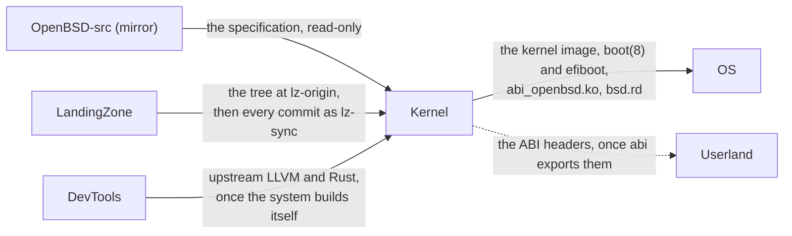
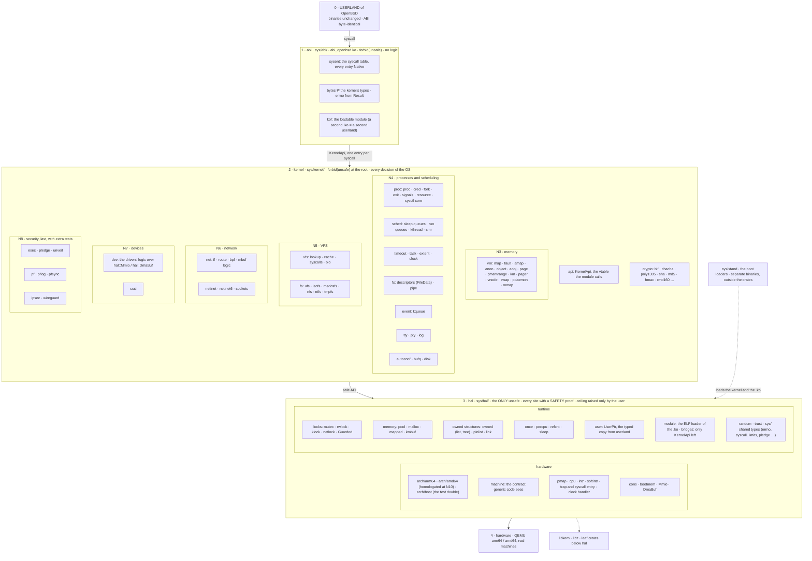

# EmiBSD

<p align="center">
  
</p>

<p align="center"><em>Ferffy, the EmiBSD mascot: a <a href="https://en.wikipedia.org/wiki/Lithodes_santolla">centolla</a>, the child of Ferris (Rust's crab) and Puffy (OpenBSD's pufferfish).</em></p>

<p align="center"><strong>An operating system in Rust, grown from the faithful port of the OpenBSD kernel.</strong></p>

<p align="center">
  <a href="LICENSE"></a>
  <a href="rust-toolchain.toml"></a>
  <a href="docs/ROADMAP.md"></a>
  <a href="docs/ROADMAP.md"></a>
  <a href="https://www.emibsd.org"></a>
</p>

> **Not for production.** EmiBSD is an experiment. It runs only in QEMU, and its crypto,
> network and storage code is unaudited. Do not use it to protect real data or real networks.

## What is this

- An operating system in Rust derived from [LandingZone](https://github.com/EmiBSD/LandingZone)
  (LZ, formerly EmiBSD.LZ),
  the faithful file-by-file port of the OpenBSD kernel, synced to its commit `3c62ede68802`
  (forked at `lz-origin`, `f5985f1d055a`; [lz/PINNED.md](lz/PINNED.md)). LZ ports OpenBSD; this repository, Kernel, redesigns what LZ ported.
- OpenBSD's behaviour is the specification. The system-call ABI and everything userland sees
  never change: OpenBSD's own userland runs unmodified here, as on LZ, and `just diff-openbsd`
  checks the three against each other.
- The inside changes, subsystem by subsystem. The goal is zero `unsafe` in the kernel: the
  crates `sys/kernel/` and `sys/abi/` carry `#![forbid(unsafe_code)]` at their roots, `sys/hal/`
  is the only crate with `unsafe` (the hardware and the runtime, every site proved), and the LZ
  tree is replaced and deleted ([docs/ZERO_UNSAFE.md](docs/ZERO_UNSAFE.md) section 0, the
  plan since 2026-10-16), with idiomatic ownership and measured performance. N1 settled
  the type idioms on leaves that were already almost free of `unsafe` (libkern 10 -> 10, libz
  2 -> 0, crypto 5 -> 5); N2 built the crates and moved the first subsystem, pipe(2), into
  `kernel` with no `unsafe`; N3 moved memory (uvm) into `kernel::vm` and the two pmaps into
  `hal`. Every module says what it derives
  from ([lineage.toml](lineage.toml)), and every LZ commit after the pin is triaged
  ([lz-sync.toml](lz-sync.toml)).
- A standalone `#![no_std]` kernel for amd64 and arm64, booted by its own boot(8)/efiboot or by
  Limine, run in QEMU.
- The layers, top to bottom (the detail: [docs/ARCHITECTURE.md](docs/ARCHITECTURE.md), "Vocabulary"; every term: [docs/GLOSSARY.md](docs/GLOSSARY.md)):

  | Layer | What it is | `unsafe` |
  |---|---|---|
  | `abi` | Application Binary Interface: the bytes userland and the kernel agree on (syscall numbers, `#[repr(C)]` structs, ioctls, errno), as the module `abi_openbsd.ko`; translation only | 0 |
  | `kernel` | every decision of the operating system, its own types | 0 |
  | `hal` | Hardware Abstraction Layer: the hardware and the runtime (locks, pools, owned memory, the user copy), with a safe API | the only one |
  | `lib` | `libkern` and `libz`, the leaves below `hal` | 10 |
  | `bsd` | the LandingZone tree, the kernel that boots today, replaced subsystem by subsystem and deleted at N9 | legacy |

## Where it sits



LandingZone ports; this repository redesigns what it ported and never writes back to it.
OS assembles the kernel with Userland and the toolchains of DevTools into a release. The
whole picture, and every decision that crosses repositories, is in
[Governance](https://github.com/EmiBSD/Governance) (`docs/architecture.md`).

## The target: the kernel at N9

The module view of the one architecture diagram ([docs/ZERO_UNSAFE.md](docs/ZERO_UNSAFE.md)
section 0.1, which stays the source): three crates, the arrows down only, `bsd` (the LZ tree)
deleted and the bridges at zero. Each `kernel` box names the milestone that moves it
(section 0.8); `crypto` is there since N2, its users arrive at N8; `arch/amd64` is frozen from
N4 and homologated at N10.



What goes up (the syscall handler, `KernelApi`) is a registration in `hal` at boot, never a
dependency. Today's numbers are under [Status](#status); the exit criterion per milestone is
in [docs/ROADMAP.md](docs/ROADMAP.md).

## Status

Status: N4 (processes and scheduling: proc, descriptors, kqueue, signals, the scheduler,
sysctl, tty and the clock in `kernel`; the context switch, trap, syscall entry, copy and the
kernel page-table isolation of the trampolines in `hal`) met on 2026-10-24; N5 (VFS and file
systems) next. Since decision 44 (2026-10-18) only arm64 is built and tested until N10
homologates amd64 (`docs/ZERO_UNSAFE.md` section 10).

| Milestone | Scope | State |
|---|---|---|
| N0 | Bootstrap: governance, lineage, the `lz` tooling, the unsafe budget, the baseline | done |
| N1 | Leaves: libkern, libz, the crypto primitives | done |
| N2 | Foundations: the crates `hal`, `kernel`, `abi`; the runtime; the loadable ABI module; pipe(2) by the new path | done |
| N3 | Memory: uvm into `kernel::vm`, the pmaps into `hal` behind `hal::Pmap` | done |
| N4 | Processes and scheduling (kern) | done |
| N5 | VFS and file systems | next |
| N6 | Network stack | next |
| N7 | Devices: bus_space, DMA, the driver model | next |
| N8 | Security subsystems, last: pf, IPsec, WireGuard, softraid CRYPTO, the crypto framework | next |
| N9 | Close on arm64: `bsd` deleted, the amd64 tree frozen (decision 44) | next |
| N10 | amd64 homologation: the frozen tree compiled and its `hal` halves written; the same smokes, installer, diff-openbsd and bench on amd64 | next |
| N11 | Verification: the semantic unsafe count, the idiomaticity rubric, an organic battery from OpenBSD's regress, hvf for arm64 | next |
| N12 | Performance: what decision 42 left open, closed on both archs with QEMU profiles | next |

Exit criteria are in [docs/ROADMAP.md](docs/ROADMAP.md); the current state is in
[docs/STATUS.md](docs/STATUS.md). The port's milestones (M0..M16b at `lz-origin`, and onwards)
are LandingZone's; this history holds them up to `f5985f1d055a`.

## What works today

Everything the port had at `lz-origin`; every smoke here is also LZ's, and a redesign may not
change what they see. Two are this repository's own: `smoke-abi` (N2) boots with the loadable
module `abi_openbsd.ko` (`abi_openbsd.ko: 331 syscalls, 17 native` since N3, as `smoke-efiboot`
checks under boot(8)) and runs a pipeline through it (`abi-pipe-43`); `smoke-mmap` (N3) races
msync(2) against madvise(2) on a shared file mapping, on tmpfs and on FFS, 1,000 rounds each
(`mmapstress: ok /tmp/m rounds=1000`).

Every line below is a recipe of `just smoke`, run on both architectures, on the
`multiprocessor` kernel with two processors (`-smp 2`; four for `smoke-mp`, `smoke-vmx`,
`smoke-net-mp` and `smoke-softraid`, and for every recipe in `just ci-full`); `smoke-up`
boots that same kernel with `-smp 1` once per arch (decision 40).

On one VM, with OpenBSD's own binaries from the ramdisk:

- Boot, autoconf, kernel self-tests, the ddb(4) prompt at a `-d` stop, a deliberate panic with
  a stack trace (`smoke`).
- init(8) and ksh(1) in single-user mode (`smoke-shell`).
- `/etc/rc`, getty(8), login(1) as root, the clock from the RTC (`smoke-login`).
- ifconfig(8), ping(8), route(8) over the routing socket (`smoke-net`, `smoke-route`).
- ps(1), fstat(1), vmstat(8), df(1), mount(8) over sysctl(2) (`smoke-diag`).
- pfctl(8) loading a ruleset that blocks a ping (`smoke-pf`); ipsecctl(8) over PF_KEY (`smoke-ipsec`).
- ftp(1) and nc(1) over TLS with LibreSSL, against servers on the host (`smoke-https`).
- A persistent disk: `sd0` on vioblk(4), fdisk(8), disklabel(8), newfs(8); after a second boot
  fsck(8) finds it clean and the file reads back (`smoke-disk`).
- Disk quotas: quotacheck(8), quotaon(8), edquota(8); a write as a user over its hard limit
  fails with EDQUOT and repquota(8) shows it; a hashed 5,000-entry directory; mount_mfs(8)
  (`smoke-ufsopts`).
- tmpfs(5) on /tmp; FAT, ISO 9660 and UDF images attached with vnconfig(8) and mounted with
  mount_msdos(8), mount_cd9660(8), mount_udf(8); newfs_msdos(8) on a vnd(4) over a tmpfs file
  and fsck_msdos(8) passing it (`smoke-fs`).
- softraid(4) over four vioblk disks: RAID 0, 1, 5, concat, RAID 1C and CRYPTO made with
  bioctl(8), RAID 6 with our own `sr6create` (bioctl has no `-c 6`); each gets an ffs and a
  file; after a reboot the volumes are assembled at boot, `bioctl -p` unlocks the encrypted
  ones and every file reads back; with a disk missing, RAID 1 and RAID 6 come up degraded
  and still read (`smoke-softraid`).
- ext2fs: newfs_ext2fs(8) on a persistent disk, files written with mount_ext2fs(8); after a
  reboot fsck_ext2fs(8) finds it clean and the files read back, and e2fsprogs' `e2fsck -fn` on
  the Mac passes the same disk image (`smoke-ext2fs`).
- FUSE: our own file system over OpenBSD's libfuse and /dev/fuse0 mounts, serves its files,
  refuses a write and unmounts (`smoke-fuse`).
- NTFS, amd64 only (as in GENERIC): an image made by our own generator, checked first by
  macOS's NTFS driver, attached with vnconfig(8) and mounted with mount_ntfs(8); a resident
  and a non-resident file read back (`smoke-ntfs`).
- Four processors (`-smp 4`) with the `multiprocessor` kernel: the application processors
  start, take IPIs and TLB shootdowns, two kernel threads ping-pong across CPUs, a thread per
  CPU stresses the pools, the page allocator and page faults through uvm, and the init
  self-test passes; amd64 tests
  each application processor's TSC against the boot CPU's, and on both archs every CPU runs
  its own clock interrupts with an uptime that never goes back (`smoke-mp`).
- ddb(4) on four processors: `sysctl ddb.trigger=1` from the shell stops every other CPU by
  IPI, `machine ddbcpu 1` moves the debugger to CPU 1, `machine cpuinfo` shows the other three
  stopped, and `continue` resumes them all (`smoke-ddbmp`).
- Audio: aucat(1) plays a tone through `/dev/audio0` on Intel HD Audio (azalia(4)) on both
  archs and on AC97 (auich(4)) on amd64; audioctl(8) and mixerctl(8) show and set the
  device, and QEMU's WAV capture must hold the tone (`smoke-audio`).
- USB: xhci(4) and uhub(4) enumerate QEMU's stick and keyboard; umass(4) makes the stick an
  sd(4) disk whose FAT partition mount_msdos(8) mounts, reads, writes and compares after a
  remount; uhidev(4) and ukbd(4) attach the keyboard (`smoke-usb`).
- Root on an NVMe namespace and on an AHCI disk, both archs (`virt`'s AHCI controller on its
  PCIe bus), mounted by the label's DUID without a ramdisk (`smoke-nvme`, `smoke-ahci`);
  cd(4) on vioscsi(4) mounting an ISO with mount_cd9660(8) (`smoke-cd`); siop(4) on QEMU's
  LSI 53C895A, amd64 (`smoke-siop`).
- ACPI on amd64: the AML interpreter, CPUs and I/O APICs from the MADT, PCI routing, MSI and
  MSI-X (vio(4)'s multiqueue path through intrmap(9), `smoke-mp`), acpitimer and acpihpet
  (`smoke-clock`).
- `halt -p` powers off and `reboot` restarts QEMU, through ACPI on amd64 and PSCI on arm64
  (`smoke-power`); the date from the RTC within a minute of the host (`smoke-rtc`); com(4)
  on QEMU's pci-serial through puc(4), amd64 (`smoke-puc`).
- em(4) on QEMU's e1000e (both archs) and e1000 (amd64), re(4) on rtl8139 and vmx(4) on
  vmxnet3 with four MSI-X queues ping QEMU's gateway (`smoke-em`, `smoke-re`, `smoke-vmx`).
- The frame buffer (efifb(4), simplefb) with wsdisplay(4) and the vt100 emulation: text
  written to `/dev/ttyC0` is read back from a QEMU screendump (`smoke-fb`, `smoke-wscons`);
  keys typed on QEMU's USB keyboard reach a reader of `/dev/ttyC0` and `/dev/wskbd0`
  through wskbd(4) and wsmux(4) (`smoke-kbd`). vga(4) is in and, as on OpenBSD under
  OVMF, attaches nowhere (`smoke-vga`).

- Our efiboot, OpenBSD's boot(8) for UEFI (BOOTX64.EFI, BOOTAA64.EFI), boots the MP kernel
  from an OpenBSD disk to `login:` beside Limine (`smoke-efiboot`); on arm64 `virt,acpi=on`
  it builds the device tree from the ACPI tables and the kernel attaches acpi0, acpipci(4)
  and pluart(4) at acpi, its root on a PCI disk (`smoke-acpi`).
- arm64 on QEMU's GICv3 (`virt,gic-version=3`): agintc(4) with its redistributors, IPIs on
  every CPU and MSI-X through the ITS for an NVMe root and, on ACPI, virtio-pci
  (`smoke-gicv3`); `EMIBSD_GIC=3 just smoke` puts every arm64 boot on it.
- smmu(4) on `virt,iommu=smmuv3`: the root on an NVMe namespace whose DMA the SMMUv3
  translates (`smoke-smmu`).
- QEMU's power key on the PL061: plgpio(4) and gpiokeys(4) attach, and `system_powerdown`
  is ignored, as on OpenBSD 8.0 (`smoke-powerbtn`).
- `boot -c`: UKC enables and disables devices before autoconfiguration (`smoke-ukc`), as
  the smokes of the devices GENERIC disables use it.
- ppb(4): a virtio disk behind a `pcie-root-port` and one behind a `pci-bridge` are labelled,
  formatted, mounted and read back, on both archs (`smoke-ppb`).
- acpidmar(4) on q35's `intel-iommu` and `amd-iommu`: the NVMe root mounts with every PCI
  device's DMA remapped (`smoke-dmar`).
- iic(4): piixpm(4) on `-machine pc` scans its SMBus; on q35 ichiic(4) finds the SMBus
  disabled by OVMF and stops, as OpenBSD 8.0 does (`smoke-iic`).
- ipmi(4) on QEMU's simulated BMC, and bios0 reading SMBIOS (`hw.vendor=QEMU`): the same
  lines as OpenBSD 8.0 on the same machine, the watchdog set through the BMC (`smoke-ipmi`).
- tpm(4) on QEMU's tpm-tis and tpm-crb backed by swtpm: TPM2_SelfTest answers `rc 0x0`
  (`smoke-tpm`); acpicpu(4) idles every CPU (`smoke-clock`).
- USB host controllers: uhci(4) on `piix3-usb-uhci` mounts, reads, writes and compares the
  stick (`smoke-uhci`); ohci(4) on `pci-ohci` mounts and reads it, and its first write halts
  QEMU's controller as on OpenBSD 8.0 (`smoke-ohci`); ehci(4) on `usb-ehci` attaches and,
  as on OpenBSD 8.0, gets no interrupt on amd64 and faults on a 16-bit register write on
  arm64 (`smoke-ehci`).
- USB devices: ums(4) on QEMU's usb-mouse, usb-tablet and Wacom tablet, events read from
  `/dev/wsmouse*` (`smoke-mouse`); usbdevs(8) lists usb-ccid under ugen(4), which carries a
  CCID command (`smoke-ugen`); cdce(4) on usb-net pings the gateway (`smoke-cdce`); ucom(4)
  over uftdi(4) on usb-serial carries text both ways (`smoke-ucom`); uaudio(4) plays the tone
  on usb-audio (`smoke-uaudio`).

Outside `just smoke`, because they take minutes under TCG (the user requires them at every
milestone close): `just smoke-install` boots `bsd.rd` through our efiboot and lets OpenBSD's
`install.sub`, under autoinstall(8), install the signed `base80` and `comp80` sets onto a
fresh disk (amd64, arm64, and arm64 on ACPI); `just smoke-install-boot-<arch>` boots that
disk on a fresh VM through the efiboot installboot(8) put on it, OpenBSD's `/etc/rc` runs,
and `cc hello.c && ./a.out` prints its line with OpenBSD's clang (`just comp` builds it).

Between two VMs on a private link (`cargo xtask smoke2`):

- ping across the link (`smoke-link`); a wg(4) tunnel, with a pf rule on `wg0` (`smoke-wg`).
- An ESP tunnel (`smoke-esp`); IPComp inside ESP (`smoke-ipcomp`).
- pfsync(4) and pflow(4) (`smoke-pfsync`); pf `divert-to` (`smoke-divert`).
- TCP with nc(1): directly, through `wg0` and through ESP (`smoke-tcp`).
- tcpdump(8) on `vio1` and on `pflog0` (`smoke-tcpdump`).
- IPv6: ping(8) as ping6 to the other VM's global and link-local addresses, ::1 on lo0 (`smoke-inet6`).
- NFS over UDP and TCP with OpenBSD's portmap(8), mountd(8), nfsd(8), mount_nfs(8) and
  showmount(8): one VM exports a directory, the other lists and mounts it, reads a file and
  writes files the first one reads (`smoke-nfs`).
- Both VMs on the `multiprocessor` kernel with `-smp 4`: four softnet threads (eight with
  `-smp 8`), a ping across the link and through `wg0`, TCP with nc(1) directly and through
  `wg0`, loopback interfaces created and destroyed (`smoke-net-mp`).
- tcpbench(1) both ways at once, four connections each, for 15 seconds (`smoke-tcpbench`).

An excerpt of the serial console, from `smoke-login` on amd64 (trimmed):

```
bsd: booted on amd64 by Limine 12.9.1
EmiBSD 8.0 (GENERIC) #221: Sun Oct  4 07:56:52 UTC 2026
root on rd0a swap on rd0b dump on rd0b
rc: multi-user
EmiBSD/amd64 (Amnesiac) (tty00)

login: root
Password:
Welcome to EmiBSD 8.0: OpenBSD's init(8) and ksh(1) on an ffs ramdisk root.
# uname -a
EmiBSD  8.0 GENERIC#221 amd64
```

And from `smoke-install-boot-amd64`, the system `install.sub` installed, booted by its own
efiboot (trimmed; the smoke types the source with ksh's `print -r`, then `cc hello.c && ./a.out`):
```
>> EmiBSD/amd64 BOOTX64 3.71
bsd: booted on amd64 by boot(8) efiboot
EmiBSD 8.0 (GENERIC) #445: Thu Oct  8 03:07:29 UTC 2026
root on sd1a (f71160858c5a8c8b.a) swap on sd1b dump on sd1b
Automatic boot in progress: starting file system checks.
EmiBSD/amd64 (emibsd.emibsd.test) (tty00)
login: root
emibsd# uname -a; mount; echo up-$((6*7))
EmiBSD emibsd.emibsd.test 8.0 GENERIC#445 amd64
/dev/sd1a on / type ffs (local, wxallowed)
up-42
hello from cc 42
```
And from `smoke-net`, another boot (trimmed):

```
# ifconfig vio0
vio0: flags=4008843<UP,BROADCAST,RUNNING,SIMPLEX,MULTICAST> mtu 1500
        lladdr 52:54:00:12:34:56
        inet 10.0.2.15 netmask 0xffffff00 broadcast 10.0.2.255
# ping -c 1 10.0.2.2
64 bytes from 10.0.2.2: icmp_seq=0 ttl=255 time=5.278 ms
```

And from `smoke-fuse` on amd64 (trimmed):

```
# mkdir -p /fuse && fusehello /fuse && mount && echo fuse-up-$((40+2))
/dev/rd0a on / type ffs (local)
fusefs on /fuse type fuse
fuse-up-42
# cat /fuse/hello.txt /fuse/sub/deep.txt
m10d-fuse-42
m10d-fuse-sub-42
```

And from `smoke-mp`, the `multiprocessor` kernel with `-smp 4` on amd64 (trimmed; the last
three lines come from its `selftest=mpstress` boot):

```
bsd: 4 processors, boot processor hwid 0x0
cpu1 at mainbus0: apid 1 (application processor)
tsc: cpu0/cpu1: sync test passed
cpu3 at mainbus0: apid 3 (application processor)
tsc: cpu0/cpu3: sync test passed
x86_ipi_selftest: X86_IPI_NOP taken by 3 cpus, tlb shootdowns acknowledged
selftest: 4 cpus running
selftest: cpu1 clockintr: 20 uptime checks, 0 behind
selftest: clockintr on 4 cpus ok, uptime monotonic on each
selftest: mpstress pool ok (4 cpus, 432000 gets, 431592 through the per-cpu caches, 71904 items exchanged between threads, 0 PR_NOWAIT refused, 30 pages reclaimed, 485 ms)
selftest: mpstress pmemrange ok (4 cpus, 14400 page lists, 88389 pages, 0 UVM_PLA_NOWAIT refused, 95997 pages free before and after; 96108 free at the start, 96101 at the end)
selftest: mpstress uvm ok (4 cpus, 9988 pageable kernel pages and 16000 anonymous pages faulted in, 4000 slices unmapped and mapped again, per-cpu page caches 26017 hits 3718 misses, 378 ms)
```

And from `smoke-tcpbench`, VM a of two MP VMs on amd64 (trimmed):

```
# until tcpbench -n 4 -t 15 192.168.77.2; do sleep 1; done; echo bench-a-$((5+5))
Conn:   4 Mbps:      367.652 Peak Mbps:      367.652 Avg Mbps:       91.913
Conn:   4 Mbps:      241.680 Peak Mbps:      367.652 Avg Mbps:       60.420
--- 192.168.77.2 tcpbench statistics ---
445265160 bytes sent over 15.352 seconds
bandwidth min/avg/max/std-dev = 127.436/232.681/367.652/65.268 Mbps
bench-a-10
```

And from `smoke-ddbmp`, ddb on the same kernel and four processors, amd64 (trimmed):

```
# sysctl ddb.trigger=1
Stopped at      0xffffffff802954aa
ddb{0}> machine ddbcpu 2
Stopped at      0xffffffff80195655
ddb{2}> machine ddbcpu 1
Stopped at      0xffffffff80195655
ddb{1}> machine cpuinfo
    0: stopped
*   1: ddb
    2: stopped
    3: stopped
ddb{1}> continue
ddb.trigger: 0 -> 1
```

And from `smoke-net-mp`, VM A on amd64 with `-smp 4` (trimmed):

```
# ifconfig lo3 destroy && echo if-destroyed-$((3+3))
if-destroyed-6
# ps -axk -o pid,cpuid,comm
  PID    CPUID COMMAND
97671        1 softnet0
13175        1 softnet1
72457        1 softnet2
92012        1 softnet3
81307        2 smr
38591        3 wg_crypt
softnets-4
```

And from `smoke-usb` and `smoke-audio` on amd64 (trimmed):

```
xhci0 at pci0 dev 4 function 0 vendor 0x1b36 product 0x000d rev 0x01: irq 10, xHCI 1.0
usb0 at xhci0: USB revision 3.0
umass0 at uhub0 port 1 configuration 1 interface 0 "QEMU QEMU USB HARDDRIVE" rev 3.00/0.00 addr 2
sd1 at scsibus1 targ 1 lun 0: <QEMU, QEMU HARDDISK, 2.5+> serial.46f4000100:00:04.0-1
ukbd0 at uhidev0
emibsd m12: hello from a usb stick
4071711340 1048576 /mnt/BIG.BIN
azalia0 at pci0 dev 4 function 0 vendor 0x8086 product 0x2668 rev 0x01: irq 10
audio0 at azalia0
outputs.master=126,126
# aucat -i /root/tone.wav && echo tone-$((40+2))
tone-42
```

The real console also prints `unported: <name>` lines. Each one is a known gap, reported once.

## Quick start (macOS)

You need:

- Homebrew `rustup`, `qemu`, `limine` and `just`. The pinned toolchain installs itself.
- For the userland: Apple clang and an LLD 17 or newer with OpenBSD support.
- The sparse clone of the OpenBSD sources in `reference/openbsd-src` ([reference/README.md](reference/README.md)).

Every step is in [docs/SETUP.md](docs/SETUP.md). Then:

```sh
just build        # kernel and the Rust init, amd64 and arm64
just userland     # OpenBSD's libc and programs, and the ffs ramdisk (slow)
just run-amd64    # boot in QEMU, serial console on stdio
just run-arm64
just smoke        # every boot test, headless, both architectures
```

The test image's root password is in docs/SETUP.md ("The test image's login").
`just` with no arguments lists every recipe.

## How it's built

- `sys/` keeps LZ's subsystem directories (`kern/`, `uvm/`, `net/`, `dev/`, ...); inside them the
  modules are redesigned, and [lineage.toml](lineage.toml) says which LZ files (and, through
  them, which C files) each one derives from, item by item where a redesign split, renamed,
  moved, merged or dropped one. `cargo xtask lz trace` answers both ways.
- Generic code reaches the hardware only through `crate::machine`, a set of traits that stands in
  for `<machine/*.h>`. Each arch implements them; the compiler checks it.
- One kernel crate, `bsd`, because kern, uvm and arch call each other. Only true leaves
  (`libkern`, `libz`) are separate crates.
- The userland is OpenBSD's C, cross-compiled unmodified with clang, on an ffs ramdisk
  made by OpenBSD's own makefs(8). So the kernel must speak OpenBSD's system call ABI exactly.
- `#![no_std]`, stable Rust only. No `static mut`. Every `unsafe` block has a `// SAFETY:` comment.
- Gaps are explicit: `unported!()` yields `ENOSYS` and says so on the console. No `todo!()`.

Against a real OpenBSD (`just diff-openbsd`, beside `just ci`): the same 102 steps (291 system
call probes, file-system operations through OpenBSD's own utilities) on EmiBSD and on the
OpenBSD 8.0 snapshot nearest the pin, on both archs: 99 equal, 3 expected differences
(fifofs, core dumps, branding).

Details, boot flow and deviations: [docs/ARCHITECTURE.md](docs/ARCHITECTURE.md).

## Lineage and safety

From `cargo xtask lz status --write` and `cargo xtask unsafe-report --write` at the commit of
this README: modules per subsystem by status (`inherited`: byte for byte LZ's; `adapted`: only
its call sites changed; `redesigned`), and the `unsafe` totals against the baseline at
`lz-origin` ([unsafe-budget.toml](unsafe-budget.toml), which `just ci` enforces).

<!-- lz:begin -->
_Generated by `cargo xtask lz status --write` against LandingZone 3c62ede68802: 1209 modules (362 `forbid` of 875 non-core, 334 core), 1013 function rows, 81 extras, 0 dropped._

| Subsystem | inherited | adapted | redesigned | total | non-core | forbid |
|---|---:|---:|---:|---:|---:|---:|
| arch/amd64 | 66 | 17 | 6 | 89 | 0 | 0 |
| arch/arm64 | 34 | 22 | 7 | 63 | 0 | 0 |
| conf | 3 | 0 | 0 | 3 | 3 | 2 |
| crypto | 3 | 1 | 8 | 12 | 12 | 9 |
| ddb | 8 | 2 | 0 | 10 | 10 | 5 |
| dev | 16 | 11 | 0 | 27 | 27 | 3 |
| dev/acpi | 16 | 2 | 0 | 18 | 18 | 5 |
| dev/ata | 9 | 0 | 0 | 9 | 9 | 2 |
| dev/efi | 1 | 0 | 0 | 1 | 1 | 0 |
| dev/fdt | 10 | 0 | 0 | 10 | 10 | 1 |
| dev/gpio | 2 | 0 | 0 | 2 | 2 | 1 |
| dev/hid | 4 | 0 | 0 | 4 | 4 | 2 |
| dev/i2c | 5 | 0 | 0 | 5 | 5 | 1 |
| dev/ic | 58 | 4 | 0 | 62 | 62 | 27 |
| dev/isa | 18 | 1 | 0 | 19 | 19 | 5 |
| dev/microcode | 2 | 0 | 0 | 2 | 2 | 2 |
| dev/mii | 14 | 0 | 0 | 14 | 14 | 5 |
| dev/ofw | 5 | 0 | 0 | 5 | 5 | 1 |
| dev/pci | 71 | 2 | 0 | 73 | 73 | 35 |
| dev/pckbc | 6 | 0 | 0 | 6 | 6 | 4 |
| dev/puc | 1 | 0 | 0 | 1 | 1 | 0 |
| dev/pv | 10 | 2 | 0 | 12 | 12 | 3 |
| dev/rasops | 9 | 0 | 0 | 9 | 9 | 0 |
| dev/sdmmc | 13 | 0 | 0 | 13 | 13 | 5 |
| dev/usb | 38 | 5 | 0 | 43 | 43 | 10 |
| dev/wscons | 27 | 5 | 0 | 32 | 32 | 13 |
| dev/wsfont | 5 | 0 | 0 | 5 | 5 | 4 |
| hal | 46 | 1 | 52 | 99 | 0 | 0 |
| isofs | 9 | 7 | 0 | 16 | 16 | 3 |
| kern | 19 | 38 | 24 | 81 | 71 | 31 |
| kernel | 3 | 1 | 68 | 72 | 72 | 72 |
| lib/libkern | 7 | 0 | 5 | 12 | 11 | 10 |
| lib/libsa | 41 | 1 | 0 | 42 | 0 | 0 |
| lib/libz | 2 | 2 | 10 | 14 | 14 | 14 |
| miscfs | 6 | 4 | 0 | 10 | 10 | 2 |
| msdosfs | 8 | 4 | 0 | 12 | 12 | 2 |
| net | 30 | 12 | 1 | 43 | 43 | 7 |
| netinet | 36 | 8 | 0 | 44 | 44 | 11 |
| netinet6 | 20 | 5 | 0 | 25 | 25 | 3 |
| nfs | 10 | 14 | 0 | 24 | 24 | 3 |
| ntfs | 6 | 3 | 0 | 9 | 9 | 3 |
| scsi | 10 | 0 | 0 | 10 | 10 | 2 |
| stand | 17 | 0 | 2 | 19 | 0 | 0 |
| sys | 38 | 14 | 26 | 78 | 67 | 40 |
| tmpfs | 3 | 4 | 0 | 7 | 7 | 2 |
| ufs | 25 | 18 | 0 | 43 | 43 | 12 |
| **total** | 790 | 210 | 209 | 1209 | 875 | 362 |

Core (`unsafe-core.toml`): 334 modules, 2379 `unsafe`, budget 3052.
<!-- lz:end -->

Unsafe (`cargo xtask unsafe-report`, N4 close): crates `kernel` 0, `abi` 0, `hal` 184 (ceiling
600), `bsd` 9490 (legacy 7916 against 8748 at the zero-unsafe baseline; 1440 of hardware to move
into `hal` by owner), boot loaders 621; kernel total 10295 (10917 at the N3 close, 11239 at the
N2 close, 10357 at `lz-origin`, before the LZ sync of 2026-10-10 brought 122 inherited modules
and re-baselined the budget).

## Testing

Four tiers:

1. Host unit tests (`just test`): pure logic runs on macOS through `sys/arch/host`.
2. Reference-backed tests (`just test-ref`): constants are cross-checked against the C headers.
3. QEMU smoke tests (`just smoke`): boot arm64 headless (amd64 is frozen until N10, decision 44;
   its expectations stay in the recipes and a skipped boot is never green) and assert serial
   lines and exit codes. A full run boots 67 single VMs and 24 pairs of VMs, all on the
   `multiprocessor` kernel with `-smp 2` (`-smp 4` for the `smp4` group, and for every recipe
   in `just ci-full`) except `smoke-up`'s `-smp 1` boot per arch.
   The recipes run four at a time, each in its own `target/smoke/<recipe>/` with its own log;
   `JOBS=N just smoke` changes N.
4. Differential tests (`just diff-openbsd`, beside `just ci`): the same scenarios on EmiBSD and
   on a real OpenBSD VM (the -current snapshot nearest the pin, installed once with
   autoinstall(8) under `target/openbsd/`), compared step by step; every difference is fixed
   or listed with its reason in `tools/xtask/diff-openbsd/expected.toml`. About a minute for
   arm64 once installed (amd64 again at N10).

`just ci` runs fmt, clippy for arm64 and the host, all tests, the arm64 build, every arm64 smoke, and
the lineage, drift and unsafe-budget checks (`cargo xtask lz check`, `lz drift --strict`,
`unsafe-report --check`). Green `just ci` is the definition of done.
Rules: [.claude/rules/testing.md](.claude/rules/testing.md).

## Repository layout

```
reference/openbsd-src/  OpenBSD sources at LZ's pin, sparse clone, gitignored, read-only
reference/emibsd-lz/    LandingZone, full history, gitignored, read-only (what every module started from)
lz/PINNED.md            the LZ commit this tree is synced to
lineage.toml            native module -> LZ files and items (the source of truth for provenance)
lz-sync.toml            one triage record per LZ commit after the pin
unsafe-budget.toml      per-subsystem unsafe totals that `just ci` enforces
sys/                    the kernel (package `bsd`): LZ's subsystem directories, redesigned inside
  kern/ uvm/ dev/ net/ netinet/ crypto/ ufs/ ddb/
  sys/                  header types
  machine/              the <machine/*.h> contract (traits)
  arch/{amd64,arm64}/   per-arch code
  arch/host/            std-backed test double for `cargo test`
  stand/                boot glue (Limine; boot(8)/efiboot under arch/*/stand)
  lib/libkern/ lib/libz/
init/                   the Rust init, the kernel's self-test
tools/xtask/            images, QEMU, smoke tests, userland build, the lz tooling, unsafe-report
docs/                   the process (PHASE2), architecture, idioms, roadmap, sync, journal, status
.claude/                rules, agent roles, the /progress skill, agent memory
```

## Documentation

| Question | Where |
|---|---|
| How do I set up the toolchain on macOS? | [docs/SETUP.md](docs/SETUP.md) |
| How do I get the OpenBSD sources? | [reference/README.md](reference/README.md) |
| Why is it built this way? What deviates from OpenBSD? | [docs/ARCHITECTURE.md](docs/ARCHITECTURE.md) |
| What do `hal`, `abi`, LZ, MP, KPTI, pmap, bridge, slice... mean? | [docs/GLOSSARY.md](docs/GLOSSARY.md); the layers in detail: [docs/ARCHITECTURE.md](docs/ARCHITECTURE.md), "Vocabulary" |
| Where does a module come from? | [lineage.toml](lineage.toml), [docs/PHASE2.md](docs/PHASE2.md), `cargo xtask lz trace` |
| How is this LZ shape redesigned? | [docs/IDIOMS.md](docs/IDIOMS.md); the C -> LZ idioms, frozen: [docs/C_TO_RUST.md](docs/C_TO_RUST.md) |
| What comes next? | [docs/ROADMAP.md](docs/ROADMAP.md) (N0..N8) |
| How is LZ's later work absorbed? | [docs/SYNC.md](docs/SYNC.md), [.claude/rules/lz-sync.md](.claude/rules/lz-sync.md) |
| Where are we right now? | [docs/STATUS.md](docs/STATUS.md) |
| What rules does every change follow? | [CLAUDE.md](CLAUDE.md), [.claude/rules/](.claude/rules/) |
| Who redesigns? | [docs/PHASE2.md](docs/PHASE2.md) ("Who redesigns"), [.claude/agents/](.claude/agents/) |
| How far is the redesign? | `/progress` in Claude Code; the method in [docs/PHASE2.md](docs/PHASE2.md) ("Measuring progress") |

## Contributing and workflow

Re-engineering one module:

1. Pick one module of the subsystem the roadmap names (`cargo xtask lz status` shows what is
   still inherited).
2. Measure: `cargo xtask unsafe-report` for the subsystem, the smokes and `diff-openbsd`
   scenarios that cover it.
3. Read the LZ module completely, and the C it ported.
4. Redesign with ownership first; the ABI edge stays byte-identical.
5. Prove: soundness arguments for every `unsafe` that stays, tests for what changed, the smokes,
   `just diff-openbsd`.
6. Record: `lineage.toml` (the module `redesigned`, a row per item split, renamed, moved,
   merged or dropped), the `//! LZ:` lines and the `## Redesign` section.
7. `just ci` green, then one commit per step, with its numbers:

```
kern: own the run queues inside the scheduler lock

LZ: sys/kern/kern_sched.rs@f5985f1d055a
LZ: sys/kern/sched_bsd.rs@f5985f1d055a
Unsafe: kern 1234 -> 1201
```

The full process is in [docs/PHASE2.md](docs/PHASE2.md); the monthly sync with LZ in
[docs/SYNC.md](docs/SYNC.md).

Most of the redesign is done by Claude Code subagents with fixed roles ([.claude/agents/](.claude/agents/):
`redesigner`, `mechanical`, `reviewer`, `integrator`, `debugger`, `milestone-coordinator`, ...)
under one contract, [.claude/rules/subagents.md](.claude/rules/subagents.md). The main Claude Code
session drives the work: it measures, splits a milestone into clusters, launches the roles one by
one in their own worktrees, has every branch reviewed, integrates and runs `just ci`; the user sees
every plan and approves every commit. `/progress` measures the redesign per milestone; the agents'
lessons persist in [.claude/agent-memory/](.claude/agent-memory/).

Problems go to [Issues](https://github.com/EmiBSD/Kernel/issues). Problems of the port
itself go to [LandingZone's Issues](https://github.com/EmiBSD/LandingZone/issues). External
pull requests are not accepted, for now ([CONTRIBUTING.md](.github/CONTRIBUTING.md)).
Vulnerabilities are reported privately ([SECURITY.md](.github/SECURITY.md)).

## Mascot

Ferffy is a [centolla](https://en.wikipedia.org/wiki/Lithodes_santolla), the king crab of
Chile's southern seas, and the child of Ferris, Rust's crab, and Puffy, OpenBSD's pufferfish:
the claws from one parent, the spikes from the other.

## License

New code is under the ISC license. Ported files keep their OpenBSD copyright notice and license,
whole, at the top of the file. Every Rust file also carries the author's ISC notice before them (or
alone, where the source had none). Every license in the pinned OpenBSD tree is accepted.
The ramdisk's userland keeps the licenses of its sources. See [LICENSE](LICENSE).

## Acknowledgements

- The OpenBSD project and its authors, whose code is the specification. EmiBSD is not affiliated
  with or endorsed by OpenBSD; their names are not used to promote it (BSD-3-Clause, clause 3).
- [Limine](https://github.com/limine-bootloader/limine), the boot loader.
- [QEMU](https://www.qemu.org/), where every test runs.
- The Rust project and its ecosystem: the compiler, cargo, clippy, rustfmt and rust-analyzer.
