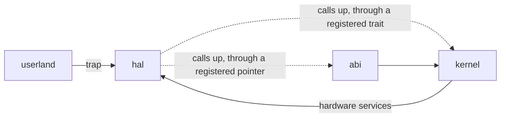
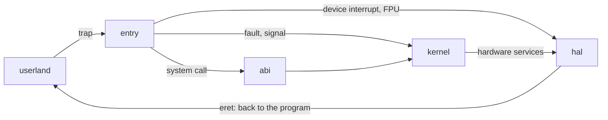
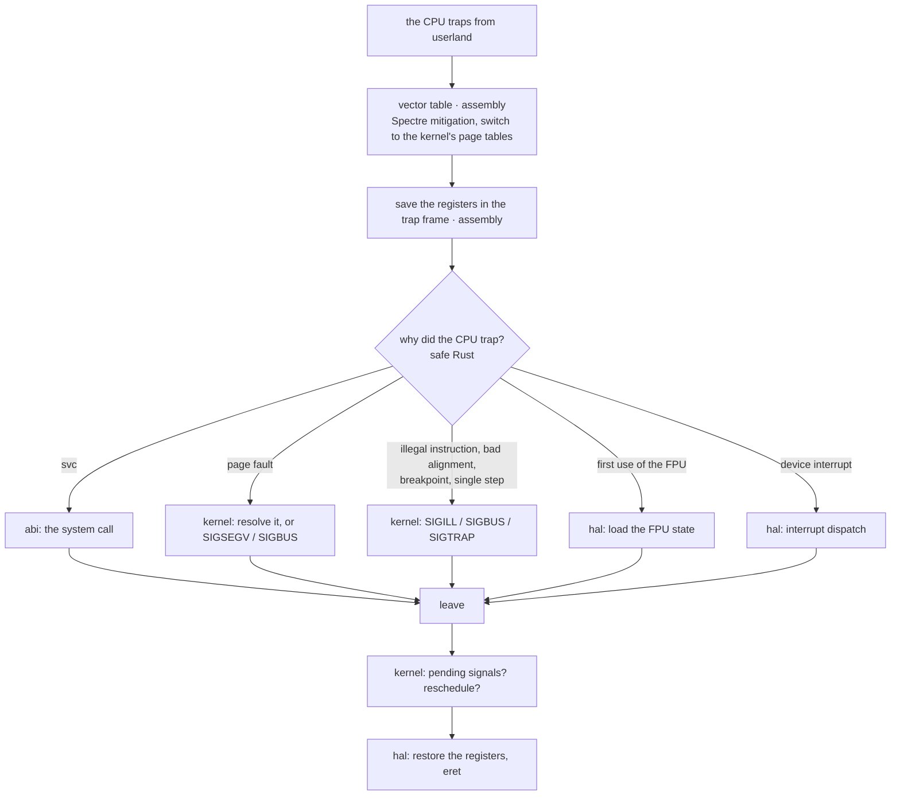
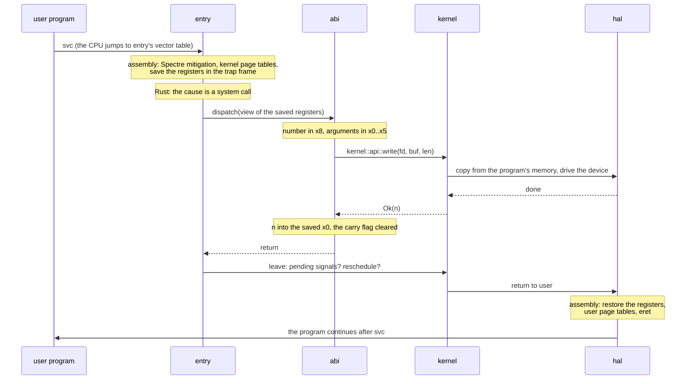
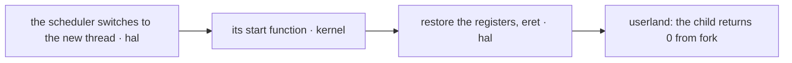

# The userland door: `sys/entry` (proposal)

**Status: a proposal, not implemented and not decided.** Written on 2026-11-26 at the user's
request, to show what the crate would be before any code is written. It amends decision 20
("`hal` is the only crate with `unsafe`"), so it needs the user's decision. The description
of today's code is of `main` at `0e5610fc`, arm64 (decision 44); the points marked **open**
wait for the survey and the plan. Nothing here changes what userland sees.

## 1. The problem

Today a user program enters the kernel image through `hal`, and `hal` calls upward:



`hal` is meant to be the bottom layer, the hardware services the kernel calls. But the first
instruction that runs when a user program traps is `hal`'s
(`sys/hal/arch/arm64/trampoline.S`), `hal` decides what the trap means
(`sys/hal/arch/arm64/trap.rs:591`, `do_el0_sync`), and it reaches `abi` and `kernel` through
pointers they registered at boot (`sys/abi/lib.rs:107`, `set_handler`; `hal::cpu::trap`'s
`TrapHandler`).

The user's two rules for the redesign (2026-11-26):

1. Userland never enters `hal` directly.
2. Neither `kernel` nor `hal` calls `entry`. These flows must not exist:
   `userland -> entry -> abi -> kernel -> entry`, `hal -> entry -> abi -> kernel`,
   `kernel -> entry`.

## 2. Background: what a trap is

A user program runs with the CPU unprivileged (EL0 on arm64). Three things take the CPU away
from it:

- it asks for a service: the `svc` instruction, a **system call**;
- it does something the CPU refuses: touches memory that is not mapped (a **page fault**),
  runs an illegal instruction, uses the FPU before its state is loaded;
- a device wants attention: an **interrupt**.

In all three the CPU does the same thing by itself: it becomes privileged (EL1) and jumps to
an address it reads from one of its own registers (`VBAR_EL1`). That address is the **vector
table**: a small table of code, one slot per kind of event. Nothing has been saved yet: the
program's registers are still in the CPU. So the first code that runs must store them in
memory before any ordinary function can be called. The stored copy is the **trap frame**
(31 general registers, the program counter, the stack pointer and the flags). Going back is
the reverse: load the registers from the trap frame and execute `eret`.

That first code is assembly by necessity, and no compiler can check it. Everything after it
can be ordinary safe Rust.

## 3. What `entry` is

`entry` is the crate that owns the vector table userland traps into. It does four things and
nothing else:

1. **Receives the CPU.** Its vector table is where `VBAR_EL1` points while a user program
   runs.
2. **Saves the program's registers** into the trap frame (assembly).
3. **Finds out why the CPU trapped** (safe Rust: it reads the cause the CPU recorded).
4. **Hands the event to its owner** with an ordinary function call, downward:
   `abi` for a system call, `kernel` for a fault or a signal, `hal` for a device interrupt
   or the FPU.

It decides nothing about the operating system, keeps no state, and nobody can call it.



Every arrow between crates points down. The only arrow into `entry` is the CPU's.

### Inside `entry`



### What it handles, and what it does not

| `entry` handles | How |
|---|---|
| The vector tables for traps from userland (nine on arm64, one per Spectre-BHB mitigation) | Owns them. With the last step of the way out, they are the only kernel code mapped while a user program runs |
| The interrupted program's registers | Saves them in the trap frame and records where the frame is, so `kernel` and `hal` can find it |
| The cause of the trap | Reads the CPU's syndrome and fault-address registers and classifies the event |
| The hand-over | One direct call down per event: `abi`, `kernel` or `hal` |

| `entry` does not handle | Who does |
|---|---|
| Which register holds the system call number, the arguments, the result, the error flag | `abi` (OpenBSD's convention, `sys/abi/arch/arm64.rs`) |
| What a system call does | `kernel` |
| Which signal a fault becomes, whether a page fault can be resolved | `kernel` |
| Reading and writing the program's memory (`copyin`, `copyout`) | `hal`, called by `kernel` |
| Page tables, the FPU state, the interrupt controller | `hal` |
| Building a signal's frame on the user stack, `sigreturn`, `ptrace`'s registers, `exec`'s first registers | `hal`, called by `kernel` |
| The return to the program | `kernel` prepares it, `hal` restores the registers and executes `eret` |
| A trap taken while the kernel itself runs | `hal`'s own vector table, as today |
| Any state (a static, a lock, a counter) | Nobody: `entry` has none |

### Which addresses are involved

There are exactly three, and none of them is an address of `abi`:

1. **The vector table's address.** It lives in the CPU register `VBAR_EL1`. `hal` loads it
   on the way back to the program; the table itself is `entry`'s. This is the one handle on
   `entry` that exists, and only the CPU uses it.
2. **The trap frame's address.** Where the registers were saved, on the thread's kernel
   stack. It is recorded in the thread's control block so that `kernel` and `hal` can read
   and change the program's registers (a system call's result, a signal, `ptrace`, `fork`).
3. **The program's own addresses** inside the frame (its program counter and stack pointer)
   and in a system call's arguments (the buffer of a `write`). To `entry` they are numbers
   it saves and passes on untouched; `abi` wraps the arguments in typed user pointers and
   `kernel` asks `hal` to copy.

`entry` calls `abi` the way any Rust function calls another: a direct call the linker
resolves when the image is built. No pointer to `abi`, `kernel` or `entry` is stored
anywhere. That is a change: today `hal` keeps `abi`'s dispatcher in a static that `abi`
fills at boot (`set_handler`), because `hal` cannot name a crate above it.

## 4. The flows

### A system call



### The other arrivals

| Event | Path |
|---|---|
| Page fault in the program | `userland -> entry -> kernel (uvm_fault) -> hal (page tables)`, then leave |
| Illegal instruction, alignment, breakpoint | `userland -> entry -> kernel (the signal)`, then leave |
| First use of the FPU | `userland -> entry -> hal (load the state)`, then leave |
| Device interrupt while the program runs | `userland -> entry -> hal (dispatch) -> the drivers' handlers`, then leave |
| Fault or interrupt while the kernel runs | `CPU -> hal -> kernel`, as today: `entry` takes no part |

### A new thread's first run

A child of `fork` (or a new thread, or process 1 after its first `exec`) has never trapped,
so it does not come through `entry`. It starts in the kernel and leaves through the same
exit as everyone:



The child's return value (0, error flag clear) is OpenBSD's convention, so `abi` owns it.
Today `hal` calls `abi` back when the child first runs (`ChildFn`,
`sys/abi/arch/arm64.rs:42`). In the proposal `abi` writes it as data into the child's saved
registers during the parent's `fork`, which did come through `entry`; no call upward is left.
**Open:** whether anything (`ptrace`, a core dump) can observe the child's registers between
the `fork` and its first run; if so, writing the value earlier would be visible and this
point needs another answer.

## 5. The rules, and what enforces them

| Rule | Enforced by |
|---|---|
| R1. Userland enters only `entry`: every vector a user program can reach is `entry`'s | `entry-check` (new, xtask): the vector tables for traps from userland are defined only under `sys/entry/` |
| R2. Nothing inside the image enters `entry` | Cargo: `entry` depends on `abi`, `kernel`, `hal`, `sysdefs`, and none of them on it, so a call into it does not compile. `entry-check`: `entry` has no `pub` item, calls no registration function, and no assembly outside it branches to one of its symbols |
| R3. The only `unsafe` in `entry` is its one block of assembly | The compiler: `#![deny(unsafe_code)]` at the root, allowed in the one module that holds the `global_asm!` (checked with DevTools' rustc: a `forbid` crate refuses `global_asm!` and `no_mangle`, so the assembly cannot live in a `forbid` crate nor be called from outside one). `entry-check`: that module holds nothing else; `unsafe-budget.toml`: `entry` 1 on arm64 |
| R4. `entry` decides nothing and remembers nothing | `entry-check`: no `static`, no lock, no loop over data; a classification and one call per event |
| R5. `hal` calls nobody above it on this path | `set_handler`, `SyscallFn`, `ChildFn` and the user half of `TrapHandler` are deleted; `hal-check` refuses their return |

The sentence of decision 20 would become: `hal` is the only crate with `unsafe` Rust;
`entry` holds the assembly userland traps into, and nothing else that is `unsafe`.

## 6. What would move

The exact split is the plan's; this is the shape.

| Today (`sys/hal/`) | After |
|---|---|
| `arch/arm64/trampoline.S`: the nine vector tables, the arrival stubs (`tramp_el0_*`) | `entry` |
| `arch/arm64/trampoline.S`: `tramp_return` (the last step of the way out) | stays in `hal` |
| `arch/arm64/exception.S`: the register save and `handle_el0_*`'s arrival half | `entry` |
| `arch/arm64/exception.S`: the AST loop, the register restore, `syscall_return` (the way out) | stays in `hal`, reached by a call down |
| `arch/arm64/exception.S`: the kernel's own vector table and `handle_el1h_*` | stays in `hal` |
| `arch/arm64/trap.rs`: `do_el0_sync` (the classification), `do_el0_error`, the user page-fault path | `entry`, calling `kernel` directly |
| `arch/arm64/syscall.rs`: `svc_handler` | `entry`, calling `abi` directly |
| `arch/arm64/syscall.rs`'s `UserRegs` and `gpr.rs`'s `Gpr` (the safe view of the saved registers) | stays in `hal`, a passive type `abi` already names (decision 53) |
| `syscall.rs`: `set_handler`, `SyscallFn`, `ChildFn` | deleted |
| `cpu/trap.rs`: `TrapHandler`'s methods for traps from userland | deleted (direct calls from `entry`); the kernel-mode page fault stays |

`sys/abi/lib.rs` stops registering and exposes its dispatcher as a function `entry` calls.
`sys/` would hold seven directories: `entry`, `abi`, `kernel`, `hal`, `lib`, `bsd`, `boot`.

```
sys/entry/
  Cargo.toml        depends on abi, kernel, hal, sysdefs; nothing depends on it
  lib.rs            #![no_std], #![deny(unsafe_code)]; no pub item
  arch/arm64/
    vectors.S       the vector tables for userland, the arrival stubs, the register save
    vectors.rs      the one global_asm!: the crate's only unsafe
    trap.rs         classify the event and call down: abi, kernel or hal
  arch/amd64/       at N10
```

## 7. What does not change

- What userland sees: nothing. The same system calls, signals and register contents.
- The trap frame's layout, the Spectre-BHB mitigations, the page-table switch on every
  crossing: the same instructions, in another crate.
- `kernel` and `abi` stay `#![forbid(unsafe_code)]`. `hal` stays the only crate with
  `unsafe` Rust.

## 8. Cost and risk

- `unsafe`: `entry` 1 (its assembly). `hal`'s count is expected to stay about the same (its
  assembly block and the frame's accessor remain for the kernel's own traps); measured by
  `cargo xtask unsafe-report` when it lands.
- Rules: decision 20's sentence, `.claude/rules/abi.md` (the registration goes, the door
  narrows), a new `entry-check`, a row in `unsafe-budget.toml`.
- Risk: this is the hottest path of the kernel and every boot crosses it. A mistake stops
  every smoke at once, so it is found immediately; a slowdown is not, so the system call
  benchmarks run before and after (decision 43). Several indirect calls per system call
  become direct ones; whether that is measurable is unknown until measured.
- Size: one or two reviewed slices of 2 to 4 hours each (an estimate, from
  `docs/ZERO_UNSAFE.md` 0.5's measured pace).

## 9. Open points

1. The forked child's registers before its first run (section 4).
2. The way out as a call down that never returns (`entry -> kernel -> hal -> eret`) instead
   of today's fall-through in assembly: the frames left behind must hold no guard or value
   with a destructor. The plan says how that is guaranteed.
3. The pages mapped while a user program runs would hold `entry`'s tables and `hal`'s last
   exit step (`tramp_return`): one linker section fed by two crates. `hal`'s part is exit
   only; `VBAR_EL1` never points at it.
4. Where the answer to a user program reading a CPU identification register belongs (today
   `emulate_msr` in `hal`): the classification is `entry`'s, the values are `hal`'s, the
   choice of what userland may see is a policy.
5. amd64 (N10): its interrupt table is one table for both rings, so a trap from userland
   and one from the kernel reach the same first instructions. Either two tables switched at
   the boundary, as arm64 switches `VBAR_EL1`, or those shared instructions live in one of
   the two crates. arm64 has the clean case today.
6. Host tests: `entry` has no host form (there is no trap on the host); `abi`'s tests call
   its dispatcher directly.

## 10. Steps

1. Survey (read-only): every instruction and function between the trap and the `eret`,
   every call upward from `hal`, every thread's first exit, the amd64 facts.
2. Plan: the exact split, the API `hal` exposes, the text of the decision, the tests, the
   commits.
3. The user's decision on the plan (the amended decision 20, `entry`'s ceiling).
4. Implementation, after the removal of Limine: a redesigner, a reviewer, the benchmarks,
   the smokes.
5. Documents: this file becomes the description of what exists; `docs/ARCHITECTURE.md`,
   `docs/ZERO_UNSAFE.md` section 0 and the README's diagram follow.

## Words

| Word | Meaning |
|---|---|
| trap | The CPU leaving a user program for the kernel: a system call, a fault or an interrupt |
| vector table | The table of code the CPU jumps to on a trap; its address is in `VBAR_EL1` |
| trap frame | The saved copy of the interrupted program's registers, on the thread's kernel stack |
| `eret` | The instruction that goes back to the interrupted program |
| AST | "Asynchronous system trap": work the kernel does just before going back to a program (deliver a signal, give the CPU to another thread) |
| EL0, EL1 | arm64's unprivileged and privileged levels: userland and the kernel |
| Spectre-BHB mitigation | A short sequence run on every arrival from userland so a program cannot steer the kernel's branch predictor; which sequence depends on the CPU model, hence nine tables |
