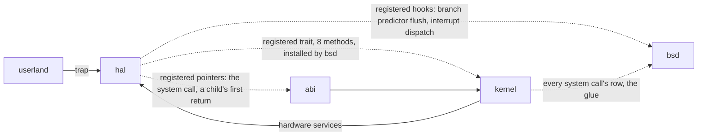
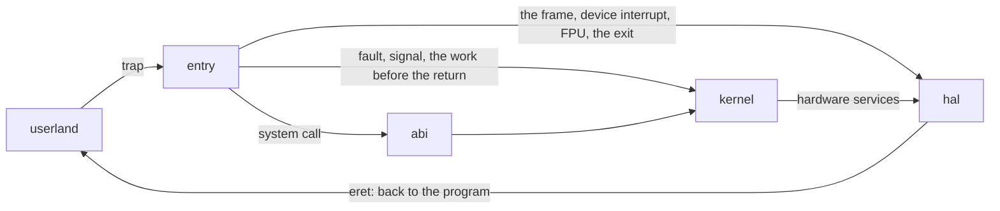
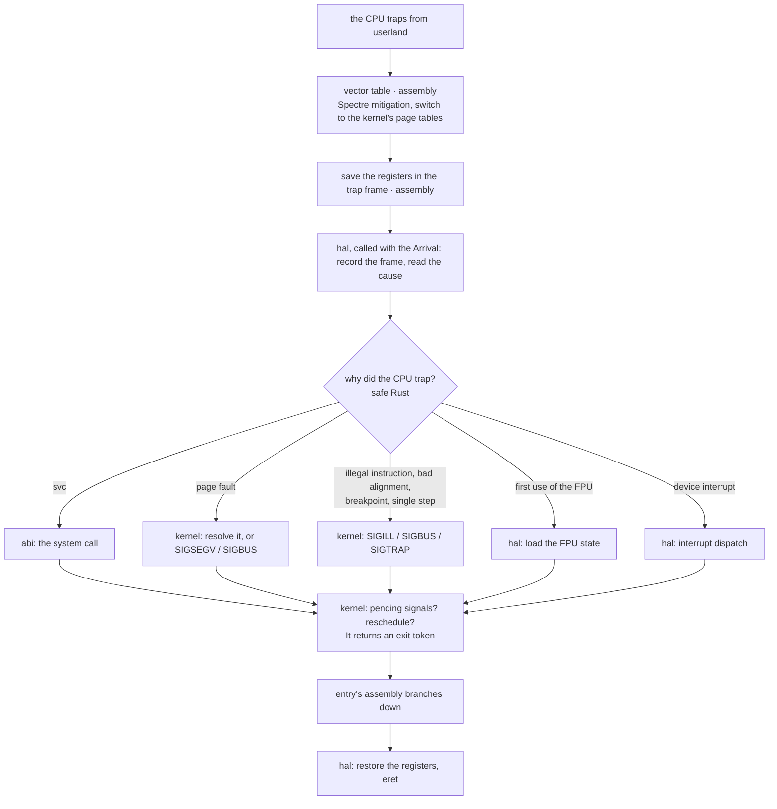
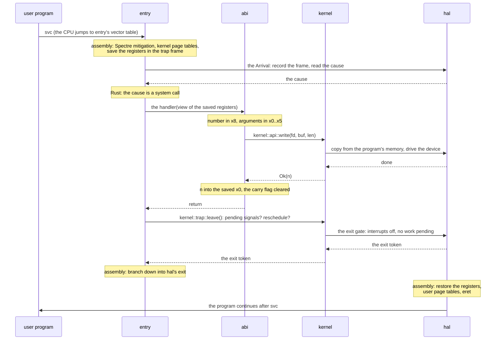
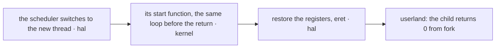

# The userland door: `sys/entry` (decision 56, not built yet)

**Status: decided; the way out (E1) built on 2026-11-27, the crate (E2) not yet.** Written on
2026-11-26 at the user's request. After the
survey and the plan, the user took decision 56 and the plan's ten points as recommended the
same day (section 10). It amends decision 20 ("`hal` is the only crate with `unsafe`"). No
code is written yet: the work runs after the removal of Limine (decision 57, done), in the slices of section 11,
and until it lands the tree is as section 1 describes (`main` at `c4bb056d`, arm64, decision
44). Nothing here changes what userland sees.

## 1. The problem

Today a user program enters the kernel image through `hal`, and `hal` calls upward:



`hal` is meant to be the bottom layer. But the first instruction that runs when a user
program traps is `hal`'s (`sys/hal/arch/arm64/trampoline.S:134`), `hal` decides what the trap
means (`sys/hal/arch/arm64/trap.rs:591`, `do_el0_sync`), and from there it calls upward
through registered pointers and traits:

- `abi`'s system call handler and its forked child's return (`sys/hal/syscall.rs:161-165`,
  registered by `sys/abi/lib.rs:107`);
- the eight methods of `TrapHandler` (`sys/hal/cpu/trap.rs:89-112`), which are the kernel's
  but are installed by `bsd` (`sys/bsd/kern/hal_bridges.rs:438`); the kernel itself calls one
  of them through `hal` to re-enter the kernel (`sys/kernel/syscall.rs:472-477`);
- `bsd`'s `CpuHooks`, interrupt dispatch and debugger; the kernel's thread start; the symbol
  `pmap_setttb` of `bsd`.

Counting each method, fifteen upward entry points lie on the way in from userland and on a
new thread's way out. `bsd` is in the path in two more ways until N9: every system call,
translated or not, ends in a row of `bsd`'s table (`sys/kernel/api.rs:76-82`), and a forked
child's first run crosses `bsd`'s glue to reach `hal` and `abi`.

The user's two rules for the redesign (2026-11-26):

1. Userland never enters `hal` directly.
2. Neither `kernel` nor `hal` calls `entry`. These flows must not exist:
   `userland -> entry -> abi -> kernel -> entry`, `hal -> entry -> abi -> kernel`,
   `kernel -> entry`.

## 2. Background: what a trap is

A user program runs with the CPU unprivileged (EL0 on arm64). Three things take the CPU away
from it:

- it asks for a service: the `svc` instruction, a **system call**;
- it does something the CPU refuses: touches memory that is not mapped (a **page fault**),
  runs an illegal instruction, uses the FPU before its state is loaded;
- a device wants attention: an **interrupt**.

In all three the CPU does the same thing by itself: it becomes privileged (EL1) and jumps to
an address it reads from one of its own registers (`VBAR_EL1`). That address is the **vector
table**: a small table of code, one slot per kind of event. Nothing has been saved yet: the
program's registers are still in the CPU. So the first code that runs must store them in
memory before any ordinary function can be called. The stored copy is the **trap frame**
(31 general registers, the program counter, the stack pointer and the flags). Going back is
the reverse: load the registers from the trap frame and execute `eret`.

That first code is assembly by necessity, and no compiler can check it. Everything after it
can be ordinary safe Rust.

## 3. What `entry` is

`entry` is the crate that owns the vector table userland traps into. It does four things and
nothing else:

1. **Receives the CPU.** Its vector table is where `VBAR_EL1` points while a user program
   runs.
2. **Saves the program's registers** into the trap frame (assembly) and hands the frame to
   `hal` as an `Arrival`, a value only that assembly can make. `hal` records where the frame
   is.
3. **Finds out why the CPU trapped** (safe Rust): `hal` reads the cause the CPU recorded;
   `entry` classifies it.
4. **Hands the event to its owner** with ordinary calls, downward: `abi` for a system call,
   `kernel` for a fault or a signal, `hal` for a device interrupt or the FPU. Then it asks
   the kernel for the work before the return, and its assembly ends by branching down into
   `hal`'s exit.

It decides nothing about the operating system, keeps no state, and nobody can call it.



Every arrow between crates points down. The only arrow into `entry` is the CPU's.

### Inside `entry`



### What it handles, and what it does not

| `entry` handles | How |
|---|---|
| The vector tables for traps from userland (nine on arm64, one per Spectre-BHB mitigation) | Owns them. With the last step of the way out, they are the only kernel code mapped while a user program runs |
| The interrupted program's registers | Saves them in the trap frame and passes the frame to `hal`, which records it, so `kernel` and `hal` can find it |
| The cause of the trap | Classifies the syndrome and fault address `hal` read from the CPU |
| The hand-over | Direct calls down: `abi`, `kernel` or `hal`; one event, one owner |

| `entry` does not handle | Who does |
|---|---|
| Which register holds the system call number, the arguments, the result, the error flag | `abi` (OpenBSD's convention, `sys/abi/arch/arm64.rs`) |
| What a system call does | `kernel` |
| Which signal a fault becomes, whether a page fault can be resolved | `kernel` |
| The loop before the return (signals, rescheduling) | `kernel`, over a gate of `hal`'s that closes the race with an interrupt |
| Reading the CPU's cause registers, enabling interrupts, the barrier skip of a system call | `hal`, callable only with the `Arrival` |
| Which identification registers a program may read, and their values | `abi` (the list) and `kernel` (the values) |
| Reading and writing the program's memory (`copyin`, `copyout`) | `hal`, called by `kernel` |
| Page tables, the FPU state, the interrupt controller | `hal` |
| Building a signal's frame on the user stack, `sigreturn`, `ptrace`'s registers, `exec`'s first registers | `hal`, called by `kernel` |
| The return to the program | `hal` restores the registers and executes `eret` |
| A trap taken while the kernel itself runs | `hal`'s own vector table, as today |
| Any state (a static, a lock, a counter) | Nobody: `entry` has none |

### Which addresses are involved

Three at run time and two at link time; none of them is an address of `abi`.

1. **The vector table's address.** It lives in the CPU register `VBAR_EL1`. `hal` loads it
   on the way back to the program; the table itself is `entry`'s. `hal` computes it from the
   bounds the linker script gives the pages userland runs with, never from a symbol of
   `entry`. This is the one handle on `entry` that exists, and only the CPU uses it.
2. **The trap frame's address.** Where the registers were saved, on the thread's kernel
   stack. It is recorded in the thread's control block so that `kernel` and `hal` can read
   and change the program's registers (a system call's result, a signal, `ptrace`, `fork`).
3. **The program's own addresses** inside the frame (its program counter and stack pointer)
   and in a system call's arguments (the buffer of a `write`). To `entry` they are numbers
   it saves and passes on untouched; `abi` wraps the arguments in typed user pointers and
   `kernel` asks `hal` to copy.

At link time `entry`'s assembly names two symbols of `hal`: the kernel's own vector table
(installed on arrival) and the exit it branches to. Nothing names a symbol of `entry` but the
linker script, which keeps its object in the image.

`entry` calls `abi` the way any Rust function calls another: a direct call the linker
resolves when the image is built. No pointer to `abi`, `kernel` or `entry` is stored
anywhere. That is a change: today `hal` keeps `abi`'s dispatcher in a static that `abi`
fills at boot (`set_handler`), because `hal` cannot name a crate above it.

## 4. The flows

### A system call



Until N9, `kernel::api::write` still runs the call's row in `bsd`'s table (the
`LegacySyscalls` bridge), and `kernel::trap` reaches the kernel's own functions through a
table `bsd` installs, because the kernel is generic over `bsd`'s glue.

### The other arrivals

| Event | Path |
|---|---|
| Page fault in the program | `userland -> entry -> kernel (uvm_fault) -> hal (page tables)`, then leave |
| Illegal instruction, alignment, breakpoint | `userland -> entry -> kernel (the signal)`, then leave |
| First use of the FPU | `userland -> entry -> hal (load the state)`, then leave |
| Device interrupt while the program runs | `userland -> entry -> hal (dispatch) -> the drivers' handlers`, then leave |
| Fault or interrupt while the kernel runs | `CPU -> hal -> kernel`, as today: `entry` takes no part |

### A new thread's first run

A child of `fork` (or a new thread, or process 1 after its first `exec`) has never trapped,
so it does not come through `entry`. It starts in the kernel and leaves through `hal`:



The child's return value (0, error flag clear) is OpenBSD's convention, so `abi` owns it, as
a constant (`CHILD_RETURN`: which register, which value, the flag). The image's boot glue
hands it to the kernel once; at each fork of a child that returns to userland the kernel
passes it to `hal`, which writes it into the child's saved registers while it builds them.
No call goes upward (before E1 `hal` called `abi` back when the child first ran, `ChildFn`).
The start function also releases the kernel lock and runs the kernel's own first-return work,
then the same loop as every exit. Built so in E1: `abi::arch::arm64::CHILD_RETURN`, handed to
`kernel::proc::fork::init`; `cpu_fork` passes it in a `hal::cpu::thread::UserStart` (with the
user stack and TCB) to `thread_setup`, whose `build_frames` writes it; the kernel's
`child_return` unlocks and calls `mi_child_return`; `thread_start` runs
`kernel::trap::user_exit` and returns its `UserExit` to `hal_proc_trampoline`, which branches to
`hal_user_first_return` (the restore and the return, no `do_ast`).

## 5. The rules, and what enforces them

| Rule | Enforced by |
|---|---|
| R1. Userland enters only `entry`: every vector a user program can reach is `entry`'s | `entry-check` E1 (new, xtask): the tables for traps from userland are defined only under `sys/entry/`, `hal`'s table has no live slot for userland, and the linker script asserts the section's size |
| R2. No code of `kernel` or `hal` calls, branches to or stores a symbol of `entry` | Cargo (nothing depends on `entry` but the image); `entry-check` E2: no `pub` item, no label of `entry` named outside it; `hal` reads the section's bounds from the linker script |
| R3. The only `unsafe` in `entry` is its one block of assembly | The compiler: `#![deny(unsafe_code)]` at the root, allowed in the one module that holds the `global_asm!` (checked with DevTools' rustc: a `forbid` crate refuses `global_asm!` and `no_mangle`). `entry-check` E3; `unsafe-report`: `entry` `unsafe 0, asm 1` (U3) |
| R4. `entry` decides nothing and remembers nothing | `entry-check` E4: no `static`, no lock, no loop; E5: it names `abi`, `kernel` and `hal` only through their doors |
| R5. On a trap from userland `hal` calls neither `abi` nor `entry`, and calls upward only what is listed | `set_handler`, `SyscallFn`, `ChildFn` and seven of `TrapHandler`'s eight methods are deleted, and `hal-check` refuses their return. Left, each with its date: `bsd`'s branch predictor hook and interrupt dispatch (N7); the registered interrupt handlers, the kernel-mode fault handler and the thread start (permanent) |

## 6. What would move

The cut is by block, not by file: today's handlers mix the way in and the way out.

| Today (`sys/hal/arch/arm64/`) | After |
|---|---|
| `trampoline.S`: the Spectre-BHB sequences, the nine vector tables, the arrival stubs (`tramp_el0_*`) | `entry` |
| `trampoline.S`: `tramp_return` | stays in `hal`, in the same linker section as `entry`'s tables |
| `exception.S`: the EL0 half of the register save, `disable_ss`, the first four lines of each `handle_el0_*`, `handle_el0_error` whole | `entry` |
| `exception.S`: the EL1 half of the save, the register restore, `allow_ss`, `return`, the last three lines of each `handle_el0_*`, the kernel's own table and `handle_el1h_*` | stays in `hal`; the exit is one label `entry` branches to |
| `exception.S`: the AST loop (`do_ast`) | no assembly: the masked test is a `hal` function (the exit gate), the loop is the kernel's |
| `exception.S`: `syscall_return` (a new thread's exit) | stays in `hal`, without the loop, which the kernel's start function runs |
| `trap.rs`: `do_el0_sync`'s classification, `do_el0_error`, `udata_abort`'s decode | `entry`, calling `abi`, `kernel` and `hal` |
| `trap.rs`: the prologue of `do_el0_sync` (the cause registers, the interrupts, the counter, the frame), the interrupt entries from userland, the SError report | stays in `hal`, behind `Arrival` |
| `trap.rs`: `udata_abort`'s choice of signal, `ast` | `kernel` (`kernel::trap`) |
| `trap.rs`: `emulate_msr` | four pieces (section 9, Gap 5) |
| `syscall.rs`: `svc_handler`'s machine half | stays in `hal`, behind `Arrival`; `entry` calls it, then `abi` |
| `syscall.rs`: `child_return` | deleted: data (section 4) |
| `syscall.rs`'s `UserRegs`, `gpr.rs`'s `Gpr` | stay in `hal`; `ChildReturn` joins them |
| `hal::syscall`: `set_handler`, `SyscallFn`, `ChildFn`, `HandlerInfo` | deleted |
| `cpu/trap.rs`: `TrapHandler`'s seven methods for userland | become `kernel::trap`, the kernel's own door for `entry`, reached through a table `bsd` installs until N9; the kernel-mode page fault stays in `hal`'s trait |

`sys/abi/lib.rs` loses `abi_init`; its handler is a function `entry` calls.
`sys/kernel/trap.rs` is new. `sys/` would hold seven directories: `entry`, `abi`, `kernel`,
`hal`, `lib`, `bsd`, `boot`.

```
sys/entry/
  Cargo.toml        depends on abi, kernel, hal, sysdefs; only the image names it
  lib.rs            #![no_std], #![deny(unsafe_code)]; no pub item
  arch/arm64/
    vectors.S       the vector tables for userland, the arrival stubs, the EL0 register save
    vectors.rs      the one global_asm!: the crate's only unsafe
    trap.rs         classify the event and call down: abi, kernel or hal; then the kernel's exit loop
  arch/amd64/       at N10
```

## 7. What does not change

- What userland sees: nothing. The same system calls, signals and register contents.
- The trap frame's layout, the Spectre-BHB mitigations, the page-table switch on every
  crossing: the same instructions, in another crate.
- `kernel` and `abi` stay `#![forbid(unsafe_code)]`. `hal` stays the only crate with
  `unsafe` Rust.

## 8. Cost, risk and how it is measured

- `unsafe`: `entry` has no `unsafe` keyword and one block of assembly (counted as `asm 1`,
  U3). `hal`: 235 today, 236 or 237 expected (one new site in the exit gate),
  under its ceiling of 600.
- Rules: decision 20's sentence (decision 56), `.claude/rules/abi.md` (the registration
  goes, the door narrows), a new `entry-check`, a line in `unsafe-budget.toml`.
- Size (an estimate, from `docs/ZERO_UNSAFE.md` 0.5's measured pace): four slices and a
  close, 10 to 15 hours and 3.1 to 4.3 M subagent tokens.
- Risk: the hottest path of the kernel, and every boot crosses it. A mistake stops every
  smoke at once; a slowdown does not show by itself, so it is measured:

| Per ordinary system call | The C | Today | After |
|---|---|---|---|
| Indirect calls besides the row (translated / legacy) | 0 | 6 / 5 | 5 / 4 |
| Borrows of the trap frame | - | 4 | 4 |
| Exit of an interrupt from userland, no work pending | inline | inline | one direct call |
| One AST | 3 direct calls | 3 indirect | 1 indirect |
| A child's first exit | 2 direct calls | 2 indirect and `bsd`'s chain | 0 indirect |

  The gain per system call is one indirect call; the four or five left go at N9, with the
  glue and the table. No host benchmark crosses the trap (there is none on the host), so
  the measure is the QEMU bench before and after, debug and release, three runs on AC:
  `pipe`, `pagefault`, `forkexit`, `forkexec` and a new null system call row (no row
  measures the bare path today). A row over +10 % without a measured cause stops the work
  (decision 43).

Coverage of what moves, as it is today:

| What | Covered by | State |
|---|---|---|
| A signal's handler and `sigreturn` | `smoke-boot`, `diff-openbsd` (signals) | covered |
| `fork`, `wait`, SIGSEGV on a fault | `smoke-boot`, `diff-openbsd` (procs) | covered |
| `__tfork` | `smoke-thrsleep` | covered, smoke only |
| SIGBUS for a file-backed fault | `diff-openbsd` (mmapfile) | covered |
| First use of the FPU | nothing asserts it | gap; a new step adds it |
| SIGILL, SIGTRAP, SIGBUS for alignment | none | gap; new steps add them |
| Identification register reads | none | gap; new steps add them |
| Single step, BTI, pointer authentication, SError from userland | none | gap, kept and named |

  The new steps go into `diff-openbsd` before anything moves, and run on OpenBSD too
  (U4).

## 9. The seven gaps the user asked to close

| Gap | State | How | The two rules, to the letter |
|---|---|---|---|
| 1. The way in and the way out are mixed | resolved | cut by block; no block exists twice; two assembly symbols cross, both `entry -> hal` | kept |
| 2. The exit | resolved | the Rust returns, `entry`'s assembly branches down; the kernel runs the loop over `hal`'s gate | kept; no stack frame is abandoned |
| 3. The child's return value | resolved (U5) | `abi`'s constant, written while the child's registers are built | kept |
| 4. amd64 | deferred to N10 (U10), option A recommended | shared stubs in `entry`, a kernel-mode arrival jumps down to `hal` | rule 1 kept; rule 2 kept as "no call", **not** kept if it means "no kernel-mode event runs an instruction of `entry`": on amd64 no option does, short of CPUs with FRED |
| 5. The identification registers | resolved (U7) | `entry` sequences, `hal` the instruction, `abi` the list, `kernel` the values | kept; the user's proposal as written does not fit `abi`'s rules |
| 6. `bsd` in the path | resolved for `entry`, not for `bsd` | `kernel::trap`, a door that is not generic; 9 of the 15 upward entry points go | kept for `entry`; `hal` still calls up to `bsd` on a trap from userland until N7, and every system call crosses `bsd`'s table until N9 |
| 7. Measurement | resolved, with the coverage gaps named | section 8 | not applicable |

### Gap 1: the cut

After the cut nothing exists twice: the EL0 register save once (`entry`), the EL1 save once
(`hal`), both restores once (`hal`). What can diverge is the pair EL0 save / EL0 restore,
which nothing checks today. It is held by the frame's offsets, taken by both crates from
the one `hal` `Trapframe`, and by `entry-check` E8 (each store of the save has its load in
the restore). Rejected: one assembly file in `hal` included by both crates (`entry`'s code
would be text under `sys/hal/` that a `hal` edit changes unseen); the save as a `hal`
subroutine (the call destroys a register before it is saved).

Symbols across crates, both `entry -> hal`: `exception_vectors` (an address, installed on
arrival) and `hal_user_return` (the exit `entry` branches to). `hal -> entry` and
`kernel -> entry`: none.

### Gap 2: the exit

`entry`'s Rust returns normally to its assembly, which ends by branching into `hal`'s exit:
every Rust frame has unwound, and no path that does not return is added. The race with an
interrupt (a signal posted after the check and before the `eret`) is closed by `hal`'s exit
gate: interrupts off, the pending-work flag tested, and off until the `eret`. The loop
around the gate is the kernel's, for a trap and for a new thread alike: one mechanism, and
`hal` calls nobody. Rejected: a `hal` function that never returns, called from Rust (no
safe signature can require that the discarded frames hold no guard); the loop in `entry`'s
assembly (a new thread's first exit would then need `hal` to call the kernel).

### Gap 3: the child's return value

Nothing userland can see reads a forked child's registers before it has run. Checked in the
C: `ptrace` reads a thread's registers only once the thread stopped itself
(`reference/openbsd-src/sys/kern/sys_process.c:866-868`); a core dump reads them only after
every thread suspended itself (`reference/openbsd-src/sys/kern/kern_sig.c:1832`, `:2337`);
no sysctl reads them; `ddb`'s `show registers` is the debugger's own frame
(`reference/openbsd-src/sys/arch/arm64/arm64/db_interface.c:60-94`) and no command reads a
thread's trap frame. Only the operator examining raw memory would see the 0 early. Here
`ptrace` and core dumps are not ported; when they are, the invariant is: another thread's
registers are read only once it stopped itself, and `hal`'s accessor refuses a thread that
has not run. Its test then: `PT_GETREGS` is refused before the child's first stop and shows
0 at it. The fallback, if the user prefers no invariant (U5): the same constant, applied at
the child's first run by a `hal` function the kernel calls.

### Gap 4: amd64 (N10; nothing of amd64 is built, decision 44)

Facts, in the C and in this tree's ports (all still in `bsd`, `sys/bsd/arch/amd64/amd64/`,
none in `hal`, so at N10 the assembly moves once, straight to its crate): one interrupt
table serves both rings, loaded once per CPU. Every exception and interrupt stub tests which
ring the CPU came from (`reference/openbsd-src/sys/arch/amd64/amd64/vector.S:478-479`; the
port's `vector.S:227-228`); the non-maskable interrupt and the double fault run one path for
either ring (`vector.S:122-184`); only the system call's entry is userland's alone
(`Xsyscall`, `locore.S:543`; the port's `locore.S:483`). The exits are `sysretq` and
`iretq`. The Meltdown trampoline (`.kutext`) is not ported.

| | A: the shared stubs are `entry`'s; a kernel-mode arrival jumps down at once | B: two tables, swapped at every crossing |
|---|---|---|
| Userland enters `hal` | no | no, only if the user table's non-maskable stubs are `entry`'s too |
| `kernel` or `hal` call `entry` | no call, branch or symbol. The CPU arrives: every kernel-mode interrupt and fault runs `entry`'s test and jump | no call. The CPU arrives from kernel mode in the two crossing windows (non-maskable interrupt, machine check, double fault) |
| Hot path against the C | the same instructions | two table loads per crossing where the C has none: not measured |
| Mechanism against the C | the C's, cut at the ring test | new: a second table per CPU and a window on the wrong table |
| A non-maskable event during the crossing | nothing special: one table | it lands on the user table, whose stubs must take kernel mode anyway |

Stated plainly: on amd64, short of CPUs with FRED, neither option makes `entry` a door only
userland enters, because the CPU consults one table for both rings. Rule 1 holds to the
letter in both. Rule 2 holds as written (no call) in both; read as "no kernel-mode event
executes an instruction of `entry`", it fails in A for every kernel-mode event and in B for
the non-maskable ones during a crossing. Recommended: A, chosen at N10. Rejected: B (a cost
on the hottest path, and the stubs it meant to avoid stay); the stubs in `hal` jumping up
(breaks both rules).

R1 for amd64 would read: "Every address the CPU can vector to while userland runs is a
label of `entry`, and the user arm of each stub is `entry`'s. The CPU also vectors there
from kernel mode: the kernel arm of a stub is one jump into `hal` and nothing else." The
check that bounds it (`entry-check` A1-A3, at N10): the table of stubs is emitted only under
`sys/entry/`; between a stub's label and its ring test only the fixed prologue; the kernel
arm targets a symbol that is not `entry`'s. The arm64 design forecloses neither option: the
rules are worded per arch, `hal` reads `entry`'s addresses only as numbers from the linker,
and `hal`'s exit never names the returning instruction.

### Gap 5: the identification registers

Today `emulate_msr` (`sys/hal/arch/arm64/trap.rs:443-501`; the C's
`reference/openbsd-src/sys/arch/arm64/arm64/trap.c:220-310`) answers sixteen reads: the
CPU's model, a fixed value that hides the topology, the feature registers the kernel
computed, and zeros. Anything else, and every write, is SIGILL. The five computed values are
`hal` statics that `bsd` fills from the boot CPU and masks once after all CPUs attached; a
core that differs only prints a message. No smoke or `diff-openbsd` scenario covers it.

The user's proposal (the decode and the answer's register in `abi`) keeps both rules, but
does not fit `abi`'s rules as written, in three places: R2 allows a branch only on the
system call number or a result, and the decode tests five fields; `UserRegs` has exactly
three methods, and its one write also sets the carry flag, which this read must not touch;
`kernel::api` is one function per system call. And two of the three pieces are not OpenBSD's
convention: how the register is decoded is the CPU's format, and where the answer goes is
the trapped instruction's own operand. What is OpenBSD's, and visible to userland, is the
list of reads that are answered.

Chosen (U7): the proposal with those two pieces in `hal`; no rule of `abi` changes.
`entry` classifies and sequences; `hal` decodes the trapped instruction, writes the
destination register and advances the program counter; `abi` holds, as a constant table,
the list of registers that are answered; `kernel` holds the values announced. A read that is
not on the list is SIGILL, sent by `kernel`. Rejected: everything in `entry` (a table of
policy, and a general register-write door); everything in `kernel` (the frame write would be
a door any kernel code can call); left in `hal` (the announced values and the hidden
topology are decisions, not mechanism). Proof that userland sees the same: the new
`diff-openbsd` steps read each of the sixteen registers and two that are refused, before the
move and against OpenBSD.

### Gap 6: `bsd` in the path

`entry` cannot name `bsd`'s glue, and the kernel's functions are generic over it. So the
kernel gets a door that is not generic, `kernel::trap`, as `kernel::api` is for `abi`: plain
functions over a table the kernel owns and `bsd` fills until N9. What becomes of each upward
entry point:

| Registration | With `entry` | Until |
|---|---|---|
| `SyscallFn`, `ChildFn` (to `abi`) | deleted: `entry` calls `abi`; the child's value is data | gone at once |
| `TrapHandler`: the user page fault, the signal, the exit, the credentials, the return work, the AST, the system call return | `kernel::trap`, called down by `entry` or by the kernel's own loop | the table `bsd` fills goes at N9 |
| `TrapHandler::child_return` | deleted: the start function does it | gone at once |
| `TrapHandler`: the kernel-mode page fault | stays in `hal` (a kernel-mode trap) | permanent |
| `CpuHooks` (branch predictor flush, SError) | stays: `entry -> hal -> bsd` on a trap from userland | N7 |
| The interrupt dispatch | stays: `entry -> hal -> bsd` on an interrupt from userland | N7.2a2/a3; the drivers' handlers are permanent |
| The debugger, the thread start, `pmap_setttb` | unchanged: not the way in from userland | N9, permanent, N9 |

Stated plainly, after this work and while `bsd` exists: every system call runs
`kernel -> bsd` (the row) `-> kernel`, until N9; on a trap from userland `hal` still calls up
to `bsd` (the branch predictor hook and the interrupt dispatch, until N7; after that, to the
registered interrupt handlers, for ever); a new thread's start and the context switch still
reach `bsd`. None of these calls `entry` or `abi`. Also fixed here (U8): `bsd` writes
`exec`'s first registers into the frame past the borrow check that `hal`'s soundness
argument relies on (`sys/bsd/arch/arm64/arm64/machdep.rs:1241-1246`); it becomes one `hal`
function.

### Other points

- The pages mapped while a user program runs are one linker section inside the kernel's
  text, fed by `entry` (the tables, and on the next page the arrival stubs) and by `hal`
  (`tramp_return`); the script asserts its size and keeps `entry`'s object; `hal` maps the
  pages between the section's two bounds.
- `entry` has no host form (there is no trap on the host). `abi`'s and `kernel`'s halves are
  tested on the host; the classification is tested on the machine by the new `diff-openbsd`
  steps.
- Checked with DevTools' rustc: `extern "C" fn(Arrival) -> UserExit` compiles under
  `deny(warnings)` once `hal`'s `UserFrame` is `#[repr(transparent)]` (it has no `repr`
  today, `sys/hal/arch/arm64/trap.rs:230`).

## 10. What the user decided

The user took all ten as recommended (2026-11-26: "dale con las recomendaciones para u1 a
u10"). U10 leaves amd64's choice to N10.

| | Decision | Taken |
|---|---|---|
| U1 | Decision 56: the crate `entry`, amending decision 20 | Sign the text below. With it: `entry`'s root is `deny`, not `forbid`; `hal`'s proof for the user frame cites `entry`'s assembly; `hal` writes the address of `entry`'s tables to `VBAR_EL1`. No design keeps rule 1 without the last two |
| U2 | `abi` registers nothing (`abi.md`, `abi-check`) | `set_handler`, `SyscallFn`, `ChildFn`, `HandlerInfo`, `abi_init` go; `ChildReturn` joins the passive types `abi` may name |
| U3 | How `entry`'s assembly is counted | A separate `asm` number per crate (`entry` 1, `hal` 4 today) beside `unsafe`; `hal`'s count keeps its definition |
| U4 | Coverage before the move | Yes: the missing trap classes get `diff-openbsd` steps first. It may show a difference that exists today, which would be fixed before the move |
| U5 | The forked child's return value | `abi`'s constant, written during the fork. Alternative: the same constant applied at the child's first run |
| U6 | `bridges.toml` rows for the two tables `bsd` fills | Add them, paid at N9 (36 -> 38 open), so N9's gate catches them |
| U7 | The identification registers | The user's split with the decode and the register write in `hal`; no rule of `abi` changes. Alternative: the proposal as written, with three amendments to `abi`'s rules |
| U8 | `bsd`'s raw write of `exec`'s registers | Fix it in this work, with its `Security-Review:` |
| U9 | When the benches run | At this work's own close (an exception to decision 50), with the new null system call row |
| U10 | amd64 | Leave the choice to N10, with option A recorded and the caveat on rule 2 to be signed then |

The text of decision 56:

> **Decision 56: `entry` is the crate userland traps into; `hal` stays the only crate with
> `unsafe` Rust** (the user, 2026-11-26: "mi objetivo [es] evitar a toda costa que userland
> entre directo a hal"; "kernel ni hal deberian llamar a entry"). It amends decision 20's
> "a HAL crate ... holds the only `unsafe` the system has". A fifth crate, `sys/entry/`, owns
> every instruction a trap from userland runs first: the vector tables, the switch to the
> kernel's page tables, the arrival stubs and the save of the user's registers; then, in safe
> Rust, the classification of the event and the calls down: `abi` for a system call, `kernel`
> (`kernel::trap`) for a fault, a signal and the work before the return, `hal` for an
> interrupt, the FPU and the frame. Its root is `#![deny(unsafe_code)]`; one module, allowed,
> holds one `global_asm!` and nothing else; it has no `pub` item, no state and no
> registration, and only the image crate names it. No code of `kernel` or `hal` calls,
> branches to or stores a symbol of `entry`; `hal` knows the pages userland runs with by the
> linker script's bounds and writes their address to the CPU's vector register. The way out
> is downward: the kernel runs the AST loop over `hal`'s exit gate, `entry`'s assembly ends by
> branching into `hal`'s exit, and a new thread leaves through `hal -> kernel -> hal`.
> `entry`'s assembly is part of the proof of `hal`'s frame premise (the `Arrival` it passes is
> the frame it saved), written in both crates. The chain is userland -> `entry` -> `abi` ->
> `kernel` -> `hal`. `hal::syscall`'s registration (`set_handler`, `SyscallFn`, `ChildFn`,
> `HandlerInfo`) and `abi_init` are gone: decisions 47, 52 and 53 are amended, `abi` registers
> nothing. Enforced by Cargo, the lint and `cargo xtask entry-check`. What `hal` still calls
> upward on a trap from userland is listed, each with its milestone: `bsd`'s `CpuHooks` and
> interrupt dispatch (N7), the registered interrupt handlers and the thread start (for ever).
> amd64 is N10's (its interrupt table serves both rings). Rejected: the vectors left in
> `hal`; a shared assembly file; an exit that does not return; a `forbid` root (it refuses
> `global_asm!`).

Other documents state today's path wrongly and are corrected with the decision:
`docs/ZERO_UNSAFE.md` section 0.1 and `.claude/rules/abi.md` call `abi`'s handler the only
upward call (section 1 lists the rest), and the diagram's note says a translated system call
does not reach `bsd`'s table (it does, until N9).

## 11. Steps

1. Survey: done. 2. Plan: done. 3. The user's decisions: taken (section 10).
4. Implementation, after the removal of Limine (done, decision 57) and never beside the interrupt controller
   slices (N7.2a2/a3), in four slices: the coverage and the bench row; the way out (the exit
   gate, `kernel::trap`, the child's value, `exec`'s registers); the crate (the vectors, the
   classification, `abi` registering nothing, `entry-check`); the documents and the rules.
   E0 (coverage, the `nullsys` row) and E1 (the way out) are built. E1 as built: `hal::cpu::
   usertrap::{ExitGate, UserExit, AstPending}` (the gate reads the running thread's slot with
   one `unsafe`, `hal::cpu::thread::with_current_slot`); `kernel::trap::{ast, user_exit}`,
   generic over the glue (the `UserTraps` trait and its `dyn`, which `entry` needs because it
   cannot name the glue, come with E2); a trap's return still runs `exception.S`'s `do_ast`,
   whose `ast()` now asks the kernel once (`TrapHandler::ast` is `kernel::trap::ast`);
   `ChildFn` is gone (`set_handler(call, info)`), `SyscallFn`, `HandlerInfo` and `abi_init`
   stay until E2; `setregs` writes the frame through `hal::cpu::trap::set_exec_regs`.
5. The close: every smoke, `diff-openbsd`, the bench pair.

## Words

| Word | Meaning |
|---|---|
| trap | The CPU leaving a user program for the kernel: a system call, a fault or an interrupt |
| vector table | The table of code the CPU jumps to on a trap; its address is in `VBAR_EL1` |
| trap frame | The saved copy of the interrupted program's registers, on the thread's kernel stack |
| `Arrival` | The value `entry`'s assembly passes with a trap from userland: the trap frame, in a type nothing else can make |
| exit gate | `hal`'s check, with interrupts off, that no work is pending before the return to a program |
| exit token | What the gate returns when it is clear; `entry`'s assembly leaves only after its handler returned one |
| `eret` | The instruction that goes back to the interrupted program |
| AST | "Asynchronous system trap": work the kernel does just before going back to a program (deliver a signal, give the CPU to another thread) |
| EL0, EL1 | arm64's unprivileged and privileged levels: userland and the kernel |
| Spectre-BHB mitigation | A short sequence run on every arrival from userland so a program cannot steer the kernel's branch predictor; which sequence depends on the CPU model, hence nine tables |
| FRED | A newer amd64 mechanism with separate entry points for traps from userland and from the kernel; not the baseline hardware |
