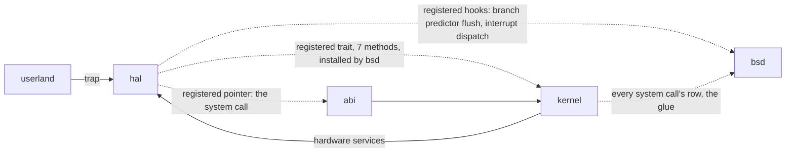
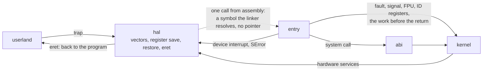
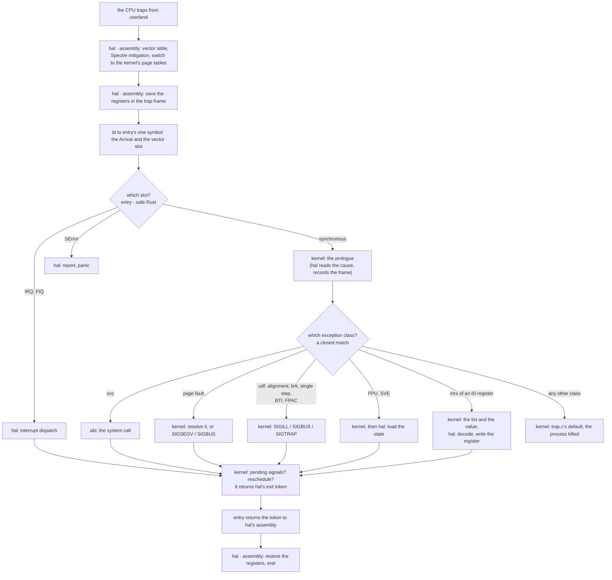
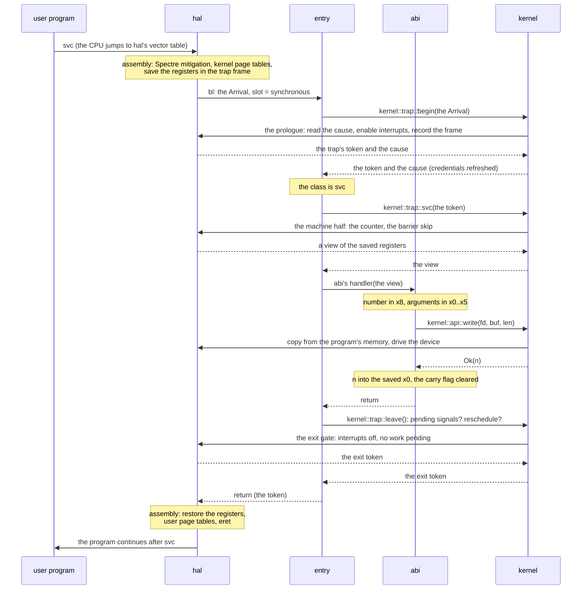
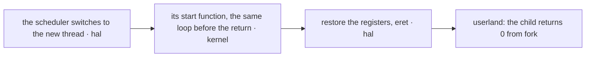

# The userland door: `sys/entry` (decision 56 as amended by decision 58)

**Status: decision 56 as amended by decision 58, which the user signed on 2026-11-27. E0
(coverage, the bench row) and E1 (the way out) are built and on `main` (`c46ea94e`). E2 (the
crate) is redesigned here and is not on `main`.** E2 was built once under decision 56's first
shape, on a branch that was never merged (tip `400c1071`); on 2026-11-27 the user changed its
design (section 10), and the work resumes with the register round trip (section 11). Decision 20 is not amended. Until E2 lands the tree is as section 1 describes.
Nothing here changes what userland sees. arm64 only (decision 44).

## 1. The problem

Today a user program enters the kernel image through `hal`, and `hal` calls upward through
pointers registered at boot:



`hal` is meant to be the bottom layer. On `main` (`c46ea94e`, E0 and E1 built) the first
instruction a user program's trap runs is `hal`'s (`sys/hal/arch/arm64/trampoline.S:134`),
`hal` decides what the trap means (`sys/hal/arch/arm64/trap.rs:620`, `do_el0_sync`), and from
there it calls upward:

- `abi`'s system call handler, a pointer in a `hal` static (`sys/hal/syscall.rs:206-210`,
  called from `enter`, `:234`), which `abi` registers at boot (`sys/abi/lib.rs:107-108`);
- the seven methods of `TrapHandler` (`sys/hal/cpu/trap.rs:91-111`), which are the kernel's
  but are installed by `bsd` (`sys/bsd/kern/hal_bridges.rs:438`); the kernel itself calls one
  of them through `hal` to reach its own code (`sys/kernel/syscall.rs:474-479`);
- `bsd`'s `CpuHooks`, interrupt dispatch and debugger; the kernel's thread start; the symbol
  `pmap_setttb` of `bsd` (`sys/hal/arch/arm64/cpuswitch.S:74`).

E1 removed two of the plan's fifteen upward entry points (the child's `ChildFn` and
`TrapHandler::child_return`). `bsd` is in the path in one more way until N9: every system
call, translated or not, ends in a row of `bsd`'s table (`sys/kernel/api.rs:77-81`).

What is wrong is the registered pointers and the dispatch going up. Which crate holds the
first instruction is not.

The user's two rules (2026-11-27; they replace the two of 2026-11-26):

1. "todo trap desde userland lo clasifica y lo despacha solo `entry`, con llamadas directas
   hacia abajo; nada se registra en runtime". Every trap from userland is classified and
   dispatched by `entry` alone, with direct calls downward; nothing is registered at run
   time.
2. "`kernel` nunca llama a `entry`; `hal` lo alcanza solo por un único símbolo resuelto al
   enlazar, desde su assembly, y no guarda ningún puntero". `kernel` never calls `entry`;
   `hal` reaches it only through one symbol resolved at link time, from its assembly, and
   stores no pointer.

The rules they replace, for the record: "userland never enters `hal` directly" and "neither
`kernel` nor `hal` calls `entry`". The user's reason for the change: "Mover los vectores y el
guardado EL0 a `entry` parte en dos crates el par guardar/restaurar, hace que la prueba de
solidez de `hal` dependa de assembly ajeno, obliga a enmendar la decisión 20 y no se sostiene
en amd64. Lo que me importa es eliminar los punteros registrados y que el despacho baje, no
de qué crate es la primera instrucción."

## 2. Background: what a trap is

A user program runs with the CPU unprivileged (EL0 on arm64). Three things take the CPU away
from it:

- it asks for a service: the `svc` instruction, a **system call**;
- it does something the CPU refuses: touches memory that is not mapped (a **page fault**),
  runs an illegal instruction, uses the FPU before its state is loaded;
- a device wants attention: an **interrupt**.

In all three the CPU does the same thing by itself: it becomes privileged (EL1) and jumps to
an address it reads from one of its own registers (`VBAR_EL1`). That address is the **vector
table**: a small table of code, one slot per kind of event. Nothing has been saved yet: the
program's registers are still in the CPU. So the first code that runs must store them in
memory before any ordinary function can be called. The stored copy is the **trap frame**
(31 general registers, the program counter, the stack pointer and the flags). Going back is
the reverse: load the registers from the trap frame and execute `eret`.

That first code is assembly by necessity, and no compiler can check it. It is `hal`'s, with
the code that undoes it. Everything after it can be ordinary safe Rust.

## 3. What `entry` is

`entry` is the crate that decides where a trap from userland goes. It is safe Rust with no
assembly. It does two things and nothing else:

1. **Classifies the event.** `hal`'s assembly calls it with the `Arrival` (the trap frame, in
   a type nothing else can make) and the vector slot the CPU took. `entry` matches on the
   slot and, for a synchronous trap, on the exception class `hal` read from the CPU.
2. **Hands the event to its owner** with ordinary calls, downward: `abi` for a system call,
   `kernel` for everything else a program can cause, `hal` for a device interrupt and an
   SError. It ends by asking the kernel for the work before the return and gives `hal`'s
   assembly the exit token the kernel got from `hal`'s gate.

It does not receive the CPU, save or restore a register, or touch the frame. It decides
nothing about the operating system, keeps no state, and no Rust code can call it.



Every arrow between crates points down but one: the call `hal`'s assembly makes into `entry`.
It is a `bl` to a symbol, resolved when the image is linked. Nothing is registered for it and
no address of `entry` is stored anywhere.

### Inside `entry`



### What it handles, and what it does not

| `entry` handles | How |
|---|---|
| Which vector slot the CPU took (synchronous, IRQ, FIQ, SError) | A `match` with four arms on the slot `hal`'s assembly passes |
| Which exception class a synchronous trap is | A closed `match` on the class, fixed when the kernel is built (the lock, section 5) |
| The hand-over | Direct calls down: `abi`, `kernel::trap` or `hal`; one event, one owner |
| The token for the return | Returned to `hal`'s assembly as the function's result |

| `entry` does not handle | Who does |
|---|---|
| The vector tables, the Spectre-BHB sequences, the page-table switch, the arrival stubs | `hal`'s assembly, as today |
| Saving and restoring the program's registers, `eret` | `hal`'s assembly, both halves in one file, as in the C |
| Reading the CPU's cause registers, enabling interrupts, recording the frame, the barrier skip of a system call | `hal`, callable only with the `Arrival` |
| Which register holds the system call number, the arguments, the result, the error flag | `abi` (OpenBSD's convention, `sys/abi/arch/arm64.rs`) |
| What a system call does | `kernel` |
| Which signal a fault becomes, whether a page fault can be resolved, what a class means inside (an alignment fault among the data aborts, an ID register among the `mrs` traps) | `kernel` (`kernel::trap`) |
| Which identification registers a program may read, and their values | `kernel` (the list and the values); `hal` decodes the instruction and writes the register |
| The loop before the return (signals, rescheduling) | `kernel`, over a gate of `hal`'s that closes the race with an interrupt |
| Reading and writing the program's memory (`copyin`, `copyout`) | `hal`, called by `kernel` |
| Page tables, the FPU state, the interrupt controller | `hal` |
| Building a signal's frame on the user stack, `sigreturn`, `ptrace`'s registers, `exec`'s first registers | `hal`, called by `kernel` |
| A trap taken while the kernel itself runs | `hal`'s own handlers, as today: `entry` takes no part |
| Any state (a static, a lock, a counter) | Nobody: `entry` has none |

### Which addresses are involved

Three at run time and one at link time; none of them is an address of `abi`, and none of
`entry` is ever stored.

1. **The vector table's address.** It lives in the CPU register `VBAR_EL1`. The tables are
   `hal`'s: `hal` loads the address of its own table, by its own label, on the way back to
   the program (`sys/hal/arch/arm64/exception.S:213-224`).
2. **The trap frame's address.** Where `hal`'s assembly saved the registers, on the thread's
   kernel stack. `hal` records it in the thread's control block so that `kernel` and `hal`
   can read and change the program's registers (a system call's result, a signal, `ptrace`,
   `fork`). `entry` carries it as the `Arrival`, opaque, and passes it on.
3. **The program's own addresses** inside the frame (its program counter and stack pointer)
   and in a system call's arguments (the buffer of a `write`). `entry` never sees them;
   `abi` wraps the arguments in typed user pointers and `kernel` asks `hal` to copy.

At link time `hal`'s assembly names one symbol of `entry`, the function it calls after the
save. The linker writes the call's offset into the `bl` instruction. `entry` names `abi`,
`kernel` and `hal` the way any Rust function names another: direct calls the linker resolves.
No pointer to `abi`, `kernel` or `entry` is stored anywhere. That is the change: today `hal`
keeps `abi`'s dispatcher in a static that `abi` fills at boot (`set_handler`), and the
kernel's trap functions in another that `bsd` fills.

## 4. The flows

### A system call



Until N9, `kernel::api::write` still runs the call's row in `bsd`'s table (the
`LegacySyscalls` bridge), and `kernel::trap` reaches the kernel's own functions through a
table `bsd` installs, because the kernel is generic over `bsd`'s glue (section 9, Gap 6).

### The other arrivals

Every path starts `userland -> hal (vectors, save) -> entry` and ends `-> kernel (the loop
before the return) -> hal (restore, eret)`. Between them:

| Event | Path |
|---|---|
| Page fault in the program | `entry -> kernel (kernel::trap, uvm_fault) -> hal (page tables)` |
| Illegal instruction, alignment, breakpoint, single step, BTI, FPAC | `entry -> kernel (the signal)` |
| First use of the FPU, SVE | `entry -> kernel -> hal (load the state)` |
| A read of an identification register | `entry -> kernel (is it on the list, its value) -> hal (decode, write the register, advance the pc)` |
| Any class the list does not name | `entry -> kernel (trap.c's default: the process killed with SIGILL)` |
| Device interrupt while the program runs | `entry -> hal (dispatch) -> the drivers' handlers` |
| SError while the program runs | `entry -> hal (report, panic)`: no return |
| Fault or interrupt while the kernel runs | `CPU -> hal -> kernel`, as today: `entry` takes no part |

### A new thread's first run

A child of `fork` (or a new thread, or process 1 after its first `exec`) has never trapped,
so it does not come through `entry`. It starts in the kernel and leaves through `hal`:



The child's return value (0, error flag clear) is OpenBSD's convention, so `abi` owns it, as
a constant (`CHILD_RETURN`: which register, which value, the flag). The image's boot glue
hands it to the kernel once; at each fork of a child that returns to userland the kernel
passes it to `hal`, which writes it into the child's saved registers while it builds them.
No call goes upward. Built so in E1 and unchanged by decision 58:
`abi::arch::arm64::CHILD_RETURN` (`sys/abi/arch/arm64.rs:132`), handed to
`kernel::proc::fork::init` (`sys/bsd/kern/hal_bridges.rs:444`); `cpu_fork` passes it in a
`hal::cpu::thread::UserStart` (with the user stack and TCB) to `thread_setup`, whose
`build_frames` writes it; the kernel's `child_return` unlocks and calls `mi_child_return`;
`thread_start` (`sys/kernel/proc/fork.rs:359`) runs `kernel::trap::user_exit` and returns its
`UserExit` to `hal_proc_trampoline` (`sys/hal/arch/arm64/cpuswitch.S:101-105`), which
branches to `hal_user_first_return` (`sys/hal/arch/arm64/exception.S:279-281`).

## 5. The rules, and what enforces them

`entry_user_trap`, `UserVector` and `UserTrapFn` are the names E2 built (`sys/entry/arch/arm64/trap.rs`,
`sys/hal/arch/arm64/usertrap.rs`).

| Rule | Enforced by |
|---|---|
| R1 (the user's rule 1). Every trap from userland is classified and dispatched by `entry` alone | `hal`'s four EL0 handlers do nothing between the save and the restore but call `entry`'s symbol. `hal-check` H8 (new): each `handle_el0_*` holds exactly one `bl entry_user_trap`; no function `do_el0_sync`, `do_el0_error`, `arm_cpu_irq_el0` or `arm_cpu_fiq_el0` and no macro `do_ast` is defined under `sys/hal/`. H7 (new): `Arrival`, `SyncTrap` and `IdRead` are named outside `sys/hal/` only under `sys/entry/` and in `sys/kernel/trap.rs` |
| R2 (rule 1, second half). The calls go down and nothing is registered for them | `set_handler`, `SyscallFn`, `HandlerInfo`, `abi_init` and `TrapHandler` are deleted and `hal-check` refuses their return anywhere under `sys/`. `entry-check` L3: no `static`, no function pointer type, no `dyn`, no registration under `sys/entry/` |
| R3 (the user's rule 2). `kernel` never calls `entry`; `hal` reaches it through one symbol resolved at link time, from its assembly, and stores no pointer | Cargo: nothing depends on `entry` but the image crate. `entry-check` E2: no `pub` item, no path `entry::` outside it. `hal-check` H8: the symbol appears under `sys/` only at its definition and as the operand of `bl` in `hal`'s `.S` files; never in an `adr`, `adrp` or `ldr`, a Rust `extern` block, a `link_name`, a string or a linker script. The external symbols `hal`'s assembly may reference are a list of two: this one, and `bsd`'s `pmap_setttb` with its date (section 9, Gap 6) |
| R4. The only `unsafe` in `entry` is the attribute that exports that symbol | The compiler: `#![deny(unsafe_code)]` at the root, one `#[allow(unsafe_code)]` on the exported item. `entry-check` E1: no `.S` file, no `global_asm!`, no `asm!` under `sys/entry/`. E3: one `allow(unsafe_code)`; the item is `#[unsafe(no_mangle)] extern "C" fn entry_user_trap(Arrival, UserVector) -> UserExit`; no other `unsafe` token, no `extern` block, no `export_name`, `link_section`, `link_name`, `naked` or `used`. `unsafe-report --check`: `entry` `unsafe` at most 1, `asm` 0 |
| R5. `entry` decides nothing and remembers nothing | `entry-check` E4: no `static`, no lock, no cell, no `loop`, `while` or `for`. E5: it names `abi` only as `abi::arch::current::svc`, `kernel` only as `kernel::trap`, `hal` only as the `Arrival` with its `irq`, `fiq` and `serror`, `UserVector`, `UserExit`, and the exception class constants |
| R6. The lock (the user, 2026-11-27). The `match` on the exception class is closed and fixed when the kernel is built. `svc` goes to `abi`'s one entry function; a fault, `udf`, `brk`, a single step, an alignment fault, an identification register's read, the FPU and SVE traps, BTI and FPAC go to `kernel::trap`'s function of that class; an IRQ, an FIQ and an SError go to `hal`. A class the list does not name takes `trap.c`'s `default:` through `kernel::trap`. No table, no function pointer, no registration: a new system call or identification register changes `abi` or `kernel`, never `entry` | `entry-check`, one failing fixture per rule: (a) L1, the door of E5; (b) L2, the `_` arm of the class match is `kernel::trap::unknown` and nothing else, and the slot match has no `_` arm; (c) L3, as R2 |
| R7. The save and the restore of the program's registers agree | They are in one file of one crate, as in the C. Measured, not scanned: the register round trip of `diff-openbsd` (section 8), equal to OpenBSD before anything moves and at the close. It replaces the first design's `entry-check` E8 |
| R8. On a trap from userland `hal` calls upward only what is listed | Deleted: the registrations that reach `abi` and the kernel's seven trap methods. Left, each with its date: `entry`'s one symbol (permanent, a link-time call); `bsd`'s branch predictor hook and interrupt dispatch (N7); the registered interrupt handlers, the kernel-mode fault handler and the thread start (permanent) |

What `entry-check` no longer has: E6 (the symbols `entry`'s assembly may reference), E7 (the
order of `entry`'s tables against `hal`'s `BhbMitigation`) and E8. `entry` has no assembly, so
there is nothing for them to read.

## 6. What moves

No assembly changes crate. Against `main` (`c46ea94e`):

| Today (`sys/hal/arch/arm64/`) | After |
|---|---|
| `trampoline.S` whole: the Spectre-BHB sequences, the nine tables, `tramp_return`, the arrival stubs (`:47-236`) | stays in `hal`, unchanged |
| `exception.S`: `save_registers`, `restore_registers`, `disable_ss`, `allow_ss`, `return`, the kernel's own table and `handle_el1h_*` (`:41-120`, `:148-224`, `:296-315`) | stays in `hal`, unchanged |
| `exception.S`: the `bl` of each `handle_el0_*` to a `hal` handler (`:232`, `:244`, `:256`, `:268`) | `mov x1, #slot` and `bl entry_user_trap`: the one symbol, four call sites |
| `exception.S`: the AST loop (`do_ast`, `:122-146`, used at `:233`, `:245`, `:257`) | no assembly: the masked test is `hal`'s exit gate (built in E1), the loop is the kernel's, run inside the call |
| `exception.S`: `hal_user_first_return` (`:279-281`) | stays, as E1 built it |
| `trap.rs`: `do_el0_sync`'s `switch` (`:620`), `do_el0_error` (`:691`), the IRQ and FIQ entries from EL0 (`:763`, `:768`) | `entry`: the slot match and the class match, calling down |
| `trap.rs`: the prologue of `do_el0_sync` (the cause registers, the interrupts, the counter, the frame), the interrupt dispatch from userland, the SError report | stays in `hal`, behind `Arrival` (`begin`, `irq`, `fiq`, `serror`) |
| `trap.rs`: what each class does (`udata_abort` at `:388`, the signals, the `default:`), `ast` (`:718`) | `kernel` (`kernel::trap`), on the trap's token |
| `trap.rs`: `emulate_msr` (`:472`) | three pieces (section 9, Gap 5) |
| `syscall.rs`: `svc_handler`'s machine half | stays in `hal`, behind the trap's token (`SyncTrap::svc`) |
| `hal::syscall`: `SyscallFn`, `HandlerInfo`, the static, `set_handler` and `enter` (`sys/hal/syscall.rs:167`, `:191-234`) | deleted; `ChildReturn` (`:176`) stays |
| `cpu/trap.rs`: `TrapHandler`'s six methods for a trap from userland and `syscall_return` (`sys/hal/cpu/trap.rs:91-111`) | become `kernel::trap`, the kernel's own door, reached through a table `bsd` installs until N9; the kernel-mode page fault stays in `hal`'s trait, renamed `KernelFault` |

`sys/abi/lib.rs` loses `abi_init`; its handler is a function `entry` calls.
`sys/kernel/trap.rs` grows into the door. The linker script is not touched. `sys/` holds
seven directories: `entry`, `abi`, `kernel`, `hal`, `lib`, `bsd`, `boot`.

```
sys/entry/
  Cargo.toml        depends on abi, kernel, hal, sysdefs; only the image names it
  lib.rs            #![no_std], #![deny(unsafe_code)]; no pub item
  arch/arm64/
    trap.rs         the exported function (the one allowed item), the slot match,
                    the class match: abi, kernel::trap or hal; then the kernel's exit loop
  arch/amd64/       at N10
```

The shape of the export, in `entry` and in `hal`:

```rust
// hal, sys/hal/arch/arm64/usertrap.rs
#[repr(u64)] pub enum UserVector { Sync = 0, Irq = 1, Fiq = 2, SError = 3 }
// entry, sys/entry/arch/arm64/trap.rs
#[allow(unsafe_code)]
#[unsafe(no_mangle)]
extern "C" fn entry_user_trap(a: Arrival, v: UserVector) -> UserExit {
    match v {
        UserVector::Sync => sync(a),                              // the class match, then leave()
        UserVector::Irq => { a.irq(); kernel::trap::exit() }
        UserVector::Fiq => { a.fiq(); kernel::trap::exit() }
        UserVector::SError => a.serror(),                         // never returns
    }
}
```

The slot is an enum of `hal`'s, so the match has four arms and no default. The values are
`const` operands of `hal`'s own assembly; that the assembly passes one of the four is part of
its contract, as "x0 is the frame" is. The function is not `pub`: rustc gives a `no_mangle`
function external linkage whatever its visibility, so no Rust code can call it and the linker
still finds it.

## 7. What does not change

- What userland sees: nothing. The same system calls, signals and register contents.
- Every instruction of the arrival and of the return but two per trap: `mov x1, #slot` is
  added, and `do_ast`'s inline loop becomes the kernel's loop over `hal`'s gate. A third
  only if the user takes Gap 2's proposal (`hal`'s exit masks the interrupts itself).
- The trap frame's layout, the Spectre-BHB mitigations, the page-table switch on every
  crossing, the trampoline's pages and how `hal` maps them, the linker script.
- Decision 20: `hal` is the only crate with assembly and with `unsafe` blocks. `kernel` and
  `abi` stay `#![forbid(unsafe_code)]`. `entry` is `deny` with one allowed attribute and no
  `unsafe` block, function, impl or assembly.
- `Arrival`, the exit gate and `UserExit`, `kernel::trap`, the child's return as data: as
  decision 56 designed them, and as E1 and the E2 branch built them.
- The bench criterion (+10 %, decision 43) and the coverage criterion (the new steps equal to
  OpenBSD before anything moves).

## 8. Cost, risk and how it is measured

- `unsafe`: `entry` `unsafe 1` (the `no_mangle` attribute, counted as kind Other,
  `tools/xtask/src/unsafereport.rs:94-95`) and `asm 0`. `hal`: 236 on `main` and 236 on the
  branch's tip; 236 expected (an estimate), under its ceiling of 600. The export adds nothing
  to `hal`.
- Rules: `.claude/rules/abi.md` (the registration goes), a new `entry-check`, two new rules of
  `hal-check` (H7, H8), `unsafe-report`'s line for `entry`. No amendment of decision 20.
- Size of what is left (an estimate, from `docs/ZERO_UNSAFE.md` 0.5's measured pace): the
  round trip 1.5 to 2.5 h and 0.4 to 0.6 M subagent tokens; the E2 rework, with the same
  redesigner resumed and one review, 2 to 4 h and 0.9 to 1.5 M; the documents 1 h and 0.3 to
  0.4 M; the close 1.5 to 2.5 h and 0.2 M. In all 6 to 10 h and 1.8 to 2.7 M.
- Risk: the hottest path of the kernel, and every boot crosses it. A mistake stops every
  smoke at once; a slowdown does not show by itself, so it is measured:

| Per ordinary system call | The C | `main` (E0, E1 built) | After E2 |
|---|---|---|---|
| Indirect calls besides the row (translated / legacy) | 0 | 6 / 5 | 5 / 4 |
| Borrows of the trap frame | - | 4 | 4 |
| Tests of the vector slot | 0 (four handlers) | 0 | 1 (`mov x1` in assembly, one `match` in `entry`) |
| `daif` writes | 3 | 3 | 4: the exit's own `msr daifset, #3` (`sys/hal/arch/arm64/exception.S`, first instruction of `hal_user_return` and `hal_user_first_return`), which decision 58 keeps so `hal`'s exit proof is local (the gate's token no longer has to mean "masked"); measured by `nullsys` at the close |
| Exit of an interrupt from userland, no work pending | inline | inline | one direct call, the gate inlined |
| One AST | 3 direct calls | 1 indirect | 1 indirect |
| A child's first exit | 2 direct calls | 0 indirect | 0 indirect |

  The gain per system call is one indirect call (`abi`'s handler); the five or four left go
  at N9, with the glue and the table (a line for `docs/ROADMAP.md`'s N12 row). No lock and no
  interrupt-level transition is added or removed against the C: the interrupts are enabled in
  the prologue and for the system call as in `trap.c` and `syscall.c`, and the kernel lock is
  taken only before `sigexit` in the default arm
  (`reference/openbsd-src/sys/arch/arm64/arm64/trap.c:453-454`). The slice walks no list or
  tree. No host benchmark crosses the trap (there is none on the host), so the measure is the
  QEMU bench before and after, debug and release, three runs on AC: `nullsys` (built in E0),
  `pipe`, `pagefault`, `forkexit`, `forkexec`. Before is `main` when the rework starts. A row
  over +10 % without a measured cause stops the work (decision 43).

Coverage of what moves:

| What | Covered by | State |
|---|---|---|
| A signal's handler and `sigreturn` | `smoke-boot`, `diff-openbsd` (signals) | covered |
| `fork`, `wait`, SIGSEGV on a fault | `smoke-boot`, `diff-openbsd` (procs) | covered |
| `__tfork` | `smoke-thrsleep` | covered, smoke only |
| SIGBUS for a file-backed fault | `diff-openbsd` (mmapfile) | covered |
| SIGILL (`udf`), SIGTRAP (`brk`), SIGBUS for a misaligned `sp`, an FP instruction | `diff-openbsd` syscalls/entry#2 (E0) | covered |
| The sixteen identification register reads, two refused ones, the carry kept | `diff-openbsd` syscalls/entry#3 (E0), on `neoverse-n2,sve=off` | covered |
| The registers a program gets back after a trap | the register round trip, syscalls/entry#4 | new, first step of the rework |
| Single step, BTI, pointer authentication, SError from userland; the two firmware Spectre-BHB tables | none | gap, kept and named |

### The register round trip

One more step of `difftest`'s `entry` scenario, `difftest syscalls regs`, a set of its own
after `idregs` so no step id moves. Four cases, each in a child. An assembly routine fills
the registers with a pattern, lets the event happen, stores every register and compares.
Printed per case: its name and `ok`, or the first register that differs; never a value. It runs on EmiBSD and on OpenBSD, on both CPU models E0 uses (`cortex-a72`, whose
table is `loop_8`, and `neoverse-n2,sve=off`, whose table is `loop_32`).

| Case | The event | Left out of the pattern, and why |
|---|---|---|
| (a) a system call | `getppid` from an `svc` the test pins in its own `.openbsd.syscalls` table, as libc pins its stubs (an unpinned site is SIGABRT, `sys/sys/syscall_mi.h:55`; `getpid` is libc's and a second entry would unpin it) | nothing: `x0` is compared with the parent's pid and the carry is expected clear (`reference/openbsd-src/sys/arch/arm64/arm64/syscall.c:60-61`); `x1`, `x8` and every other register must be unchanged |
| (b) a resolved page fault | a load from one untouched anonymous page and a store to another | nothing: the base register holds their address and the stored word is checked |
| (c) an interrupt during a loop | a loop of 2^27 steps that leaves the flags alone | nothing: the loop's counter is expected to be 0. That an interrupt landed cannot be seen in the registers: the loop's length makes it certain |
| (d) a signal handler with `sigreturn` | `brk #2`, caught on an alternate `MAP_STACK` stack; the handler steps over the `brk` and overwrites `x0`-`x18`, NZCV, `V0`-`V31`, FPSR and FPCR | nothing: `sigreturn` restores `x0`-`x30`, `sp`, the pc and NZCV, and the signal trampoline `V0`-`V31`; FPSR and FPCR are expected to hold the handler's values, because OpenBSD's trampoline reads them back with `mrs` where `msr` was meant (`reference/openbsd-src/sys/arch/arm64/arm64/locore.S:390-392`). The step pins that behaviour, which is OpenBSD's |

Three things hold for every case, on OpenBSD as here:

- `sp` is a known address inside a `MAP_STACK` mapping, not a free pattern: the kernel checks
  it at every system call and fault (`difftest`'s `stackpivot` case).
- TPIDR_EL0's pattern is installed with `__set_tcb(2)`. The C reloads TPIDR_EL0 from the
  thread's `pcb_tcb` at every context switch and never saves it
  (`reference/openbsd-src/sys/arch/arm64/arm64/cpuswitch.S:62`), so a value a program writes
  with `msr` does not survive a switch on OpenBSD itself.
- FPCR and FPSR take a pattern of bits a program can write (the rounding mode, FZ and DN; the
  cumulative flags and QC).

It runs first, on `main`, before the rework's branch exists. A difference it finds on `main`
is a bug that exists today (E1's way out is in it) and is fixed first, in its own commit.

## 9. The seven gaps the user asked to close

| Gap | State | How | The two rules of 2026-11-27, to the letter |
|---|---|---|---|
| 1. The way in and the way out are mixed | resolved differently | nothing is cut: both halves stay in `hal`'s one file; one symbol crosses, `hal -> entry` | kept |
| 2. The exit | resolved (E1, built) | `entry`'s function returns to `hal`'s assembly; the kernel runs the loop over `hal`'s gate | kept; no stack frame is abandoned |
| 3. The child's return value | resolved (E1, built) | `abi`'s constant, written while the child's registers are built | kept |
| 4. amd64 | simpler; two events left to N10 | every stub stays in `hal`; the user arm calls `entry` | kept as written; the first design's caveat is gone |
| 5. The identification registers | resolved (built on the branch, under the lock) | `entry` classifies, `kernel` holds the list and the values, `hal` decodes and writes | kept |
| 6. `bsd` in the path | resolved for `entry`, not for `bsd` | `kernel::trap`, a door that is not generic | rule 1 holds for `entry`'s own calls; three registrations remain below it, each with its date |
| 7. Measurement | resolved, with the coverage gaps named | section 8 | not applicable |

### Gap 1: nothing is cut

The first design cut `hal`'s two assembly files by block and gave `entry` the way in. The cut
left the EL0 register save in one crate and its restore in another, with a scan
(`entry-check` E8) to hold them together. Decision 58 removes the cut: `save_registers` and
`restore_registers` stay side by side in `sys/hal/arch/arm64/exception.S` (`:41-73`,
`:75-120`), as in the C's `exception.S`, and the round trip measures the pair on the machine.

What crosses between crates is one symbol, `hal -> entry`: the function `hal`'s four EL0
handlers call. `entry -> hal` in assembly: none (`entry` has none). `kernel -> entry`: none.

`hal`'s frame premise (`sys/hal/arch/arm64/trap.rs:99-111`) keeps its owner. Today it reads
"every handler here is reached only from the assembly of `exception.S`, with `x0` the trap
frame it just saved". After E2 the handler of an entry from userland is `entry`'s function,
and the premise reads: an `Arrival` exists only as the first argument of the one call
`hal`'s EL0 handlers make, with the frame they just saved. The assembly that establishes it
is `hal`'s own. What the proof takes from `entry` is one fact: the function behind the symbol
has the signature the assembly assumes (the `Arrival` first, the slot second). Safe Rust in
`entry` could write another signature under the same name, and the linker would not object.
Decided with decision 58 (the planner's addition, which the user accepted): `hal`
publishes the type, `pub type UserTrapFn = extern "C" fn(Arrival, UserVector) -> UserExit`,
and `entry` pins its function to it with `const _: UserTrapFn = entry_user_trap;`. The
compiler then refuses a wrong signature, and `entry-check` E3 holds the line's presence. It
is a compile-time coercion, not a stored pointer; L3 allows that one line.

Rejected: the vectors in `entry` (the first design: section 10); a macro of `hal`'s that
expands to the exported function inside `entry` (the signature would be `hal`'s text and
`entry` would count 0, but the `unsafe` item would still exist in `entry`'s expansion and
the count would hide it); four exported symbols, one per slot (the user's rule 2 says one).

### Gap 2: the exit

`entry`'s function returns normally to `hal`'s assembly, which restores the registers: every
Rust frame has unwound, and no path that does not return is added (`kill` and `serror`
diverge today, into `exit1` and `panic`). The race with an interrupt (a signal posted after
the check and before the `eret`) is closed by `hal`'s exit gate
(`sys/hal/cpu/usertrap.rs:72-95`): interrupts off, the pending-work flag tested, and off
until the `eret`. The loop around the gate is the kernel's, for a trap and for a new thread
alike: one mechanism, and `hal` calls nobody for it. Verified by reading the path from the
gate to the `eret` on the branch (four function returns, then `hal`'s `allow_ss`, restore,
`return` and `tramp_return`): no instruction unmasks IRQ or FIQ.

Stated plainly: that is a reading, not a type. The token is a value; it does not hold the
interrupts masked. `hal`'s restore is unsound if an interrupt is taken between its writes of
`ELR_EL1`/`SPSR_EL1` (`sys/hal/arch/arm64/exception.S:88-89`) and the `eret`
(`sys/hal/arch/arm64/trampoline.S:196`), so `hal`'s exit trusts the kernel functions and
`entry`'s function that carry the token to return at once. This is so since E1, for a new
thread's first return (`sys/hal/arch/arm64/exception.S:272-281`). Decided with decision
58 (the planner's addition, which the user accepted): `hal`'s exit masks IRQ and FIQ itself (`msr daifset, #3`, one instruction, first
in the exit), so its proof is local; the token then only means "the check was made". Cost: a
fourth `daif` write per return where the C has three, measured by `nullsys`.

Rejected: a `hal` function that never returns, called from Rust (no safe signature can
require that the discarded frames hold no guard); the loop in assembly (a new thread's first
exit would then need `hal` to call the kernel).

### Gap 3: the child's return value

Built in E1; decision 58 changes nothing here. Nothing userland can see reads a forked
child's registers before it has run. Checked in the C: `ptrace` reads a thread's registers
only once the thread stopped itself (`reference/openbsd-src/sys/kern/sys_process.c:866-868`);
a core dump reads them only after every thread suspended itself
(`reference/openbsd-src/sys/kern/kern_sig.c:1832`, `:2337`); no sysctl reads them; `ddb`'s
`show registers` is the debugger's own frame
(`reference/openbsd-src/sys/arch/arm64/arm64/db_interface.c:60-94`). Here `ptrace` and core
dumps are not ported; when they are, the invariant is: another thread's registers are read
only once it stopped itself, and `hal`'s accessor refuses a thread that has not run.

### Gap 4: amd64 (N10; nothing of amd64 is built, decision 44)

Facts, in the C and in this tree's ports (all still in `bsd`, `sys/bsd/arch/amd64/amd64/`;
`sys/hal/arch/amd64/` holds `include/`, `pmap/` and `mod.rs` only): one interrupt table
serves both rings. Every exception stub goes through `alltraps`, which tests the ring the CPU
came from (`reference/openbsd-src/sys/arch/amd64/amd64/vector.S:478-479`) and whose user arm
calls `usertrap` and leaves through `intr_user_exit` (`:489-499`). Every interrupt stub
starts with `INTRENTRY`, which makes the same test
(`reference/openbsd-src/sys/arch/amd64/include/frameasm.h:67`). The system call's entry is
userland's alone (`Xsyscall`, `reference/openbsd-src/sys/arch/amd64/amd64/locore.S:543`,
`call syscall` at `:554`). The exits are `sysretq` (`:652`, `:663`) and `iretq`
(`intr_user_exit`, `:747`).

Under the first design the shared stubs would have been `entry`'s, so every kernel-mode
interrupt and fault would have run `entry`'s ring test: rule 2 held only as "no call". Under
decision 58 the stubs are `hal`'s and that problem is gone: the ring test stays in `hal`, and
only its user arm calls `entry`. The two rules for amd64:

1. Every trap the CPU takes at CPL 3 (an exception whose stub's ring test finds the user
   selector, an interrupt whose `INTRENTRY` finds the same, and `Xsyscall`) is classified and
   dispatched only by `entry`, with direct calls downward: `hal`'s stub saves the frame and
   calls `entry`'s one symbol; `entry` calls `abi` (the system call), `kernel::trap` (the
   trap's function) or `hal` (the interrupt's dispatch). Nothing is registered at run time.
2. `kernel` never calls `entry`. `hal` reaches it through one symbol resolved at link time,
   named only in the user arm of its stubs and in `Xsyscall`, and stores no pointer to it:
   the IDT's gates and `LSTAR` hold `hal`'s stubs, never an address of `entry`.

Left for the user at N10: the non-maskable interrupt and the double fault. The C serves both
on a path of their own, on dedicated stacks, with no ring test and `kerntrap` for either ring
(`vector.S:122-149`, `:288-289`). Either they stay outside rule 1 (the C's model: a
non-maskable or abort event is not a trap from userland), or their stubs gain a ring test and
a user arm that calls `entry` (a difference from the C on its most delicate path).
Recommended: outside rule 1. The machine check is not a third case: its stub goes through
`alltraps` (`vector.S:369`, the `ZTRAP` of `:104-105`), so it has a user arm in the C and
follows rule 1 as written.

What the arm64 types leave open for amd64. `Arrival` is "the frame of a trap from user mode",
made on the user arm only. `UserVector` is per machine: arm64's four slots; amd64's stubs
already store the trap number in the frame, so its second argument may be only "system call,
trap or interrupt". `UserExit` and the gate never name the returning instruction: `sysretq`
or `iretq` is `hal`'s choice in its tail (`locore.S:573-575`). An interrupt's dispatch is a
function (`Arrival::irq`), so amd64's `Xintr_*` bodies, shared today with kernel-mode
recursion, are split at their user path: an N10 design item, not a blocker. The symbol's
name is the same on both machines.

### Gap 5: the identification registers

Today `emulate_msr` (`sys/hal/arch/arm64/trap.rs:472`; the C's
`reference/openbsd-src/sys/arch/arm64/arm64/trap.c:220-310`, called at `:407-408`) answers
sixteen reads: the CPU's model, a fixed value that hides the topology, the feature registers
the kernel computed, and zeros. Anything else, and every write, is SIGILL.

As built on the E2 branch, under the lock (which sends the class to `kernel::trap` and so
amended decision 56's U7, where `abi` held the list): `entry`'s match has one arm,
`EXCP_MSR => kernel::trap::msr`. `kernel` holds what is announced, the list and the values
in one `match (crm, op2)`, as `trap.c`'s `switch` (`kernel::trap::id_value`, `None` for a read
not answered; the five computed values are the kernel's statics, which `bsd`'s CPU code fills
until its slice; `MIDR_EL1` is read live through the closure `msr` passes). `hal` holds the
instruction: the decode of the trapped `mrs` (`SyncTrap::id_read`), the write of its
destination register and the pc's advance (`id_answer`, which consumes the trap's token), and
the live read of the CPU's model (`midr`). A read that is not on the list falls to the FPAC
arm's SIGILL, as the C's fall-through does. `abi` takes no part: a new identification
register changes the kernel's match, never `entry` and never `abi`.

Proof that userland sees the same: E0's step reads each of the sixteen registers and two that
are refused, against OpenBSD. On the branch's tip it was equal on both CPU models (158 steps,
155 equal, 3 expected, 0 unexpected).

### Gap 6: `bsd` in the path

`entry` cannot name `bsd`'s glue, and the kernel's functions are generic over it. So the
kernel has a door that is not generic, `kernel::trap`, as `kernel::api` is for `abi`: plain
functions over a table the kernel owns and `bsd` fills until N9 (`UserTraps`, a row of
`bridges.toml` paid at N9, with `KernelFault`). What becomes of each upward entry point:

| Registration | With decision 58 | Until |
|---|---|---|
| `SyscallFn` (to `abi`) | deleted: `entry` calls `abi` | gone at once |
| `TrapHandler`: the user page fault, the signal, the exit, the credentials, the return work, the AST, the system call return | `kernel::trap`, called down by `entry` or by the kernel's own loop | the table `bsd` fills goes at N9 |
| `TrapHandler`: the kernel-mode page fault | stays in `hal`, as `KernelFault` (a kernel-mode trap) | permanent |
| `CpuHooks` (branch predictor flush, SError) | stays: `entry -> kernel -> hal -> bsd` on a trap from userland | N7 |
| The interrupt dispatch | stays: `entry -> hal -> bsd` on an interrupt from userland | N7.2a2/a3; the drivers' handlers are permanent |
| The debugger, the thread start | unchanged: not the way in from userland | N9, permanent |
| `pmap_setttb` (a symbol of `bsd` that `hal`'s context switch calls, `sys/hal/arch/arm64/cpuswitch.S:74`) | unchanged: the switch, not the door. It is the second external symbol on `hal-check` H8's list | with `bsd`'s arm64 glue, N7 to N9 |
| new: `entry`'s one symbol | a link-time call from `hal`'s assembly; no registration | permanent |

Stated plainly, after E2 and while `bsd` exists. Rule 1's "nothing is registered at run
time" holds for what `entry` calls: three direct calls. Below them three registrations
remain. `kernel::trap`'s functions reach the kernel's own code through the table `bsd`
installs, until N9. On a trap from userland `hal` still calls up to `bsd` (the branch
predictor hook and the interrupt dispatch, until N7; after that to the registered interrupt
handlers, for ever). Every system call runs `kernel -> bsd` (the row) `-> kernel`, until N9.
None of these calls `entry` or `abi`. Rule 2's "one symbol" holds for `entry`; `hal`'s
assembly names one more symbol above it, `pmap_setttb`, until `bsd`'s arm64 glue moves.

### Other points

- The pages mapped while a user program runs are `hal`'s, as today: the tables and
  `tramp_return`, between `hal`'s own labels (`sys/hal/arch/arm64/exception.rs:158-186`).
  `entry` contributes nothing to them, and its code is not mapped while a program runs.
- The image keeps `entry` without help: `hal`'s object holds an undefined reference to the
  symbol, and the image crate names the crate (`extern crate entry as _;`, a row of
  `docs/SCAFFOLDING.md` until N9's image). No `EXTERN` and no `KEEP` in the linker script.
  Built so at E2: `llvm-nm` of the dev kernel shows `entry_user_trap` defined once (`T`).
- `entry` has no host form (there is no trap on the host): off the machine the crate is
  empty, and `hal`'s reference exists only in arm64 assembly, so the host builds see no
  undefined symbol. The kernel's half is tested on the host; the classification is tested on
  the machine by `diff-openbsd`.
- Checked with DevTools' rustc on the branch: `extern "C" fn(Arrival) -> UserExit` compiles
  under `deny(warnings)` with `hal`'s `UserFrame` `#[repr(transparent)]`; built at E2 with the
  second parameter, `#[repr(u64)]` `UserVector`, and the item-level `#[allow(unsafe_code)]` over
  `#[unsafe(no_mangle)]` under the root's `deny(unsafe_code)`: no warning, no other allow.

## 10. What the user decided

On 2026-11-26 the user took decision 56 and the plan's ten points as recommended ("dale con
las recomendaciones para u1 a u10"). On 2026-11-27 the user decided twice more.

**The lock (2026-11-27, inside E2; option 1).** A closed, compile-time list of EL0 exception
classes in `entry`'s match, each with one destination; no table, function pointer or
registration; three `entry-check` rules. It is R6 of section 5. It moved the identification
registers' list from `abi` to `kernel` (Gap 5). It applies unchanged under decision 58.

**Decision 58 (2026-11-27, signed by the user the same day).** The two rules of section 1
and the design of this document: all the assembly stays in `hal`; `entry` is safe Rust behind
one exported symbol; decision 20 is not amended; the register round trip replaces
`entry-check` E8. The user's words: "Cambio de rumbo para E2 de docs/ENTRY.md. E0 y E1 quedan
como están construidos." The full row is `docs/PHASE2.md`'s.

What became of the ten points:

| | Decision of 2026-11-26 | After decision 58 |
|---|---|---|
| U1 | Decision 56: the crate `entry`, amending decision 20; `hal`'s proof cites `entry`'s assembly; `hal` writes the address of `entry`'s tables to `VBAR_EL1` | Amended: `entry` exists; decision 20 is not amended; `hal`'s proof cites `hal`'s assembly; the tables are `hal`'s. Of U1's three consequences only the `deny` root is left |
| U2 | `abi` registers nothing | Stands: `set_handler`, `SyscallFn`, `HandlerInfo`, `abi_init` go (`ChildFn` went in E1) |
| U3 | A separate `asm` number per crate; `entry` `unsafe 0, asm 1` | The `asm` column stands. `entry` is `unsafe 1, asm 0` (the user, 2026-11-27) |
| U4 | Coverage before the move | Stands, built (E0); the register round trip joins it |
| U5 | The forked child's return value is `abi`'s constant | Stands, built (E1) |
| U6 | `bridges.toml` rows for the two tables `bsd` fills | Stands (`UserTraps`, `KernelFault`, paid at N9) |
| U7 | The identification registers: the list in `abi` | Amended by the lock: the list is the kernel's |
| U8 | `bsd`'s raw write of `exec`'s registers fixed | Stands, built (E1) |
| U9 | The benches run at this work's own close | Stands |
| U10 | amd64 left to N10, option A recorded with a caveat on rule 2 | Replaced: no option A or B; the stubs are `hal`'s; the caveat is gone; NMI and the double fault are N10's question |

The first design, for the record. Decision 56 as signed put the vector tables, the arrival
stubs and the EL0 register save in `entry`, in one `global_asm!`, with a linker section for
the pages userland runs with. It was built on a branch (six commits, tip `400c1071`), booted
and passed the smokes and `diff-openbsd`, and was never merged. Why it was withdrawn is the
user's reason in section 1. Three of its commits are reused as they are (section 11).

## 11. Steps

1. Survey: done. 2. Plan: done. 3. The decisions of 2026-11-26: taken.
4. E0 (coverage, the `nullsys` row) and E1 (the way out): built, on `main`. E1 as built:
   `hal::cpu::usertrap::{ExitGate, UserExit, AstPending}` (the gate reads the running
   thread's slot with one `unsafe`, `hal::cpu::thread::with_current_slot`);
   `kernel::trap::{ast, user_exit}`, generic over the glue; a trap's return still runs
   `exception.S`'s `do_ast`, whose `ast()` asks the kernel once; `ChildFn` is gone;
   `SyscallFn`, `HandlerInfo` and `abi_init` stay until E2; `setregs` writes the frame
   through `hal::cpu::trap::set_exec_regs`.
5. Decision 58: signed on 2026-11-27, with the planner's points taken as recommended
   (the count, the two symbols of `hal-check`, the registrations that stay with their
   dates, `UserTrapFn`, the exit's own mask, the round trip as OpenBSD's rules allow it, row 56 appended).
6. The register round trip, before anything moves: built (`ea6469cb`, syscalls/entry#4).
   Equal to OpenBSD on both CPU models: 159 steps, 156 equal, 3 expected, 0 unexpected.
7. The E2 rework, on a fresh branch from `main`; the first branch is its source and is not
   merged. In order, each commit building:

| Commit | From the first branch | What changes |
|---|---|---|
| `hal: the user trap behind Arrival` | `e7c4507f`, reworked | keeps `Arrival`, `SyncTrap`, `Syndrome`, `UserFrame` `repr(transparent)`; adds `UserVector`; drops the linker section, its bounds, `EXTERN` and the `ASSERT` |
| `kern: kernel::trap, the door a trap from user mode calls down` | `52226b0f`, as it is | nothing |
| `xtask: the crate entry in unsafe-report and lz check` | `38fb9a6d`, small rework | `entry`: `unsafe` at most 1 where it was 0, `asm` 0 where it was at most 1 |
| `entry: the classification behind one exported symbol` | `8bd07641`, reworked | no `vectors.S`, no `vectors.rs`; the four handlers become one exported function with the slot match; `hal`'s EL0 handlers call it; `hal`'s `do_ast`, `ast` and the EL0 handlers' Rust go. Kept as built: the closed class match, `kernel::trap`'s per-class functions, the identification registers |
| `hal: KernelFault, the trap handler of kernel mode alone` | `5ad8213f`, as it is | nothing |
| `abi: nothing is registered` | `400c1071`, as it is | `abi.md`'s first paragraph reworded |
| `xtask: entry-check and hal-check's upward symbol` | new | E1-E5 and L1-L3 with a failing fixture each; H7, H8; `abi-check`'s list loses the three registration items |

   One review, with its `Security-Review:` text (the system call entry is a
   `security-review.md` area). The work stops and asks if: the symbol is missing from the
   image, dev or release, without help from the linker script; the `allow` on the item does
   not lift the lint, or the function's signature warns; a smoke or `diff-openbsd` line
   changes; `hal`'s count rises; a file under an `amd64` directory would be touched.
8. E3, the documents and the rules: this file as built, `docs/PHASE2.md`'s row 58 and the
   sentence on row 56, `docs/ZERO_UNSAFE.md` 0.1 and `README.md`'s diagrams, `abi.md`,
   `xtask.md`, the rows of `docs/IDIOMS.md` (the token `hal`'s assembly passes; the closed
   match; a link-time call from the hardware crate's assembly in place of a registration),
   `docs/GLOSSARY.md` and `docs/SCAFFOLDING.md` (`UserTraps`' `dyn` and the image's
   `extern crate entry`, both N9), N10's and N12's rows of `docs/ROADMAP.md`.
9. The close: every smoke, `diff-openbsd` on both CPU models, the bench pair, one release
   build with `llvm-nm` (the symbol defined once, by `entry`'s object; the tables and the
   handlers `hal`'s).

## Words

| Word | Meaning |
|---|---|
| trap | The CPU leaving a user program for the kernel: a system call, a fault or an interrupt |
| vector table | The table of code the CPU jumps to on a trap; its address is in `VBAR_EL1`. `hal`'s |
| vector slot | Which of the table's entries the CPU took: synchronous, IRQ, FIQ or SError. `hal`'s assembly passes it to `entry` |
| trap frame | The saved copy of the interrupted program's registers, on the thread's kernel stack |
| `Arrival` | The value `hal`'s assembly passes to `entry` with a trap from userland: the trap frame, in a type nothing else can make |
| the one symbol | The exported function of `entry` that `hal`'s assembly calls. The linker resolves it; no pointer to it exists |
| the lock | The closed `match` on the exception class in `entry`: every class has one destination, fixed when the kernel is built |
| exit gate | `hal`'s check, with interrupts off, that no work is pending before the return to a program |
| exit token | What the gate returns when it is clear; `entry` returns it to `hal`'s assembly |
| `eret` | The instruction that goes back to the interrupted program |
| AST | "Asynchronous system trap": work the kernel does just before going back to a program (deliver a signal, give the CPU to another thread) |
| EL0, EL1 | arm64's unprivileged and privileged levels: userland and the kernel |
| Spectre-BHB mitigation | A short sequence run on every arrival from userland so a program cannot steer the kernel's branch predictor; which sequence depends on the CPU model, hence nine tables |
| register round trip | The `diff-openbsd` step that fills a program's registers with a pattern and compares them after a trap, here and on OpenBSD |
