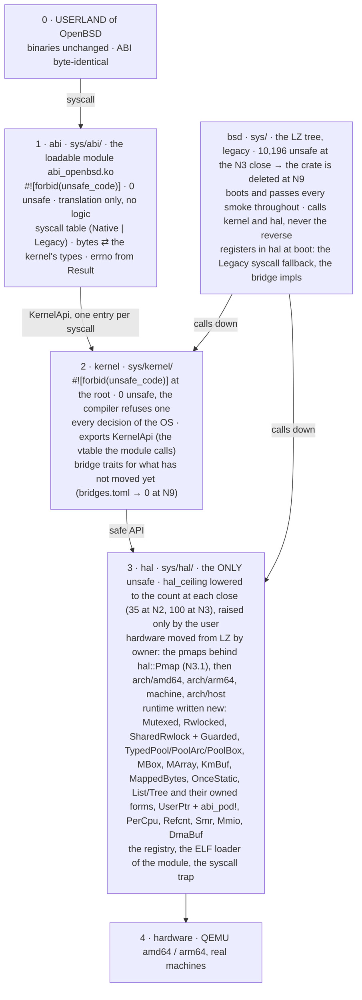
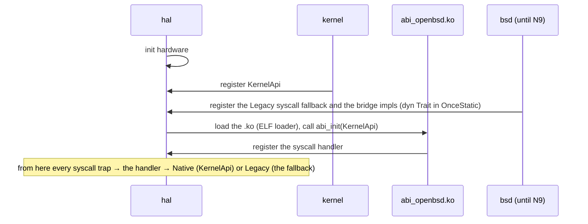

# Zero unsafe in the kernel

The kernel is a crate the compiler refuses to build with one `unsafe` in it; the only `unsafe`
of the system lives in a small HAL below it, proved site by site; an ABI crate above it keeps
OpenBSD's userland interface byte-identical and decides nothing. Section 0 is the plan in force (v2,
2026-10-16); section 10 is the decisions log; v1's sections are in docs/ZERO_UNSAFE_V1.md.

## 0. v2 (2026-10-16): the kernel is a crate with no `unsafe`

Decisions 20 and 21 (section 10) replace the shape of sections 4, 6 and 7: the kernel is not
"the LZ tree with a listed core", it is a **new crate with `#![forbid(unsafe_code)]` at its
root**, and the LZ tree is what that crate replaces. Everything below here is the plan in force;
v1 and its measurements are docs/ZERO_UNSAFE_V1.md.

### 0.1 The four crates

The one diagram of the architecture. Every other drawing (a chat, a slide, a session's notes)
is a copy of this one or wrong.

The arrows go down only. What goes up (the module's syscall handler, `KernelApi`, the bridge
implementations, the `Legacy` fallback) is never a dependency: it is a registration in `hal`'s
registry at boot, and this is the whole of it:

Dependencies, one direction: `bsd → kernel → hal`; `abi → hal` and `abi → KernelApi` (the
vtable `hal` hands the module at load). Nothing names `abi`; `kernel` and `abi` never name
`bsd`. Arrows up (the syscall handler, `KernelApi`, the bridge implementations, the `Legacy`
fallback) exist only as registrations in `hal`'s registry, made by `bsd`'s `main()` at boot.

| Crate | Path | `unsafe` | Holds |
|---|---|---|---|
| `hal` | `sys/hal/` | the only `unsafe` of the system, every site with a soundness proof, Miri on its host tests | the hardware primitives (page tables, traps, context switch, the interrupt level, ports and MMIO, caches, `bus_dma`'s hardware side, early boot: moved in from `sys/arch` and `sys/machine` with the kernel owner of each boundary, decision 26; the drivers of `sys/arch` go to `kernel::dev`, decision 28), the host test double (`sys/arch/host`), the constant headers of `sys/sys/` (decision 27: 18 at N2, `types.rs` at N3.1), the pmaps behind `hal::Pmap` (N3.1), and the runtime written new: `Mutexed<T>`, `Rwlocked<T>`, `SharedRwlock` with `Guarded` cells and witnesses (locks that own their data), `TypedPool<T>`/`PoolArc<T>`/`PoolBox<T>`, `MBox<T>`, `MArray<T>`, `KmBuf` (owned memory), `MappedBytes` (a byte view of busy frames, N3.4), `OnceStatic<T>` (the init-once static that replaces `StaticCell`), `List`/`Tree` over `'static` elements (N3.3) and the owned intrusive trees and lists (N3.5), written new for `kernel::vm` (`queue.rs`, `tree.rs`, `subr_tree.rs` stay in `bsd` for their legacy users), `PerCpu<T>`, `Smr`, `Refcnt`, `UserPtr<T>` with `abi_pod!` (typed copyin/copyout), `Mmio<Regs>`, `DmaBuf`, the interrupt-level guard, the console primitive, the bridge registry |
| `kernel` | `sys/kernel/` | **0**, `#![forbid(unsafe_code)]` at the root: the compiler refuses any | every decision the operating system makes: memory (vm), processes, scheduler, signals, descriptors, kqueue, pipes, VFS and the file systems, the network stack, the drivers' logic, crypto, pf, pledge, unveil, exec. Its own types, ownership first, no C shape |
| `abi` | `sys/abi/`, built as the loadable module `abi_openbsd.ko` (decision 22) | **0**, `#![forbid(unsafe_code)]` (the user allowed `unsafe` here; none is needed: `UserPtr` is safe) | OpenBSD's userland interface, byte-identical: the syscall table, the `#[repr(C)]` structs (`stat`, `kevent`, `sockaddr`, `kinfo_*`, ...), ioctl and sysctl encodings, errno (the constant headers through `hal`, decision 27). Translation only (decision 21): bytes to the kernel's types, one kernel entry point per syscall, the `Result` to an errno; no check on what a value means, no state |
| `bsd` | `sys/` (the LZ tree, today's crate) | 10,196 in 1,069 files at the N3 close (`unsafe-report`, 2026-10-18; 10,583 in 1,103 at the N2 close, 10,604 in 1,161 before N2): 1,538 of them the hardware, the host double and the lists and trees that have not moved yet, the other 8,658 legacy (8,501 outside `unsafe-core.toml`) (a file counts as `hal` only once it compiles there), **0 files at N9** | what gets replaced. It keeps booting, running every smoke and `diff-openbsd` throughout; it links the three crates and calls down into them; the kernel crate never calls it except through a registered bridge (0.3) |

The boot loaders (`sys/stand`, `sys/lib/libsa`, `sys/arch/*/stand`: 621 `unsafe`) are separate
binaries that run before the kernel; they are outside the four crates and unchanged. `libkern`
and `libz` stay crates of their own, leaves below `hal`; `StaticCell` stays in `libkern` (`hal`
depends on it, so it cannot move up) and `hal::OnceStatic` replaces its uses one by one.

Dependencies, one direction: `bsd -> kernel -> hal`; `abi -> hal` (for `UserPtr`) and `abi -> KernelApi` (the vtable `hal` hands it at load, decision 22); nothing names `abi`, plus `libkern`/`libz` under
`kernel`. `hal` depends on nothing of ours but `libkern`. No cycle: a kernel-to-legacy call is a bridge.

### 0.2 What the compiler guarantees

- `cargo build` of `kernel` or `abi` with one `unsafe` anywhere, in any module, under any
  `cfg`, fails: `#![forbid(unsafe_code)]` cannot be overridden below the root. There is no
  allow list, no core list, no per-module attribute.
- `hal`'s API is safe: an `unsafe fn` in `hal` is `pub(crate)`. `cargo xtask hal-check` fails
  `just check` on a `pub unsafe fn`, on an `unsafe` block without a `// SAFETY:`, and on a
  `hal` count above `hal_ceiling` in `unsafe-budget.toml` (lowered by `--write`, never raised
  without the user).
- `abi` holds no logic: `cargo xtask abi-check` fails `just check` on a function of `abi` that
  branches on anything but the syscall number, its own conversion's `Ok`/`Err` and the byte
  layout, that calls more than one `kernel` entry point, or that exceeds the per-syscall line
  limit (decision 21).

### 0.3 The migration mechanism

1. **A subsystem moves, it is not patched.** The unit of work is still one owner module (or
   cluster) of the ROADMAP row: the surveyor inventories the LZ module and the C, the planner
   writes the brief, the redesigner writes the subsystem **in `kernel`** from the C's behaviour
   (LZ's shape is reference, never the starting text), deletes the LZ module from `bsd`, and
   leaves in `bsd` at most a call-site adapter with 0 `unsafe` (`adapted`, `adapted_by` the
   kernel module) until the callers move too.
2. **Bridges, for the kernel's calls into what has not moved yet.** `kernel` declares a trait
   (`pub trait Vfs`, `pub trait Sockets`, ...) and holds it in a `hal::OnceStatic<&'static dyn
   Trait>`; `bsd` implements it over its legacy code and registers it in `main()` before first
   use. Every bridge is a row of `bridges.toml` (`trait`, `for`, `paid_by` = the milestone whose
   subsystem removes it); `cargo xtask` counts them; N9 requires 0. A bridge carries no logic
   of its own (the same rule as `abi`). A trait a crate declares and receives as a value
   (`hal::pmap::PhysPages` passed to `bootstrap`, `kernel::pipe::PipeGlue` the pair's generic
   parameter) is API, not a slot: it is a row only while `bsd` implements it, and the row goes
   at the milestone whose `kernel` module implements it, the trait staying (decision 39).
3. **The syscall table lives in `abi` from N2 on.** Each entry is `Native(fn)` (translation into
   `kernel`) or `Legacy` (the fallback `bsd` registers at boot). A migrated syscall flips its
   entry; `diff-openbsd` and the smokes see no difference, which is the test.
4. **Lineage keeps every provenance rule.** A kernel module is `redesigned` with its `lz` list
   and `//! LZ:` lines; the LZ file it replaces becomes `[[dropped]]` with `absorbed by
   sys/kernel/...`; `lineage.toml` gains `crate`. An LZ change to a dropped file is
   `covered-by-redesign` or `reimplemented` in `kernel` (`lz-sync.md`).
5. **Tests.** `kernel`'s host tests run on `hal`'s host backend; `just check` (build on both
   archs, clippy, fmt, `lz check`, `hal-check`, `abi-check`, `unsafe-report --check`, host
   tests) gates every commit; the smokes, `just ci`, `ci-full` and `diff-openbsd` run at the
   milestone close (the user's rule of 2026-10-16).

### 0.4 The metric

`cargo xtask unsafe-report` prints four numbers and `/progress` shows them per milestone:
`kernel` (always 0, else the build failed), `abi` (always 0), `hal` (today's hardware code plus
the new runtime; the ceiling in `unsafe-budget.toml`, lowered only), and `bsd` (legacy: the
`unsafe` still in the LZ tree, per ROADMAP row). A row is **complete when its files in `bsd`
are 0** (deleted, or a 0-`unsafe` adapter listed as such) and its subsystem answers in
`kernel`. The old `forbid` count is gone: nothing in `kernel` needs marking.

Since decision 44 (2026-10-18) a fifth class exists from N9 on: `frozen`, the amd64 tree
(`sys/arch/amd64/`, `sys/hal/arch/amd64/`, the amd64 implementations of `sys/machine`) left as
it is, `inherited`, outside every crate, until N10 homologates it; `/progress` and
`unsafe-report` print it beside the boot loaders, and a row is complete when its `bsd` files are
0 whatever `frozen` holds. Until N9 those files are still `bsd`'s and belong to N10's row.

### 0.5 Milestones, replanned

Measured on `main` at `47e1c4f` with `/progress`. "Files" and "`unsafe`" are what leaves `bsd`.
The estimate is continuous agent time (sessions open around the clock), from the one slice
measured end to end on 2026-10-16 (the typed slots: 4 h for two series of a mid-size slice);
it is the planning session's number, labelled as such, and `/progress` replaces it once five
active days have moved 100 `unsafe`.

| Milestone | Scope (what moves into `kernel`/`abi`/`hal`) | Files | `unsafe` | Exit (mechanical) | Est. |
|---|---|---:|---:|---|---:|
| **N2 Foundations** (met 2026-10-16; section 0.9) | the crates `hal`, `kernel`, `abi` exist and `bsd` links them; `hal` holds the 24 `bsd`-free machine headers and 18 constant headers of `sys/sys/` (decisions 26, 27; `types.rs` at N3) and the new runtime (locks, pools, `MBox`, `KmBuf`, `OnceStatic`, lists and trees, `UserPtr`/`abi_pod!`, the bridge registry); `abi` holds the syscall table (all `Legacy`); `kernel` holds crypto (28 files, already safe), and the first subsystem by the new path, **pipe(2)** (`sys_pipe.rs`, `pipe.rs`), with bridges to descriptors, kqueue and sigio; `xtask`: `hal-check`, `abi-check`, `unsafe-report` v2, `/progress` v2, `bridges.toml` | 2 + 18 + 24 + 18 | 21 (+ 1 moved into `hal`; + 30 new for the module loader; the hardware's remaining 1,626 move by owner: N3 the pmap cluster ~150, N4 cpu/clock/trap ~740, N7 bus/autoconf/glue ~675, N9 ddb glue and tables ~60; decision 26) | `kernel` and `abi` build with `forbid` at the root; `hal` ≤ 2,150 with every site proved; `sys_pipe.rs` and `pipe.rs` deleted from `bsd`; the 24 + 18 headers under `sys/hal/`; `just ci` and `diff-openbsd` equal (`ci-full` at N3's close, decision 24) | 8.5 d |
| **N3 Memory** (met 2026-10-18, section 0.10) | `sys/uvm/` → `kernel::vm` in owner slices (km, object, anon, amap, aobj, vnode pager, page, pmemrange, addr, map, mmap, glue; `uvm_fault` before the map, re-planned at N3.4, with `security-review.md`); the pmap behind a safe `hal::Pmap` API: no file of the cluster was movable as it stood (all 14 name `bsd`), so N3.1 redesigned the two pmaps into `hal` (the LZ pmap files and `pmap_module.rs` out of `sys/arch`); the two `cpufunc.rs` and `vm_machdep.rs` stay for N4 (decision 26) | 26 + 14 | 215 (measured at the close: `bsd` 10,583 -> 10,196, the `uvm` row gone, `hal` 35 -> 100) | `sys/uvm/` gone from `bsd`; `kernel::vm` answers every `uvm_*` call through its API; `hal::Pmap` has no `pub unsafe fn` | ~15.5 d estimated (N3.1 ~9 and N3.2 ~2 by their planners, items 3-6 of 0.8 4.5); measured: 35 h of wall time, 2026-10-16 23:01 to 2026-10-18 09:49, many agents in parallel |
| **N4 Processes** | `sys/kern/` by owner into `kernel`: timeout, task, event/kqueue, descriptors (`file`, `kern_descrip`), signals, proc, the scheduler, sysctl's core, tty; `StaticCell` uses in `kern` → `OnceStatic` | 75 + 4 (kqueue and descriptors, N2's before) + 97 of `sys/arch` (cpu, clock, interrupts, trap, syscall entry, copy, into `hal`; decision 26) | 680 + 95 (+ 742 moved) | `sys/kern/` in `bsd` holds only the VFS (N5), the sockets (N6) and the N8 files; the bridges `Proc`, `Fd`, `Kq` removed from `bridges.toml` | 15 d |
| **N5 VFS and file systems** | `sys/kern/vfs_*`, `sys/ufs/`, `sys/isofs/`, `sys/msdosfs/`, `sys/nfs/`, `sys/ntfs/`, `sys/tmpfs/`, `sys/miscfs/` → `kernel::fs` | 140 | 816 | those directories gone from `bsd`; the `Vfs` bridge removed | 14 d |
| **N6 Network** | `sys/net/`, `sys/netinet/`, `sys/netinet6/`, the sockets of `sys/kern/uipc_*` → `kernel::net`, except N8's files | 99 | 1,840 | those directories gone from `bsd` but N8's files; the `Sockets` bridge removed | 18 d |
| **N7 Devices** | `sys/dev/` and `sys/scsi/` → `kernel::dev`, one bus at a time, over `hal::Mmio<Regs>` and `hal::DmaBuf`; `sys/dev/rnd.rs` last; the bus, autoconf and ACPI/FDT glue of `sys/arch` (74 files) into `hal`, its 19 drivers into `kernel::dev` (decisions 26, 28) | 383 + 74 | 4,101 (+ 675 moved; 4,124 with `softraid_crypto`, N8's) | `sys/dev/` and `sys/scsi/` gone from `bsd` but `softraid_crypto.rs` (N8) | 44 d |
| **N8 Security subsystems** | `pf*`, `if_wg`/`wg_*`, IPsec, `softraid_crypto`, `pledge`, `unveil`, `exec_*`, the crypto framework → `kernel`, each with `Security-Review:` and the area's smokes before every commit | 36 | 849 | those files gone from `bsd`; `lz drift --security` empty | 8 d |
| **N9 Close** | what is left: `sys/ddb/`, `sys/conf/`, `init/`, the old runtime files (`subr_pool`, `kern_lock`, `kern_rwlock`, `kern_malloc`, `smr`, `percpu`: deleted with their last user), `sys/sys/` emptied into `abi`/`kernel`; the `bsd` crate deleted; the binary is `kernel` + `abi` + `hal`; `bridges.toml` empty; `hal`'s floor recorded with its proof list; Miri green on `hal` | 14 + the old runtime 19 + the ddb glue and configuration tables of `sys/arch` (15) | 28 + 159 (+ ~60 moved) | `sys/` holds `hal/`, `kernel/`, `abi/`, `stand/`, `lib/`; `unsafe-report`: `bsd` does not exist, `kernel` 0, `abi` 0, `hal` = its floor | 5 d |
| **N10 amd64 homologation** (decision 44; after N9) | the compile-and-fix pass of the frozen amd64 tree against `hal`'s and `kernel`'s APIs at N9; the amd64 halves N4 and N7 deferred (cpu, clock, trap, syscall entry, copy; bus, autoconf, the ACPI glue; the amd64 drivers of `sys/arch` into `kernel::dev`); the module window of decision 37; the open amd64 performance of decision 42 (`pagefault` +49 %, the pmap side of the fault, `fileread`); the `deferred-to-N10` LZ records applied | the amd64 tree | its count at N9 | `EMIBSD_ARCHS=amd64,arm64 just ci` rc=0 with the recipes' amd64 expectations unchanged; `ci-full` with the amd64 installer recipes and `cd80.iso`; `diff-openbsd` amd64 0 unexpected; `bench` amd64 at or under its value before N3 per measurement, or a written reason; `frozen` 0 files; no `deferred-to-N10` record open | n/a |
| **N11 Verification** | the gaps deferred on 2026-10-17 after the TRACTOR comparison: the semantic count of unsafe operations beside the syntactic one; the six-dimension idiomaticity rubric as the reviewer's scorecard; an organic and hidden battery (OpenBSD's `regress` through `diff-openbsd`; the clone's widening is the user's); decision 8's renames; `-accel hvf` for arm64 tried once and recorded | 0 | 0 | `unsafe-report` prints operations and keywords; every module redesigned from N11 carries its six scores; the `regress` battery runs with its own `expected.toml`, 0 unexpected; the hvf result recorded | n/a |
| **N12 Performance** | what decision 42 left open, on both archs: the QEMU profile of the fault and of fork (the pmaps in `hal`, the page system's locks under TCG, the trap, the TLB shootdowns), the lookups beyond the C listed for `sys/kernel/vm/map.rs`, `zero_page`/`copy_page` over typed pages | 0 | 0 | `just bench` on both archs: every ratio at or under its value before N3 (`docs/bench/n3-before-<arch>.toml`) or a written reason per measurement; `Bench:` on every commit (decision 43); no new `unsafe`, no check relaxed | n/a |

Total: 8,906 `unsafe` out of `bsd` (8,747 legacy + 159 old runtime files), 580 + 19 files, about **112 days of continuous agent
time** at the measured pace, serial (the slices share files); this number is the planning
session's and promises nothing: `/progress` measures.

What does not change in any milestone: what userland sees (`abi` is byte-identical, the smokes
and `diff-openbsd` are the proof), the LZ sync (`lz-sync.md`, with `covered-by-redesign` for
dropped files), the two architectures on every commit, the per-commit `just check`.

### 0.6 The work in flight on 2026-10-16

The two branches of the typed-slots slice (`worktree-agent-ab058223a74c4dcd6` at `ade1ddb`,
series 0 and 1 reviewed; `worktree-agent-ad1fb0331db500561`, series 2 half done) redesign
inside `bsd`. Under v2 that is not the goal: `bsd` is deleted, not improved. They are **not
merged**; their shapes (`FileData` by value to the close, `CredRef`, the typed hook over `dyn
Any`, `KlistLock`) are reused when descriptors and kqueue move into `kernel` at N4. About
eight hours of agent work set aside by the architecture change; said here so it is not
recounted as progress.

### 0.7 The whole account (measured 2026-10-16 with `unsafe-report --json`)

| Today | `unsafe` | At N9 | `unsafe` |
|---|---:|---|---:|
| LZ code not redesigned (580 files) | 8,747 | rewritten in `kernel`, deleted | 0 |
| old LZ runtime files (19: `subr_pool` 58, `subr_percpu` 16, `kern_malloc` 14, `staticcell` 9, `kern_lock` 8, `smr` 8, `kern_tc` 7, `subr_prf` 7, `percpu` 7, `kern_smr` 6, `kern_subr` 6, `malloc` 3, `kern_rwlock` 2, `mutex` 2, `rwlock` 2, `explicit_bzero` 1, `pool` 1, `refcnt` 1, `systm` 1) | 159 | deleted with their last user; `hal` replaces them | 0 |
| hardware (`arch/amd64` 732, `arch/arm64` 772, `machine` 85; without `sys/arch/*/stand`) | 1,589 | the primitives (1,094) moved into `hal`; the 19 arch drivers (495) rewritten in `kernel::dev` over `hal::Mmio`/`DmaBuf` (decision 28) | 1,094 |
| host test double (`arch/host`) | 38 | moved into `hal` | 38 |
| ours (`queue`, `tree`, `subr_tree`) | 71 | moved into `hal` | 71 |
| new `hal` code, written new, each site proved: N2 runtime 120 + ELF loader 30, N3 `Pmap` ~60 (the two pmaps redesigned into `hal`, not a wrapper over moved code; 40 measured at N3.2's close with `PoolBox`), N4 `cpu_switch`/clock glue 10, N7 `Mmio`/`DmaBuf`/interrupts 60 | 0 | added by the milestone that needs it, a commit each | 230 (estimate) |
| boot loaders (`stand` 235, `libsa` 84, `arch/*/stand` 302), separate binaries | 621 | unchanged | 621 |
| **total** | **11,225** | | **2,054** |

Removed from the repository: 9,171 (8,747 + 159 + 495 − 230). `kernel` 0 and `abi` 0 by the
compiler; `hal` 1,433 by this table (the planner's estimate is ~1,700; both are estimates
until the first cluster moves; the first did at N3.1: the pmap cluster landed in `hal` at about a quarter of LZ's count, so 1,433 is an upper bound), 84 % of it the hardware primitives, the host double and the
lists and trees that exist today; the boot loaders apart. The 2,150 and 2,230 ceilings of 0.1
were set on the 1,891 figure, which counted 302 of boot-loader code; they stand as ceilings,
`unsafe-report --write` lowers them to the measured count, and they rise only in the commit
that adds a listed piece, with the user's OK.

What `cargo xtask unsafe-report` printed before N2 (2026-10-16): `kernel` 0, `abi` 0, `hal` 0,
`bsd` 10,604 (1,698 of them to move into `hal`), boot 621. At the N2 close (the first cluster
moved, pipe(2), section 0.9): `kernel` 0, `abi` 0, `hal` 35 (the runtime and the ELF loader,
ceiling 35), `bsd` 10,583 (legacy 8,726; the hardware's 1,698, one more for amd64's module
window of decision 37, move by owner: the pmap cluster at N3, cpu/clock/trap at N4,
bus/autoconf at N7, the ddb glue and tables at N9), boot 621; total 11,239. The per-close series the planning
session wrote here counted the hardware as `hal` from N2 on; it is withdrawn until the N2.2
decision (the survey of 2026-10-16: 1,627 hardware `unsafe` in 198 files, 36 of them movable
as they stand), and each close records the five numbers the tool prints.

### 0.8 The slices, milestone by milestone

Each slice is one surveyor -> planner -> redesigner -> reviewer -> `just check` cycle; the
smokes, `just ci`, `ci-full` and `diff-openbsd` run at the close. Files and `unsafe` are the
tool's at `47e1c4f`; days are continuous agent time, the planning session's estimate.

**N2 Foundations, 8.5 d.** 1. The crates: `sys/hal/`, `sys/kernel/` and `sys/abi/` with
`#![forbid(unsafe_code)]` on the last two, `bsd` linking `kernel` and `hal`, `just check` green
(0.5 d). 2. The hardware into `hal`, staged (decision 26, 2026-10-16; the survey: 135 of 198 files name
`bsd`, 1,514 of 1,627 `unsafe`): now the 24 `bsd`-free machine headers (1 `unsafe`) and the 19
constant headers of `sys/sys/` (decision 27), `git mv` with the old paths kept by `pub use`
(0.5 d); the pmap cluster with N3.1, cpu/clock/interrupts/trap with N4.1 and N4.5, bus/autoconf
with N7.0-N7.2 (the arch drivers to `kernel::dev`, decision 28), ddb glue and the tables at
N9.1. 3. The runtime, each piece with its first user in `kernel` or in the move:
`List`/`Tree` (not moved: written new with their first `kernel` user), `Mutexed<T>`, `Rwlocked<T>`, `TypedPool<T>`/`PoolArc<T>`, `MBox<T>`,
`KmBuf`, `OnceStatic<T>`, `PerCpu<T>`, `Refcnt`, `UserPtr<T>` with `abi_pod!`, the bridge
registry, the interrupt-level guard, the console primitive; `hal-check` (3 d). 4. `KernelApi`
(the vtable), the ELF loader, `abi_openbsd.ko` with every entry `Legacy` and the 41 constant
headers, the boot loaders and the installer reading two files, `smoke-abi`, `abi-check`,
`unsafe-report` v2 (kernel/abi/hal/bsd), `/progress` v2, `bridges.toml` (2 d). 5. Crypto into
`kernel` (28 files, 0 `unsafe`, already safe) (0.5 d). 6. **pipe(2)** into `kernel`: its own
`Pipe`/`PipePair` over `Rwlocked`, `PoolArc`, `KmBuf`; bridges `Fd` (descriptor and `File`
glue), `Kq` (knote/klist), `Sigio`, `Uio` (the copy); `sys_pipe.rs` and `pipe.rs` deleted from
`bsd`; the two syscall entries flipped to `Native` (1.5 d). 7. Close: `just ci`, `ci-full`,
`diff-openbsd`, docs, push (0.5 d). Out of `bsd`: 21 `unsafe` removed and 1 moved, 62 files (2 + 18 + 24 + 18; the 10 crypto files that
name `bsd` follow their unblockers, the framework at N8).

**N3 Memory, ~15.5 d** (6 d in this plan; the planners' estimates for N3.1 and N3.2 replace
items 1 and 2; met 2026-10-18, as built in 0.10, where the order changed: N3.3 took items 3's
page and pmemrange, N3.4 the owners of item 4 and the fault of item 6, which had to go before
the map, N3.5 item 5 and `uvm_addr`; no N3.6). 1. `hal::Pmap`: a safe typed API over the two arch pmaps
(`enter`, `remove`, `protect`, `extract`, `activate`; `uvm_pmap.rs` is the shape), the page
allocator's hardware side (~9 d: no movable file, two pmaps re-expressed, 55 callers, a
`security-review.md` area); `types.rs` moves in its first commit. 2. `uvm_km` -> `kernel::vm::km`
(~2 d; `uvm_km` holds the `KernelMapper`, so it follows N3.1); re-scoped at N3.2: `uvm_object`
and `uvm_anon` move with item 3's `Page` (one lock protocol with the page's owner fields),
`uvm_extern`'s `Vmspace` and `uvm` with item 5. 3. `uvm_page`, `uvm_pmemrange`, `uvm_addr`
with `uvm_object` and `uvm_anon` (86 `unsafe` + 13, the free lists over `List`/`Tree`;
`kernel::vm::Page` implements `PhysPages` and embeds `PageMd`) (1.5 d). 4. `uvm_amap`, `uvm_aobj`, `uvm_vnode`, `uvm_pager` (61; bridge `Vfs` for the
vnode pager) (1 d). 5. `uvm_map`, `uvm_mmap`, `uvm_glue`, `uvm_io`, `uvm_meter`, `uvm_percpu`,
`uvmexp`, `uvm_init`, `uvm_pdaemon`, `uvm_swap`, `uvm_unix` (bridge `Proc` for the current
vmspace, `Swap` for the device) (1.5 d). 6. `uvm_fault`, `security-review.md`, its smokes before
every commit (0.5 d). Out of `bsd`: 215 `unsafe`, 26 files; `sys/uvm/` deleted.

**N4 Processes and scheduling, 12 d.** 1. `kern_timeout`, `kern_task`, `subr_extent` (hal: the
clock interrupt as a registered handler) (1 d). 2. `kern_proc`, `kern_prot` (credentials, the
`CredRef` shape), `kern_fork`, `kern_exit`, `kern_resource`, `kern_sysctl`'s core (2 d). 3.
Descriptors: `sys/sys/file.rs`, `kern_descrip.rs`, `sys_generic` (the `FileData` shape; the `Fd`
bridge of N2 removed) (1.5 d). 4. kqueue: `kern_event.rs`, `sys/sys/event.rs` (the typed hook
over `dyn Any`, `KlistLock`; the `Kq` bridge removed) (1.5 d). 5. `kern_sig`, `kern_synch`,
`kern_sched`, `sched_bsd`, `kern_kthread`, `kern_smr`'s logic (the sleep queues and run queues in
`kernel` over `hal::cpu_switch`; the `Sigio` bridge removed) (2.5 d). 6. `tty`, `tty_pty`,
`tty_tty`, `tty_conf`, `subr_log` (1.5 d). 7. `kern_bufq`, `subr_disk`, `subr_autoconf`,
`subr_hibernate`, `kern_time`, `kern_clock`, `kern_xxx`, `subr_*`, `selftest.rs` rewritten as
`kernel` tests (1.5 d). 8. Close (0.5 d). Out of `bsd`: 699 `unsafe`, 56 files + the 4 of the
old N2 (`kern_event`, `kern_descrip`, `event.rs`, `file.rs`) = 775 in 60 files.

**N5 VFS and file systems, 14 d.** 1. The VFS core: `vfs_subr`, `vfs_bio`, `vfs_lockf`,
`vfs_syscalls`, `vfs_lookup`, `vfs_vnops`, `vfs_cache`, `vfs_init`, `vfs_sync`, `vfs_getcwd`,
`vfs_vops`, `vfs_default`, `spec_vnops` (149; the `Vfs` bridge becomes the kernel's own; bridge
`Disk` to the block drivers until N7) (4 d). 2. `ufs` + `ffs` + `ext2fs` (43 files, 228) (3 d).
3. `nfs` (24, 143; over `kernel::net`'s sockets or the `Sockets` bridge) (2 d). 4. `isofs`
(cd9660, udf; 16, 89) (1.5 d). 5. `msdosfs` (12, 60) and `ntfs` (9, 54) (1.5 d). 6. `miscfs`
(fuse, fifofs, deadfs) (10, 37) and `tmpfs` (7, 24) (1.5 d). 7. Close (0.5 d). Out of `bsd`:
816 `unsafe`, 134 files; those directories deleted.

**N6 Network stack, 18 d.** 1. The core: `if_`, `route`, `rtable`, `art`, `radix`, `rtsock`,
`if_ether`, `if_loop`, `netisr`, `pfkeyv2`'s stub (858 in `sys/net/` minus N8's files; bridge
`Ifnet` to the NIC drivers until N7) (5 d). 2. `netinet`: `in_`, `in_pcb`, `ip_input`,
`ip_output`, `tcp_*`, `udp_usrreq`, `raw_ip`, `igmp`, `ip_icmp`, `if_ether` (38, 465) (5 d). 3.
`netinet6` (25, 355) (4 d). 4. The sockets: `uipc_socket`, `uipc_socket2`, `uipc_usrreq`,
`uipc_syscalls`, `uipc_mbuf`, `uipc_domain`, `sys_socket` (9, 155; `mbuf` over `TypedPool`;
the `Sockets` bridge removed) (3 d). 5. Close (0.5 d). Out of `bsd`: 1,840 `unsafe`, 95 files.

**N7 Devices, 40 d.** 0. `hal`: `Mmio<Regs>`, `DmaBuf`, typed interrupt handlers, `bus_space`
and `bus_dma` behind them, the autoconf attach protocol as safe traits (3 d). 1. `dev/pv` first,
virtio: every smoke boots on it (12, 249) (3 d). 2. `dev/pci` core and `ppb`, then `dev/ic`'s
shared chips with their `pci` front ends, bus by bus (`com`, `pckbc`, `ahci`, `nvme`, `em`,
`ix`, `re`, `vmx`, `mpi`, `azalia`, `auich`, `eap`, `vga`, ...) (135, 1,401; the `Ifnet` and
`Disk` bridges removed as each driver moves) (14 d). 3. `wscons` + `rasops` + `wsfont` (47,
611) (4 d). 4. `usb` (43, 528) (5 d). 5. `acpi` (18, 205), `fdt` + `ofw` (15, 115), `isa` (19,
106) (4 d). 6. `scsi` (10, 149), `ata` (9, 82), `sdmmc` (13, 110), `softraid` (9, 218; 8 and 195 without
`softraid_crypto`) (4 d). 7. `audio`, `midi`, `mii`, `ipmi`, `gpio`, `i2c`, `hid`, `rd`, `vnd`,
`bio`, `cons`, `puc`, `efi`, `clock_subr`, `firmload`, `microcode` (2 d). 8. `dev/rnd.rs` last,
`security-review.md` (0.5 d). 9. Close (0.5 d). Out of `bsd`: 4,101 `unsafe`, 383 files (408 with `mod.rs`; measured by the
legacy-hardware study of 2026-10-17, decision 41). Honest
limit: a driver no QEMU device exercises is verified by `just check` and its host tests only;
the list of those drivers goes in the close commit.

**N8 Security subsystems, 8 d.** Every commit with `Security-Review:`, the area's smokes and
`diff-openbsd` before it. 1. pf: `pf`, `pfvar`, `pfvar_priv`, `pf_table`, `pf_ioctl`,
`pf_norm`, `pf_if`, `pf_osfp`, `pf_lb`, `pf_ruleset`, `pf_syncookies` (already safe), `if_pfsync`,
`if_pflog`, `if_pflow` (3 d). 2. WireGuard: `if_wg`, `wg_cookie`, `wg_noise` (1 d). 3. IPsec:
`ip_ipsp`, `ip_esp`, `ip_ah`, `ip_ipcomp`, `ipsec_input`, `ipsec_output`, `pfkeyv2`,
`pfkeyv2_convert`, `pfkeyv2_parsemessage` (2 d). 4. `kern_pledge`, `kern_unveil`, `exec_*` and
the ELF loader of userland (1 d). 5. The crypto framework: `crypto`, `cryptosoft`, `criov`,
`cryptodev`; `softraid_crypto` (0.5 d). 6. Close (0.5 d). Out of `bsd`: 849 `unsafe`, 32 files.

**N9 Close, 5 d.** 1. `ddb` (10, 15), `sys/conf/` (3, 2), `sys/reftest.rs`, `init/` (the
stand-in, 11) (1.5 d). 2. The old runtime files deleted with their last user: `subr_pool`,
`subr_percpu`, `kern_malloc`, `kern_lock`, `kern_smr`, `kern_rwlock`, `kern_tc`, `subr_prf`,
`kern_subr`, `staticcell`, `explicit_bzero` and their `sys/sys/` headers (19, 159);
`sys/sys/` emptied into `abi` and `kernel` (1.5 d). 3. The `bsd` crate deleted; the binary is
`kernel` + `hal`; `bridges.toml` empty; `hal`'s floor recorded with its proof list; Miri green on
`hal`'s host tests; `README`, `ARCHITECTURE`, `JOURNAL` (1.5 d). 4. `ci-full`, `diff-openbsd`,
push (0.5 d). Out of `bsd`: 192 `unsafe`, 33 files; `sys/` holds `hal/`, `kernel/`, `abi/`,
`stand/`, `lib/` and nothing else.

Sum: 8,906 `unsafe` and 599 files out of `bsd`; 112 days. Order of risk, highest first: the
sleep/wakeup and run queues over `hal::cpu_switch` (N4.5), the ELF loader (N2.4), the VFS
core's locking (N5.1), `if_` and the routing tables (N6.1); `uvm_map` and `uvm_fault` were N3's
(N3.5, N3.4d).

### 0.9 N2 as built (the close, 2026-10-16)

What 0.8's N2 plan became, measured on the merged tree with the tools.

- **The crates and the headers** (N2.1, N2.2 slice 1): `hal`, `kernel` and `abi` exist, the
  last two `#![forbid(unsafe_code)]`; `bsd` links `kernel` and `hal`. The 24 `bsd`-free machine
  headers and 18 constant headers of `sys/sys/` are `inherited` modules under `sys/hal/`
  (`types.rs` stays in `bsd` until N3). The lists and trees (`sys/sys/queue.rs`,
  `sys/sys/tree.rs`, `sys/kern/subr_tree.rs`) went back to `bsd` after the runtime's review:
  `hal`'s own `List`/`Tree` come with their first `kernel` user.
- **The runtime** (N2.3): `OnceStatic<T>`, `Mutexed<T>`, `Rwlocked<T>` (with `rwsleep` on the
  guard), `PerCpu<T>`, `Refcnt`, `KmBuf`, `TypedPool<T>`/`PoolArc<T>`, `MBox<T>`,
  `UserPtr<T>` with `abi_pod!`, the spl guard, CPU identity, the console primitive and the
  bridge registry (decisions 30, 32-36).
- **The ABI module** (N2.4a): `hal::api::KernelApi`, the dispatch point
  `hal::syscall`, the ELF loader `hal::module`, `abi_openbsd.ko` with the table of 331
  entries; boot(8) and Limine hand it over, every medium carries it but `cd80.iso` until
  its name is settled (decision 29; docs/ARCHITECTURE.md, "abi_openbsd.ko"). On amd64 it
  executes from a window of the kernel's L4 slot, kernel_map keeping the C's NX (decision
  37).
- **Crypto** (N2.5): 18 of the 28 files of `sys/crypto/` in `kernel`, 0 `unsafe`; the 10 that
  name `bsd` follow their unblockers, the framework at N8.
- **pipe(2)** (N2.6), the first subsystem by the new path: `sys/kernel/pipe.rs` (0 `unsafe`),
  generic over `bsd`'s glue through three bridges (`PipeGlue`, `UioMove`, `PipeFiles`, paid by
  N4; not the `Fd`/`Kq`/`Sigio`/`Uio` of 0.8's text); `sys/kern/sys_pipe.rs` and
  `sys/sys/pipe.rs` are gone from `bsd`; `sys/kern/pipe_glue.rs` is the 0-`unsafe` call-site
  adapter; pipe and pipe2 are `Native` in the module's table (`abi_openbsd.ko: 331 syscalls,
  2 native`). `KernelApi` v2 adds `pipe2(nr, fdp, flags)`, which carries the number for
  `pin_check` and pledge.

The glue's deviations, gone at N4 when `File`, `Klist` and `Sigio` are the kernel's:

- The klist and sigio of each pipe live in a glue-allocated `PipeKlists`, recycled and never
  freed: they stay allocated at the peak number of pipes and show under `M_TEMP` in
  `vmstat -m` instead of inside the `pipepl` items. No `diff-openbsd` scenario prints
  `vmstat -m`. Option (i), an `unsafe impl Send` for `Klist` and `SigioRef` in `bsd` so the
  pair could hold them by value, was not taken: it is the pattern decision 30 refused (an
  `unsafe impl` in `bsd` to meet a `hal` bound), and `bsd` gets no new `unsafe`.
- The file's typed slot `File::f_pipe: Mutexed<Option<PipeFile>>` costs one uncontended mutex
  and one atomic per pipe operation; `pipe_stat`'s uid and gid come from the slot (the
  opener's cred, the one `f_cred` holds), since reading `f_cred` needs `unsafe` until N4.
- Both pipe files are `FREAD | FWRITE` in the C, so a file's end travels with its handle
  (`Dir`), never from `f_flag`. The filters read four atomics (state, `peer_alive`, `cnt`,
  `size`) written only under the guard, because kqueue calls them back under the lock
  without a guard (beside decision 12). `sys/kernel/pipe.rs` is one file of about 2,150
  lines (code zone about 1,280), left unsplit.

Open for N3 and N4 (the reviewers' notes; N3 closed the first four, section 0.10):

- On arm64, `ModulePlatform::reserve` maps the module's range read-write in `kernel_map`
  (`km_alloc(KP_NONE)`), so a stray kernel write to a text page goes through `uvm_fault`
  instead of panicking: a `uvm_map_protect` of the range to R/RX after the loop closes it.
  amd64 no longer has the question: its window lies outside every uvm map (decision 37).
- `sys/arch/amd64/amd64/pmap_module.rs` (the window) moves into `hal` with the pmap cluster;
  arm64 then takes a window too, or PXN on its tables, for the symmetry of decision 37.
  A pure `module_leaf` function with `const` asserts would check W^X on every amd64 build.
  `sys/arch/amd64/amd64/pmap.rs` is `adapted` now, so its LZ syncs are
  `cherry-pick-conflicts`.
- `ModulePlatform` is a safe trait and `load` a safe function: a lying `image()` is undefined
  behaviour reached from safe code, accepted as the bridge N3 pays (an `unsafe trait` or
  `hal`-owned code then).
- `release` uses `km_free(KP_NONE)` (`uvm_unmap` -> `pmap_remove`); OpenBSD's `km_free` does
  `pmap_kremove` and `pmap_update` (`reference/openbsd-src/sys/uvm/uvm_km.c:700-711`), an
  `unsafe fn` in `bsd`, so not done until the pmap is `hal`'s.
- `hal::bridges::register_module_platform` is `pub` and the first registration wins (the
  `let _ =` in `sys/kern/abi_module.rs`); so does `kernel::testutil::install` for the test
  doubles. locore0's early tables with `esym` raised by up to 64 MiB were not checked by
  anyone.

Numbers at the close (`cargo xtask unsafe-report`, `hal-check`, `lz check`): `kernel` 0, `abi`
0, `hal` 35 in 72 files (ceiling 35), `bsd` 10,583 in 1,103 files (legacy 8,726, ceiling
8,726; arch/amd64 863, its budget raised by the user for decision 37), boot 621; `forbid` 320
of 1,196 modules; `lz check` 1,156 modules (1,058 inherited, 40 adapted, 58 redesigned), 157
fn rows, 60 extras; 12 bridges open (N3 2, N4 7, N7 1, N9 2).

### 0.10 N3 as built (the close, 2026-10-18)

What 0.8's N3 items became, on the merged tree (d612f9c5), measured with the tools. N3.1 and
N3.2 were integrated and booted once before the rest (the checkpoint 54f48bd4, whose `just ci`
found the two boot defects fixed in 74eabc4d and 6e996212); `sys/uvm/` is gone from `bsd`.

- **N3.0** (621a179d): the module renamed `abi_openbsd.ko` (decision 38), 41 files with the
  cargo package (`abi_openbsd`, since the `.ko` takes its name); `cd80.iso` carries it.
- **N3.1, `hal::Pmap`** (80cdbac9 .. 1fa20789). `types.rs` and the page arithmetic first
  (decision 27); `PoolBox<T>`, the owned pool item of the pv entries and pteds; the API
  (`Pmap`, `PmapRef` a counted handle: `pmap_reference` is a clone, `pmap_destroy` the drop,
  and a last drop with mappings left panics where the C frees; `PageMd`; `PhysPages` passed to
  `bootstrap` as a value, decision 39) with its host backend; the amd64 backend (walks under
  `pm_mtx`, loads only through the `Switcher` token, PTPs without `pm_obj`, the pv chain owned
  by its page) and the arm64 one (a pted owned by its level-3 slot and torn down inside its
  page's `pv_mtx`, the C's 40-byte pted, ASIDs with rollover). Commit 6 moved `bsd`'s 55
  caller files onto it: `sys/machine/pmap.rs` is an adapter over `hal::pmap` with no `unsafe`
  block (its three legacy `unsafe fn` signatures, and arm64's `pmap_kenter_cache`, leave with
  their last caller); the LZ pmap files and `pmap_module.rs` left `sys/arch` (157 `[[module.fn]]`
  rows; no `[[dropped]]`, since `hal` modules list those files in `lz`). Commit 7 gave arm64
  amd64's module window and PXN on `kernel_map`'s tables (decision 37). Commit 8 maps arm64's
  image by section in `hal`'s own tables, text RX, rodata R, data and BSS RW and PXN, nothing
  past `round_page(_end)`, and switches TTBR1 from a one-page identity map as the C does
  (`pmap_map_stolen`, `switch_mmu_kernel_table`): the user's decision of 2026-10-17 ("as the
  C", option (a) of three), closing the inherited 64 MB RW and EL1-executable block of
  boot(8)/efiboot, whose tail past `kernel_end` was uvm's; `kernel.ld` gained OpenBSD's four
  section symbols and an `ASSERT` each. Its fix-up 8b: TTBR1 is the root with ASID 0, no guard
  bit on the image's, the identity page's and the window's leaves (the kernel has no BTI pads),
  PXNTable and UXNTable on the direct map's level-0 slots, where a block entry panics.
- **The kernel pmap's authority is a token** (the N3.1 plan's G8): `hal::pmap::KernelMapper`,
  zero-sized, not `Clone`, returned once by `bootstrap`; its `kenter`, `kremove` and the kernel
  pmap's `enter` are safe, possession being the proof. N3.2 moves it once into
  `kernel::vm::km` (`adopt_mapper`), which lends it to `bsd`'s legacy wrappers only through
  `LegacyLend`, a handle made once and kept by `sys/machine/pmap.rs`.
- **N3.2, `kernel::vm::km`** (5b9db7f0 .. 7aba0866): `km_alloc`/`km_free` in `kernel` over two
  bridges, `KmMaps` (the kernel map's record, until N3.5) and `KmPages` (the frames, until
  N3.3); frees go through `uvm_pmr_freepages` to the free list with its wakeups, in the C's
  kremove-then-free order per 32-page chunk; `TailqHead::pop_head` in `queue.rs` (sys 327 ->
  328, the user's raise); the loader's writable copy is a `ModuleMemory` value and
  `ModulePlatform` keeps only `image`. Re-scoped from 0.8's item 2 (the N3.2 plan's G11): only
  `uvm_km` moved (`sys/uvm/uvm_km.rs` stayed as `bsd`'s adapter, 9 -> 0 `unsafe`, until N3.5);
  `uvm_object` and `uvm_anon` go with N3.3's `Page` (one lock protocol with the page's owner
  fields), `uvm_extern`'s `Vmspace` and `uvm` with N3.5.
- **An inherited deviation, kept visible**: the C's `uvm_km_pages` and its thread (the
  single-page allocator of the machines without `__HAVE_PMAP_DIRECT`, arm64 in OpenBSD) were
  never ported, because LZ gives arm64 a direct map (`HAVE_PMAP_DIRECT`,
  `sys/arch/arm64/mod.rs:371`); `sys/kernel/vm/km.rs`'s Deviations says so and
  the two `unported!` lines stay (`uvm_km_page_init` in `sys/kern/vm_bsd.rs`,
  `uvm_km_page_lateinit` in `sys/kernel/vm/init.rs` since N3.5).
- **Closed from 0.9's open list**: arm64's module range read-write in `kernel_map` (the window
  replaces it, 7a); `pmap_module.rs` in `hal` (`sys/hal/arch/amd64/pmap/window.rs`) and arm64's
  window with PXN (7); `ModulePlatform::reserve`/`enter` removed; `release` removes the
  writable alias with `pmap_kremove` before `km_free(kp_none)`, the C's sequence (N3.2).
- **Still open**: the trusted inputs until their owners type them (`Pmap::enter`'s pa and the
  frames of `zero_page`/`copy_page` until N3.3's `Page`, `KmMaps::map`'s answer until N3.5,
  `BootstrapParams` from the boot glue); both direct maps alias the image's text writable, as
  OpenBSD amd64's does; Limine's HHDM leaf attributes are unchecked (PXN on its level-0 entry
  covers execution); for the user: `Lx_PT_AP01` on arm64's direct-map level-0 entries (beyond
  the C) and the xtask gaps (`lz check` misses a row for an item leaving an `adapted` module,
  `lz trace` lowercases its answer, neither sees `extern` blocks' fns, one `license` per
  module cannot say "one source none"). The 9 MP host-test failures the checkpoint saw went to
  0 with the boot fixes (ae33901a) and decision 40 (b79f0ed2).
- **The boot fixes** (74eabc4d, 6e996212, ae33901a, 799ca7ad): the amd64 kernel window is one
  whole PML4 slot from `roundup(direct_end, NBPD_L4)`, always the C's 512 GiB (Limine's HHDM
  reaches slot 258 on QEMU's 1 TiB map); the pools made before `kmeminit` take a static
  `struct pool` (`NSTATIC_POOLS`, 16 at the close), since the Rust allocator is `malloc(9)`.
- **N3.3, the page system** (8f5e43c0 .. c5a55961): `hal` gained `Link`, `List` and `Tree`
  over `'static` elements (no `unsafe`, a broken precondition panics before anything changes),
  boot memory stolen by `Layout` and the `uvmexp` statistics with their symbol;
  `kernel::vm::page` and `vm::pmemrange` hold the page array (stolen once, never freed), the
  free ranges and the per-CPU magazines; a page's owner is a compared, never dereferenced
  `OwnerTag`; `kernel::vm::Page` implements `PhysPages` and the bridge row went (decision 39).
  The review's K1 (unwiring an entry without an amap panicked, reachable from userland through
  `munlock(2)` and `vslock`) was fixed before the merge (6d90d0f2).
- **Decision 40, one MP kernel** (b79f0ed2 .. 2f861075): the uniprocessor paths of `hal`, the
  page allocator, the two redesigned machdeps and the amd64 pmap deleted (96 owned `cfg` sites
  to 0); `multiprocessor` a default of `bsd` only; `smoke-up` boots that kernel with `-smp 1`;
  the sets keep `bsd` and `bsd.mp`, identical, as before.
- **N3.4, the owners and the fault** (acc64229 .. 5962c446), re-planned after N3.4b found that
  the owners could not flip before the fault held witnesses (the planner's REPLAN, its order
  (ii-A) taken under the user's N3 authority; N3.6 folded into N3.4d/e): `hal`'s
  `SharedRwlock` with `Guarded` cells and read/write witnesses (`RwMode`, `RwWitness`, the
  consumed-guard sleep), `MArray`, `MappedBytes` (a byte view of busy, claimed frames, only
  through the kernel map's token), pool high-water marks; `kernel::vm::anon`, `amap`,
  `object`, `aobj`, `pager`, `vnode` and `fault` (`uvm_fault.c` with witnesses carried through
  the fault loop, generic over a `FaultMap` bridge until N3.5); one flip (69559939) turned the
  six owners and the fault on together, with `smoke-mmap` (tools/mmapstress) new. A new
  difference from the C, recorded in `hal`'s `pmap.rs` and `mapped.rs` Deviations: a
  deactivated multi-page pager window keeps its kernel entry where the C removes it and would
  panic in the middle of a `VOP_WRITE`.
- **N3.5, the map and the rest** (6e795add .. 925cce59): `hal`'s owned intrusive trees and lists
  with a counted secondary link and the augmented red-black tree, `StaticArena`,
  `ForeignWindow` over the `UserCopy` bridge's `kcopy`, `arc4random`, `sched_pause`;
  `kernel::vm::map` and `vm::addr` (the map, the vmspace, the selectors), `mmap`, `unix`,
  `glue`, `io`, `meter`, `init`, `pdaemon`, `swap`, `proc`; the 15 vm system calls (`mmap`,
  `munmap`, `mprotect`, `msync`, `minherit`, `madvise`, `mlock`, `munlock`, `mlockall`,
  `munlockall`, `mquery`, `mimmutable`, `pinsyscalls`, `kbind`, `obreak`) made `Native` in
  `abi` through `KernelApi` v3, so the boot line reads `abi_openbsd.ko: 331 syscalls, 17
  native`; the flip (04eb1108) deleted `sys/uvm/`. LZ's `unported!` on `mprotect` against
  `RLIMIT_DATA` is closed (the C's check; `expected.toml` had no entry for it and keeps its
  three: fifofs, the branding, the coredump); the coredump,
  the swap device and the page daemon stay visible stubs (`vm::swap`, `vm::pdaemon`,
  `vm::unix` Deviations; `unported: uvm_wait` once per boot).
- **`vmstat -m` item sizes** (userland-visible, accepted under the user's N3 authority):
  `anonpl` 48, `rwobjpl` 48 (the C's 40), `amappl` 280, `aobjpl` 128, `uvmvnodes` 136, `bufpl`
  +8 (`b_uobj` is a kernel object), `vmmpepl`/`vmmpekpl` 216 (LZ's 200), `vmsppl` 448 (LZ's
  288), `uaddr`/`uaddrrnd` 16 (24), `uaddrbest` 40 (32).
- **C slips found by reading** (for the user, never reported upstream): `uvm_fault.c:1468-1485`
  (`uvm_anfree` of an anon with `an_ref` 1 after the lock is released, and `amap_populate`
  after the map is unlocked; confirmed by a reviewer, fixed in `kernel::vm::fault`);
  `uvm_aobj.c:428-432` (the swap hash resize, latent with tmpfs and swap); `uvm_pager.c:292`
  with `uvm_page.c:1238` (the window removed under `VOP_WRITE`, probable); `uvm_map.c:2214-2221`
  (early returns that keep the lock under `UVM_LK_ENTER`, unreachable from its caller).
- **Still open after N3**: `MappedBytes`' token contract (no view of a frame that backs kernel
  memory) waits for typed pages (decision 30's extension; `mapped.rs` still says "until N3.5");
  21 bridges (N4 13, N5 2, N6 1, N7 2, N9 3); a diagnostic `bsd` does not compile
  (`sys/dev/usb/ucom.rs`, inherited; N7, the user's answer of 2026-10-17).

Numbers at the close (`cargo xtask unsafe-report`, `hal-check`, `lz check`, 20035fd0 -> the
merge): `kernel` 0 in 48 files, `abi` 0, `hal` 100 in 108 files (`hal-check` 111 files, 100
sites <= `hal_ceiling` 110 before `--write`), `bsd` 10,583 -> 10,196 in 1,069 files (legacy
8,726 -> 8,501; 1,698 -> 1,538 to move into `hal`), boot 621; rows: arch/amd64 863 -> 773,
arch/arm64 943 -> 881, arch/host 38 -> 35, machine 85 -> 79, kern 1,126 -> 1,117, dev/pv 249 ->
246, sys 327 -> 328, uvm 215 -> no row; `forbid` 320 -> 348 of 1,218 modules; `lz check`
1,170 modules (937 inherited, 123 adapted, 110 redesigned), 594 fn rows, 68 extras; 21 bridges
open. Host tests 3,229 -> 3,775 (bsd 2,396, kernel 308, hal 292, abi 9, xtask 260). The close: `just jobs=3 ci` at a043de71: 86 of 86 smokes in 18 min 32 s, rc=1 only at `check-drift` (the record of LZ 602141098d1d named the deleted `sys/uvm/uvm_init.rs`), fixed in 614d65af, the steps after it rc=0; `just jobs=3 ci-full` at 614d65af rc=0 in 2,248 s (its `ci` on four CPUs, 86 of 86 smokes in 21 min 18 s, no retry, then the eight installer recipes); `just diff-openbsd` rc=0 (107 steps per arch, 104 equal, 3 expected, 0 unexpected, as at N2); `just bench` printed 14 of 14 ratios; against the baselines (`bench compare`), the page fault and fork are slower on both machines (amd64 `pagefault` 7,956 -> 12,269 ns, `forkexit` 459,233 -> 680,755 ns; arm64 `forkexit` 1,686,982 -> 2,672,794 ns), boot, pipe and tcpbench unchanged within their spreads but arm64 boot (8.33 -> 8.65 s) and amd64 tcpbench (767.3 -> 787.6 Mbps); the table is in docs/JOURNAL.md.

## 10. Decisions

Status under v2 (2026-10-16), so no one applies a superseded one: **in force**: 1 (the goal,
restated by 20), 4, 6, 8 (the names), 10 (no `&'static` from a pool), 11, 12, 13 (the pipe's
shape, now in `kernel`), 17, 18, 19 (`abi_pod!`, typed `kn_kq`, `MBox`: `hal` designs), 20, 21,
22, 23, 24, 25-41 (30 extended at N3). **Superseded**: 2 (the core list: the crate boundary replaces it), 3 (pipe is still
the first subsystem, in `kernel`, after the foundations), 5 (closed by 20: the core is a crate),
7 (the safe `Adapter` stays, in `hal`), 9 (seams: replaced by bridges in `hal`, `bridges.toml`),
14, 15, 16 (the typed slots inside `bsd`: not merged; their shapes are reused when descriptors
and kqueue move into `kernel` at N4). Sections 1-9 of v1 are in docs/ZERO_UNSAFE_V1.md.

Taken by the user on 2026-10-10 ("ta bien, demosle, igual esto es iterativo. lz check porfa"):

1. **The goal: adopted** as stated in section 1.
2. **The initial core list: as listed** in section 4, `explicit_bzero.rs` included, `conf` and
   `init` left as legacy. A later addition is a commit of its own, with the user's OK.
3. **The first slice: pipe(2)** (section 6); since decision 9, after the two slot slices.
4. **Miri: deferred.** Decided at N9; the plan does not depend on it.
5. **The core at N9, crate or list: deferred** to N9. Nothing before it depends on it.
6. **LZ: `reimplemented` is the normal method for `forbid` modules** (section 8).
7. **The adapter: a safe trait checked by `lz check`.** `Adapter` (`sys/sys/queue.rs`) becomes a
   safe trait whose impls only `queue_adapter!` and `tree_adapter!` write; `cargo xtask lz check`
   refuses a hand-written impl. The alternative (back links that point at the element or the
   head, so no offset and no `container_of`) was set aside for now; it stays open if the
   tool-enforced boundary proves weak.

Taken by the user on 2026-10-16 ("vamos por la recta, lo barato me sale caro siempre"):

8. **Names.** The owning primitives are `Rwlocked<T>`, `TypedPool<T>` with `PoolArc<T>`, and
   later `Mutexed<T>`, beside the C-shaped `Rwlock`, `Pool` and `Mutex` (72, 73 and 129 files:
   the timing rule). The renames (`RawRwlock`, ... and the plain names for the owning types) are
   N9's.
9. **No hidden seams.** The two type-erased slots are typed first (section 6, "Before pipe"); pipe
   follows with no seam into `file` or `kern_event`. The one seam left, an owned pageable
   allocation (`KmBuf`) in `sys/uvm/uvm_km.rs` until N3 owns uvm, is recorded as such: a
   `[[seam]]` row of `lineage.toml` (`module`, `for`, `paid_by`) that `lz status` and
   `unsafe-report` print as their own group, never as `adapted`.
10. **No `&'static` from a pool** (docs/IDIOMS.md): `PoolArc<T>` is an owned handle; a raw form
    exists only inside the core.
11. **The pipe's `PIPE_LOCK`** stays a bit of `pipe_state` (userland sees the word whole through
    `kinfo_file`); the buffer is an owned `KmBuf` moved out of the lock while `uiomove` runs, so
    no I/O-lock primitive is needed.
12. **`pipe_state` and `peer_alive`** are atomics written only under the pair's write guard, so
    `kern_sysctl` keeps the C's unlocked read; a race the C has, kept on purpose and named here.
13. **sigio and klist need no primitive** for pipe: their APIs are safe. After its slice the
    pipe's klists lock through `KlistLock::Kernel` semantics replaced by the pair's guard: every
    call is the `_locked` form under it (today they use the rwlock klistops, as the C). Five
    items became three. Implemented at N2.6 as an owner-locked klist kind, `Klist::owned()`:
    the pipe's klists take only the `_locked` forms under the pair's write guard,
    `KLIST_ASSERT_LOCKED` skips that kind, and the forms that lock the list themselves panic
    on it.
14. **`FileData`** (2026-10-16, from the `f_data` survey): `File.f_data` is an `OnceCell<enum
    FileData { None, Vnode, Socket, Pipe, Kqueue }>` whose payloads are the handles the owners
    hold today; `fo_close` receives it by value from `fdrop`, the only taker (one `unsafe` there,
    on the invariant `pool_put` already rests on). `f_cred` is an owned counted `CredRef`
    (`kern_prot.rs`, the second `[[seam]]`, paid by N4). No cast is moved: the five are deleted.
15. **The knote's hook** is `OnceCell<Hook>`, `Borrowed(&'static dyn Any)` or `Owned(Box<dyn
    Any>)` (the timer), read by `downcast_ref`: typed at run time, no `unsafe` per filter. The
    klist's lock is `enum KlistLock { Kernel, Mutex(&'static Mutex), Rwlock(&'static Rwlock) }`;
    `Klistops` and the three `unsafe fn klist_init*` go. A filter with no `&'static` object in
    hand stops the work; no cast is added for it.
16. **`[[seam]]` is tooling first**: `lz check`, `lz status` and `unsafe-report` learn the table
    before the first seam lands.

Taken by the planning session on 2026-10-16 under the user's standing authority of that day
("autorizo dentro de reglas"), after the slots redesigner stopped before its series 2:

17. **`AbiPod` is a safe trait checked by `lz check`**, like `Adapter` (decision 7): the only
    impls are written by `abi_pod!(Type { field: Type, ... })` in the core (`sys/machine/copy.rs`),
    which checks every field's exact type at compile time against the primitives the core
    declares `AbiPod`; `lz check` refuses a hand-written `impl` (`unsafe` or not). First user:
    `Kevent` (`sys/sys/event.rs`), so that file can be `forbid`; the other ~200 impls convert
    as their owners' slices come. Rejected: moving the `unsafe impl` into `kern_event.rs` (an
    `unsafe` moved, not removed).
18. **`kn_kq` and `kqs_kq`** become `Cell<Option<&'static Kqueue>>`, like `kn_fp`; the callers
    already hold the `&'static` (`fp.kqueue()`, `p.kq()`). No new cast. A hook site that has no
    `&'static` object in hand takes it from the same owner lookup the other device filters use
    (`device_lookup`-style, the softc the autoconf tree owns); where the owner holds only a raw
    pointer, the site stops and reports: none is cast here.
19. **The timer's hook owns its object through `MBox<T>`**, an owned typed `malloc` in the core
    (`sys/sys/malloc.rs`, `sys/kern/kern_malloc.rs`, already core paths): `MBox::new(ty, flags,
    value) -> Option<MBox<T>>` with the C's `M_KEVENT, M_WAITOK`, so `vmstat -m` and the wait
    behaviour stay the C's; `Drop` frees. `Hook` is `Borrowed(&'static dyn Any) |
    Timer(MBox<FiltTimer>)`: the one owned hook is kqueue's own, named, not generic. Rejected:
    `Box` (the global allocator is `M_TEMP, M_NOWAIT`: a different `vmstat` row and a panic
    where the C sleeps).

Taken by the user on 2026-10-16, late ("OK te voy a permitir eso por ahora"), after rejecting
every design that kept `unsafe` inside the kernel:

20. **The kernel is a crate with `#![forbid(unsafe_code)]` at its root: zero `unsafe`, enforced
    by the compiler, with no exception inside it.** Below it, a HAL crate, new code, small, holds
    the only `unsafe` the system has (locks and the allocator: `UnsafeCell`, bytes to `T`; page
    tables, traps, context switch, MMIO, DMA), each with a soundness proof, Miri on its host
    tests: the kernel's `std`. Above it, an ABI compatibility crate keeps OpenBSD's userland
    interface byte-identical (the syscall table, the `#[repr(C)]` structs, ioctl and sysctl
    encodings) and frees the kernel from the C's shape. The LZ-derived tree is not a layer: it
    is what the kernel crate replaces, subsystem by subsystem, until it is empty; while it runs,
    it calls the new crates, never the reverse except through the HAL's registered bridges.
    This supersedes sections 4 (the core list) and 7 (the milestones): a v2 of this document
    rewrites them with the crate split, the migration mechanism and the new N2/N3. The
    Asterinas framekernel (OS services in safe Rust over an `unsafe` OSTD) is the precedent.
    The user's words: zero `unsafe` in the kernel, "por ahora" the HAL may have it.

21. **The ABI compatibility crate holds no business logic** (the user, 2026-10-16: "solo debe
    orquestar con la basura unsafe llamadas al verdadero núcleo safe"). It only translates: the
    syscall number and its register arguments to a typed call into the kernel crate, the
    userland bytes of a `#[repr(C)]` struct to the kernel's own type and back, an errno from the
    kernel's `Result`. No permission check, no semantic validation, no state of its own, no
    branch on a value's meaning: every decision OpenBSD's behaviour requires lives in the
    kernel crate, where it is safe code. Mechanical criterion, checked by `cargo xtask`: a
    function of the ABI crate contains no `if`/`match` on anything but the syscall number, the
    conversion's own result (`Ok`/`Err`) and the layout of the bytes; it calls exactly one
    kernel entry point; its size stays under a fixed line count per syscall. A violation fails
    `just check`.

22. **The ABI is a loadable module, from N2 on** (the user, 2026-10-16: the compatibility layer
    out of the kernel, "una biblioteca dinámica"). `abi_openbsd.ko` is a separate ELF file on the
    boot medium: the boot loader reads it, `hal`'s loader relocates it before `init(8)` and the
    module registers its syscall handler in `hal`'s registry and receives `KernelApi`, the vtable
    of safe functions the kernel exports: the only face of the kernel the module sees. The
    kernel does not name the ABI; the ABI does not name `bsd`. The syscall trap in `hal` calls
    the registered handler. Costs, stated: an ELF loader in `hal` (about 30 `unsafe`, the
    parsing in safe code), `KernelApi` as a vtable, the boot loaders and the installer reading
    two files, one smoke for the load. The layers are, top down: userland (0), the module (1,
    0 `unsafe`, no logic), `kernel` (2, 0 `unsafe`), `hal` (3, the only `unsafe`, ceiling
    2,150), hardware (4); `bsd` beside them until N9, calling down and registering up. There is
    no "static first, dynamic later": the module exists from N2's close.

23. **Develop first, compile later** (the user, 2026-10-16: "desarrolla primero compila
    después"; "necesito que termine en 2 semanas"). No per-commit build, clippy or test gate:
    the agents write a milestone's slices without compiling; `just check`, the smokes, `ci-full`
    and `diff-openbsd` run once, at the milestone close, where the errors are fixed in a
    compile-and-fix pass before the close. The pre-commit hook keeps only what takes seconds
    (`cargo fmt --check`, `cargo xtask lz check`). The planning session said the risk: errors
    found at the close compound across the milestone's commits; the user took it. The two-week
    target is N2 and N3 closed, with parallel redesigners from N2.3 on (section 0.8).

24. **The N2 close** (the user, 2026-10-16): integrate the agents' branches into `main`, then
    compile without QEMU until green (`just build` on both archs, then `just check`), fixing
    the integration errors between `hal`, `kernel`, `abi` and `bsd`; no `just ci-full`; one
    `just ci` and one `just diff-openbsd`, both rc=0, mark N2 closed and push. `ci-full` is
    recorded as pending in `docs/STATUS.md` and runs once at the N3 close for both milestones.

25. **`abi-check`'s mechanical criteria** (the launching session, 2026-10-16, under the user's standing authority of that day, fixing the numbers decision 21 left open): in `sys/abi/`, kernel code: no `loop`/`while`/`for`; an `if`/`match` only on the identifier `nr` (the syscall number) or on `Ok`/`Err`/`Some`/`None` arms (the conversion's own result); at most one call per function into `kernel::` or through the `&KernelApi` parameter; at most 40 lines per function body; no `static` with interior mutability. A violation fails `just check`. The limits are the planning session's and change only by a decision here.

Taken by the user on 2026-10-16, later, on the planner's options after the N2.2 survey
(scratchpad n2/hwmove/INVENTORY.md and PLAN.md: the hardware is 1,627 `unsafe` in 198 files,
135 of them naming `bsd`, 36 movable as they stand):

26. **N2.2 is staged, not a move** (the user: "(c) por etapas"). The hardware enters `hal` with
    the kernel owner that defines each boundary: now the 24 `bsd`-free machine headers (1
    `unsafe`); the pmap cluster (14 files, 213 measured at the N2 close; 147 without the two `cpufunc.rs`) with N3.1 `hal::Pmap`; cpu, clock, interrupts,
    trap and syscall entry, copy (97 files, 742) with N4.1 and N4.5; bus, autoconf, the ACPI/FDT
    glue (74 files, 675) with N7.0-N7.2; ddb glue and the configuration tables at N9.1. Each
    boundary (`Proc`, `Device`, `Clockqueue`, `VmPage`) is typed once, by its owner: `CpuInfo`'s
    by-value `SchedstatePercpu` and `Clockqueue` wait for N4.5, the softcs' `Device` for N7.0,
    `VmPage` in two halves (N3.1 typed `hal`'s side, `PageMd` and `PhysPages`; N3.3 types the
    kernel's, `Page` and its impl);
    the four configuration tables stay in `bsd` as the registration of drivers until N9.1; the
    runtime's `IntrLevel` and `CpuId` bridges are `paid_by = "N4"`. The N2 exit drops "the
    hardware moved": `hal` holds the runtime, the module loader and the headers; `unsafe-report`
    marks the rest "to move into hal". Rejected: everything now (~4 d more, every boundary
    designed against `bsd`'s shape and again at N4/N7) and everything at N7 (N3.1 blocked, four
    milestones of `dyn` bridges on `splx`, `copyin`, `curcpu`).

27. **The constant headers live in `hal`** (the user: "en hal, inherited"; amends decision 22's
    placement). The 19 leaf files of `sys/sys/` that name nothing of the crate and hold 0
    `unsafe` (`endian`, `errno`, `exec_elf`, `futex`, `intrmap`, `kernel`, `limits`, `mman`,
    `pclock`, `pledge`, `reboot`, `select`, `softintr`, `syscall`, `types`, `unistd`, `uuid`,
    `vmmeter`, `wait`) move to `sys/hal/sys/` as `inherited` modules (`lz_home` maps them back;
    18 moved on 2026-10-16: `types.rs` stayed in `bsd`, because `sys/uvm/uvm_param.rs` defines
    inherent impls on its newtypes (`Paddr`, `Vaddr`, `Vsize`), which Rust allows only in the
    defining crate; it moved at N3.1's first commit, 80cdbac9, into `sys/hal/sys/types.rs`,
    the page arithmetic into `sys/hal/vm/param.rs`, the per-arch page and address constants
    into `sys/hal/arch/<arch>/include/{param,vmparam}.rs` and `IPL_VM`/`IPL_HIGH` into
    `hal::intr` until N4;
    `sys/sys/mod.rs` re-exports them so every path stands); `kernel` and `abi` name them through
    `hal`, byte-identical. One `Errno`: the runtime's interim `hal::errno::Errno` folds into
    `hal::sys::errno::Errno` at integration. The "41 constant headers" of decision 22 were never
    listed; these 19 are the measured set. Rejected: a new leaf crate (structural, not needed
    yet), `libkern` (the C's never held them), one copy per layer.

28. **`hal` holds the primitives, not the drivers of `sys/arch`** (the user: "solo primitivas").
    Page tables, traps, context switch, the interrupt level, port and MMIO access, cache
    operations, `bus_dma`'s hardware side, early boot. The 19 driver files under `sys/arch` (21
    `Cfattach` statics: `agintc`, `ampintc`, `ioapic`, `smmu*`, `bios`, `efifb`, `acpipci`,
    `mainbus`, `simplebus`, ...; 495 `unsafe`) go to `kernel::dev` over `hal::Mmio`/`DmaBuf` at
    N7 like every driver. `hal`'s floor at N9 is therefore about 1,430 by 0.7's table (the
    planner estimated ~1,700; both are estimates until the first cluster moves); the ceilings of
    0.1 stand until `--write` lowers them.

Taken by the redesigner of N2.4a on 2026-10-16 under the user's standing authority of that
day ("yap puedes seguir solo? hasta acabar?"):

29. **A kernel without its ABI module still boots** (docs/ARCHITECTURE.md, "abi_openbsd.ko").
    When the boot loader hands over no `/abi_openbsd.ko`, or the loader refuses it (another
    machine, another `KernelApi`, a malformed file), the kernel prints one line,
    `abi_openbsd.ko: not loaded, <why>; every system call takes the legacy path`, and every
    system call goes to the `Legacy` fallback, which is the path the traps took before N2.4.
    Reason: the module only translates (decision 21) and every entry is `Legacy` at N2, so
    nothing userland sees depends on it yet, and a medium made before the module, or one a
    builder forgot, must not turn into a kernel that cannot run `init(8)`; `just smoke-abi`
    refuses that line, so a medium that lacks the module is a red smoke, not a silent
    fallback. To be revisited when the first entry is `Native` (N2.6): from then on a missing
    module changes what userland sees, and the fallback becomes a panic or stays with a
    reason here. Also taken: the loader's memory, mapping and hand-over go through the
    `ModulePlatform` bridge `bsd` implements until `hal` holds the pmap (`bridges.toml`); its
    three `unsafe` rest on that premise, stated in `sys/hal/module/load.rs`.
    Revisited at N2.6, and the fallback stays: pipe and pipe2 are `Native`, but the module's
    entry (`KernelApi::pipe2`) runs `bsd`'s `mi_syscall` on the same `sysent[]` row as the
    `Legacy` path (the prologue: `refreshcreds`, `pin_check`, pledge, the kernel-lock rule),
    and that row calls the same `kernel::pipe` function, so with the module or without it a
    pipe(2) takes the same steps and a missing module still changes nothing userland sees.
    Since the reviews: boot(8)'s record is range-checked (`sys/stand/mod.rs`
    `abi_module_handover`: one `KernelAndModules` region must cover it) and dropped with one
    line when it lies outside the kernel's image; the open descriptor across `loadfile` holds
    about 8 KiB of libsa's 1 MiB heap, bounded by the file system's block size, not by the
    file. A panic inside the module parks the CPU silently (`hal::module::rt`): the module
    keeps no state to print with (decision 25). `cd80.iso` ships without the module until its
    name is settled (decision 38: `abi_openbsd.ko`, N3's first mechanical slice): ISO 9660 stores `abi-openbsd.ko` as
    `ABI_OPENBSD.KO`, which libsa's cd9660 (no Rock Ridge) cannot open, so `cd-iso` leaves it
    off with one line (1ae6774d) and a kernel booted from the CD takes this decision's
    fallback; the choices are a name ISO 9660 keeps (`abi_openbsd.ko`), a `-` -> `_` mapping
    in boot(8)'s cd9660, or relaxed ISO names.

Taken by the user on 2026-10-16, answering the question decisions 32-36 below left open
(three `unsafe impl`s in `bsd` for `unsafe trait` memory bridges):

30. **The memory bridges are safe traits** (the user, 2026-10-16, rejecting 3 `unsafe impl` in
    `bsd`: "Rechazar: trait seguro"): `PageMemory`, `PoolBackend`/`RawPool` and `Malloc` are
    safe; the trust that the kernel's allocators return valid, exclusive memory is a
    boot-time registration contract that `hal` documents in the `// SAFETY:` of every site
    that dereferences what they return, checked for null, alignment and size on each answer,
    probed under `diagnostic`; `bsd` registers them with 0 `unsafe`. Stated cost: `hal`'s
    soundness rests on that registration until the bridges go (N3, N9); it is a documented
    trust boundary, not a compiler-checked one. (`sys/hal/trust.rs` holds the checks;
    `sys/kern/hal_bridges.rs` the registrations, called by `stand::start_kernel` before
    `main()`.)

Taken by the user on 2026-10-16, on the day's runs:

31. **The N2 pipeline's repetitions are cut** (Emilio Navarrete Lineros, 2026-10-16), measured
    on the day's launches:
    1. *Rules per agent.* A launch no longer reads CLAUDE.md and the twelve files of
       `.claude/rules/` whole. The launching prompt carries a block "Rules that apply to this
       work": the 10-15 lines that bind it (zones and the author's block, the lineage of a move
       or of a redesign, decision 23, the hook, what is forbidden) and the two or three rule
       files to read whole; the rest only if the work touches them. The reviewer keeps reading
       everything: that is its job.
    2. *Host checks.* One pass per branch, the integrator's on `main` after the merge (`lz
       check`, `unsafe-report --check`, `hal-check`, `abi-check`, fmt, `cargo test -p xtask`).
       The agent reports its lines; the integrator does not repeat them in the worktree.
    3. *Integrations into `main`.* One per milestone, at the close (decision 24), except for a
       real dependency between branches, which is resolved by merging one branch into the
       other, not into `main`. The exception that stays because it paid today: every merge into
       `main` is followed by `just build` and `cargo check -p bsd --tests` (the lesson of
       `types.rs`, f619ca94).
    4. *Docs, STATUS and memory.* One `docs:` commit at the milestone close with the
       accumulated decisions and the tools' numbers; STATUS and the session memory are updated
       at the end of the session, not per slice.
    Not cut: the review per branch (today it found two soundness defects in `abi_pod!`), the
    hook's `lz check` on every commit, and the surveyor's inventory. Expected saving, so it is
    measured: 1 to 1.5 h of the main session and 1.5 to 2 h of agent time per milestone, plus
    the rule reading in tokens; on the critical path, half an hour to an hour.

Taken by the N2.3 runtime redesigner on 2026-10-16 under the user's standing authority of that
day (numbered R1-R5 on its branch so that other slices' entries did not collide; renumbered
32-36 at the N2 close):

32. **A runtime module that re-expresses one C file's algorithm keeps that file's licence and
    provenance.** `sys/hal/mutex.rs` (`kern_lock.c`, `mutex.h`), `rwlock.rs` (`kern_rwlock.c`,
    `rwlock.h`), `percpu.rs` (`subr_percpu.c`, `percpu.h`) and `refcnt.rs` (`refcnt.h`,
    `kern_synch.c`) are `redesigned` `[[module]]`s with those LZ files in `lz`, their notices
    and `//! LZ:` lines, not `[[extra]]`s with the author's block alone: a translation is a
    derivative work (`scope-and-stubs.md`). The pieces that follow no C file (`once`, `bridges`,
    `intr`, `cpu`, `sleep`, `kmbuf`, `pool`, `malloc`, `user`, `cons`, `errno`, `assert`) are
    `[[extra]]`s. The LZ files stay `inherited` in `bsd` for their users.
33. **`TypedPool<T>` is backed by `bsd`'s `pool(9)`, one pool per type, through a bridge**,
    not by a pool allocator written in `hal`: `vmstat -m` and `systat pool` list the pools by
    name (`pipepl`, ...), which userland sees; the same for `MBox<T>` over `malloc(9)` (its
    types' rows, decision 19).
34. **`Mutexed<T>` deviations, until `hal` owns `intr_disable` (N4.1):** a contended mutex
    spins on its owner word (no parking lots); the `panicstr || db_active` bypass is not kept
    (it would hand out a second `&mut`; the console primitive takes no lock instead); entering a
    mutex this CPU holds panics in every configuration. Written in the module's
    `## Deviations`.
35. **No lock's exclusion rests on a bridge.** The owner words are never 0 for an owner
    (`MTX_OWNED`, `RWLOCK_WRLOCK`) and a writer's exit compares the word it stored, so a wrong
    `CpuId` or `Sleep` answer costs a diagnostic, never an aliased `&mut`; the bridges that
    answer such questions are safe traits.
36. **`hal::errno::Errno` is interim** (a transparent `errno(2)` number): the constant
    headers move into `hal` as inherited modules (the user's decision relayed by the
    coordinator); the runtime used only what the legacy enum also has, and after the merge of
    main at 5f9deff1 it was folded: the runtime and `bsd`'s bridges use `hal::sys::errno::Errno`.

Taken by the user on 2026-10-16, at the N2 close ("(C) Ventana del kernel"):

37. **On amd64 the ABI module executes from a window of the kernel's slot.** The close's `just
    ci` panicked every amd64 boot on the jump into `abi_openbsd.ko`: the relocated RX copy sat
    in `kernel_map`, whose directory entries carry `pg_nx` as OpenBSD's `pmap_alloc_level`
    sets them (OpenBSD never executes from `kernel_map`); arm64 has no PXN on its tables and
    loaded it. `kernel_map` keeps the C's directory-level NX. The module runs from a 16 MiB
    window of L4 slot 511 (`KERNBASE`) after the kernel's image (`hal::module::elf::MAX_SPAN`),
    linked once at the end of `pmap_bootstrap` with R|X, R and RW leaves as its segments ask
    (`sys/arch/amd64/amd64/pmap_module.rs`, redesigned; `pmap.rs` adapted; two functions in
    `sys/machine/pmap.rs`); `BsdPlatform::reserve` and `enter` use it on amd64; one `unsafe`
    block (the level-2 link), the `arch/amd64` budget raised to 863 by the user (c3950865).
    arm64 keeps `kernel_map` (no PXN on its tables, as the C) until the pmap cluster enters
    `hal` at N3, where the two machines become symmetric. Met by N3.1 commit 7 (a94d76d9,
    542d433a): arm64 has the window too (16 MiB after the boot loader's last L2 entry of the
    image's gigabyte, eight L3 tables in `.bss`), the loader places the module nowhere else on
    either machine, the kernel pmap refuses `PROT_EXEC` and `growkernel`'s table descriptors
    carry `Lx_PT_PXN` (amd64's directory NX); `arch/amd64` fell with the files (863 -> 779). Rejected: dropping `pg_nx` from the
    directory entries (one line, but it removes the C's protection from all of `kernel_map`),
    a pmap entry point that clears NX over a range (the same exposure), deferring amd64 to N3
    (no ABI module on amd64 until then). The `Security-Review:` paragraph of 8b2ed4e1 and
    2ff6d854 travels with the `docs: close N2` commit, because the commits were already on the
    candidate when the review came, as for the loader (bad16b2a) and pipe (7fc65c78).

38. **The ABI module is `abi_openbsd.ko`** (the main session, 2026-10-16, under the user's
    standing authority of that night, "acepta las recomendaciones que ofrezcas"; the option it
    recommended): an ISO 9660 name, so cd80.iso carries the module without touching libsa's
    cd9660 or the image format (`iso_name` keeps `A-Z`, `0-9`, `_`; libsa compares the
    upper-cased path with the stored name and reads no Rock Ridge). Renamed in N3's first
    mechanical slice: 36 files (boot(8)'s open path, Limine's module name, the kernel's lines,
    the smoke expectations, the docs), one `lineage:`-free `build:`/`stand:` series; until then
    cd80.iso ships without it (decision 29). Rejected: a `-` -> `_` mapping in boot(8)'s cd9660
    (a deviation from OpenBSD's libsa), relaxed ISO names with `-` (a non-conforming image).

Taken by the main session on 2026-10-16 under the user's standing authority of that night
(the N3.1 plan's D16):

39. **`PhysPages` is a parameter, not a slot.** `hal::pmap::bootstrap(params, pages)` takes the
    page provider as a `&'static dyn PhysPages`, the kernel pmap keeps it and `create` copies it
    (as `KmBuf` keeps its `PageMemory`): the arrows stay down, the host tests pass a fake, and
    no registry slot outlives the bridge. While `bsd`'s `uvm_page` implements it
    (`sys/machine/pmap.rs` `BsdPages`), `bridges.toml` carries its row (`paid_by = "N3"`, the
    slice N3.3 in its comment); the row goes when `kernel::vm::Page` implements it and the
    trait stays as API (0.3.2). Rejected: a `hal::bridges` slot, the N2 pattern, which would
    stay after N3.3 against 0.3.2's "0 at N9". Met at N3.3: `kernel::vm::page` implements it
    (`sys/kernel/vm/page.rs`) and the row went.

Taken by the main session on 2026-10-17 under the user's N3 authority ("porfavor toma
decisiones recomendadas en N3"), on the review of N3.4a:

- **Decision 30, extended to `hal::mapped`.** `MappedBytes` (made only through the kernel
  map's token, `KernelMapper::map_direct`/`map_frames`) trusts the token holder not to view a
  frame that backs kernel memory (the buffer cache's pages, busy with `PG_FAKE` for the
  buffer's life, or the kernel object's between allocation and unbusy) until the pages are
  typed; what `hal` checks itself: each frame managed, busy and claimed for this view alone
  (`PG_HAL_VIEW`, so two views of one frame are refused), the window unmapped and readable,
  and `zero_page`, `copy_page`, `page_protect`, `uvm_pageclean` and reuse refusing a claimed
  frame. The same documented trust boundary as decision 30's, not a compiler-checked one;
  open after N3 (the typed pages did not come with N3.5).

Taken by the user on 2026-10-17:

40. **One MP kernel.** The kernel without `multiprocessor` is no longer maintained: the
    MULTIPROCESSOR kernel is the only one built (every recipe, image, smoke, `abi_openbsd.ko`
    and host test; `multiprocessor` a default of `bsd`, whose `lib.rs` refuses a build
    without it; `hal`, `kernel` and `abi` have no such option), and `smoke-up` boots it with
    `-smp 1`, its expectations unchanged but the CPU count. Started only after N3.3 had landed
    and been reviewed, and only after four figures were measured and shown (8c4c5724: 577
    `cfg` lines in 60 files, 96 of them in owned code; the sets' `bsd` already MP and `bsd.mp`
    a copy; two host tests failing with the feature, asserting UP's IPL; the diagnostic build
    error of `ucom.rs`). The user's answers: "Go, keep bsd.mp" (the sets keep `bsd` and
    `bsd.mp`, identical, both MP, as OpenBSD ships them and install.sub expects), and the UP
    branches of the 9 inherited files (`subr_percpu`, `kern_lock`, `sys/percpu`,
    `kern_sched`, `ioapic`, the two `db_interface`, `db_command`, `cpufunc`) stay unbuilt
    until N4 redesigns them, "as preferred"; `ucom.rs` waits for N7. Done in b79f0ed2 ..
    2f861075: owned UP sites 96 -> 0, MP host-test failures 2 -> 0, no `unsafe` moved.

Studied for the user on 2026-10-17 (the user: "study only; measure and propose; delete
nothing"), recorded as recommended under the user's N3 authority:

41. **No hardware support is dropped: studied, nothing removed.** The criterion, all three
    required: the driver cannot attach to a current amd64 or arm64 machine (directly or
    through an existing bridge); no OpenBSD GENERIC of either arch at the pin configures it;
    no smoke or `diff-openbsd` scenario uses it (its age decides nothing, and QEMU not
    emulating it is no reason). Of 412 driver files (4,713 `unsafe`) none meets it: LZ ported
    only drivers that amd64 or arm64 GENERIC configures, and no PCMCIA, CardBus, EISA, ISAPnP,
    MCA or VLB code exists. The closest, `viocon.rs` (no GENERIC, no smoke; virtio is current)
    and `rd.rs` (no GENERIC, but every ramdisk smoke roots on `rd0a`), stay. The study also
    measured N7: 383 files (408 with `mod.rs`), 4,101 `unsafe` (4,124 with `softraid_crypto`),
    softraid 9 files and 218 (0.5, 0.8).

Taken by the user on 2026-10-18:

42. **N3's performance regression is investigated before N4.** N3's close measured the debug
    kernel slower (`pagefault` amd64 +54 %, `forkexit` +48 % amd64 / +58 % arm64, `forkexec`
    +50 % / +40 %, `fileread` arm64 +25 %). Phase 1 measured, read-only on the kernel: (1) a
    release diagnostic, `just bench` with the MP kernel in the release profile before N3
    (20035fd0) and after, both archs, the same method (ten runs, the worst left out, the 15 %
    limit), through an xtask flag (`bench --profile release`); it never replaces the
    baseline, which stays the debug kernel's; (2) host microbenchmarks of the hot path over
    the real `kernel::vm` code and `testutil`'s doubles (the anonymous fault upper and lower,
    fork, exec, map/unmap), debug and release, with the cost per piece; (3) a table per
    measurement and arch, debug and release, before and after, with the costliest pieces.
    Phase 2 optimized by cost, one commit each with its `Bench:` lines: no new `unsafe`
    (`hal` stays at most 100, else stop and ask), no check the C makes relaxed or removed,
    no soundness check (`Guarded`, `PG_HAL_VIEW`, the counters) removed, only made cheaper or
    moved to a type, nothing userland sees changed, the tests and smokes green, a
    `Security-Review:` in its areas; a stop for any optimization that needed a check removed,
    `unsafe` added or the smokes' build profile changed. At the end, `just bench` again
    (debug, the same method) against `docs/bench/n3-after-*.toml`, and the final table.
    The user's answers on the way: the table needed no approval ("no hace falta que yo
    apruebe la tabla"); `hal::owned`'s ownership check stays per node (checking it once per
    search was measured, fork.big -8 % dev / -6 % release, and refused). Done in eeb155ed
    (the release flag), 737b7b5d (sys/kernel/benches/vm.rs), ac8b9ebf .. f5caa6de (seven
    optimizations), c51cb2c2 (the review's defect: `UVM_MAP_CLIP_END`'s KASSERT restored).
    Outcome: the release kernel takes up to 30 % less time than the debug one but is slower
    after N3 in the same places, so the design, not the profile, was the cost (N3 added entry
    lookups by key, a rebuilt owners snapshot, double per-node views and handle clones); on
    the host fork.big -47 % (dev) / -49 % (release), forkexit -43 % / -44 %, forkexec -36 % /
    -38 %, map.syscall -30 % / -28 %, the faults -1 to -5 %, at the same checks, `hal` 100;
    under QEMU (the final debug `just bench`, against the N3 close) amd64 `forkexit` -12 %
    and `forkexec` -10 % (37 % and 29 % of N3's regression), the page fault and every arm64
    row within the spread (arm64 `tcpbench` refused): the rest of N3's cost is outside what
    the host sees, the pmaps first, and is open (docs/JOURNAL.md, "Decision 42").
    `sys/kernel/benches/vm.rs` uses `std`; the user allowed host bench targets under
    `sys/*/benches/` on 2026-10-18 (relayed by the main session).

43. **No "pig's tails" on the hot paths.** In force from 2026-10-18 for every launch prompt
    (decision 42's phase 2 included); nothing userland sees changes. (1) A slice touching a
    hot path (the page fault, fork, exec, mmap/munmap, the scheduler and what N4 adds) runs
    the host microbenchmarks of `sys/kernel/benches/vm.rs` (and those added for N4), debug
    and release, before its commit; the result is its `Bench:` lines (before -> after); an
    op more than 10 % slower without a reason written in the body stops the agent, who asks
    the user. A bounded exception to decision 23: no QEMU per slice, the QEMU bench stays at
    the close (`testing.md`, `re-engineering.md`). (2) `docs/IDIOMS.md` gains the "hot path"
    row, N3's pattern: whoever holds a reference to an element does not look it up again by
    key in a loop (`next(e)` or a cursor); derived state (`MapState::owners()`) is kept and
    recomputed only when what it derives from changes, computed once per operation and lent;
    a soundness check runs once per operation or per node, never repeated in the same walk,
    and is never removed; a handle is lent (`&T`) instead of cloned when the lock already
    guarantees it lives. (3) The reviewer's checklist gains "does the hot path make more
    lookups, clones or recomputations than the C?", compared with the C and with LZ
    (`.claude/agents/reviewer.md`).

44. **arm64 first; amd64 is frozen until N10, which homologates it** (the user, 2026-10-18:
    "quiero que de aquí en adelante pruebes únicamente en arm64 y en un hito N10 homologues a
    amd64"; the reason, the user's: the tokens spent advancing two architectures in parallel,
    when the bulk can stabilize on one and be homologated on the second). From N4 on:
    (1) Only arm64 is built, booted and measured: `just build`, `just clippy`, the smokes,
    `ci`, `ci-full`, `diff-openbsd` and `bench` run on the architectures of `EMIBSD_ARCHS`
    (default `arm64`), a switch read by xtask (`smoke`, `smoke2`, `smoke-all`, `diff-openbsd`,
    `bench`) and the justfile (`build`, `clippy`, `ci-full`) that N4.0 lands first; an amd64
    boot is logged `SKIPPED (decision 44)` and counted apart by `smoke-all`, never as a pass;
    the recipes and their amd64 expectations are not touched, so N10 reactivates them with
    `EMIBSD_ARCHS=amd64,arm64`.
    (2) No amd64 code is written, fixed or redesigned: `sys/arch/amd64/`,
    `sys/hal/arch/amd64/` and the amd64 implementations of `sys/machine` stay as they are, and
    the amd64 target may stop compiling while `hal` changes. The amd64 halves of N4's moves
    (cpu, clock, trap, syscall entry, copy) and of N7's (bus, autoconf, the ACPI glue, the
    amd64 drivers of `sys/arch`) are N10's.
    (3) The guard on the design: when N4 or N7 defines a `hal` boundary type (`Proc`,
    `Clockqueue`, `Device`, the trap and syscall entry), the planner reads the amd64 C as well
    and writes an "amd64 constraints" paragraph in the brief, so N10 implements against types
    that had both machines in view (the cost decision 26 set out to avoid). Reading is cheap;
    writing, compiling and debugging are what the decision stops paying.
    (4) N9 closes on arm64: `bsd` is deleted and the amd64 tree stays where it is,
    `inherited` in `lineage.toml`, outside every crate, counted by `/progress` and
    `unsafe-report` as the class `frozen` beside the boot loaders (0.4; the tooling is N9's).
    (5) LZ sync: a commit that touches only frozen amd64 files is applied by cherry-pick
    without compiling (`method = "cherry-pick"`, `frozen = true`), or recorded
    `deferred-to-N10` when it does not apply cleanly; a security fix is never deferred
    silently: its record names the fix (`lz-sync.md`).
    (6) The milestones after N8 (docs/ROADMAP.md): N9 Close on arm64; N10 amd64
    homologation (the compile-and-fix pass, the amd64 halves of N4 and N7, the module window
    of decision 37, the open amd64 performance: `pagefault` +49 %, the pmap side of the fault,
    `fileread`'s spread); N11 Verification (the gaps deferred on 2026-10-17 after the TRACTOR
    comparison: the semantic unsafe-operation count, the six-dimension idiomaticity rubric, an
    organic and hidden battery from OpenBSD's `regress`, decision 8's renames, `-accel hvf`
    for arm64 tried and recorded); N12 Performance (what decision 42 left open on both archs,
    every `just bench` ratio at or under its value before N3 or a written reason).
    The arm64 regression (`forkexit` +60 %, `forkexec` +41 %, `fileread` +24 %, unchanged by
    decision 42's phase 2) does not wait for N12 entirely: decision 43 keeps it from growing
    per slice, and its first measure, the QEMU profile of the arm64 fault, belongs with N4.1,
    which moves the trap and the syscall entry into `hal`, where the diary puts the cost.
    Stated cost, accepted: N10 is long and bisects badly, since amd64's bugs arrive in a block
    instead of per slice (N2's NX window, N3's Limine underflow, the i8254 and i8259 fixes
    were all amd64-only finds). Rejected: amd64 kept compiling (its compile fixes and `hal`
    halves cost the tokens the decision saves) and one amd64 boot per close as a canary (the
    same debugging, deferred a week at most).
