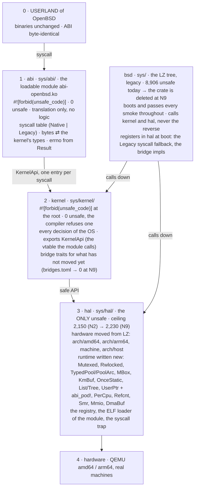

# Zero unsafe in the kernel

The kernel is a crate the compiler refuses to build with one `unsafe` in it; the only `unsafe`
of the system lives in a small HAL below it, proved site by site; an ABI crate above it keeps
OpenBSD's userland interface byte-identical and decides nothing. Section 0 is the plan in force (v2,
2026-10-16); section 10 is the decisions log; v1's sections are in docs/ZERO_UNSAFE_V1.md.

## 0. v2 (2026-10-16): the kernel is a crate with no `unsafe`

Decisions 20 and 21 (section 10) replace the shape of sections 4, 6 and 7: the kernel is not
"the LZ tree with a listed core", it is a **new crate with `#![forbid(unsafe_code)]` at its
root**, and the LZ tree is what that crate replaces. Everything below here is the plan in force;
v1 and its measurements are docs/ZERO_UNSAFE_V1.md.

### 0.1 The four crates

The one diagram of the architecture. Every other drawing (a chat, a slide, a session's notes)
is a copy of this one or wrong.

The arrows go down only. What goes up (the module's syscall handler, `KernelApi`, the bridge
implementations, the `Legacy` fallback) is never a dependency: it is a registration in `hal`'s
registry at boot, and this is the whole of it:

Dependencies, one direction: `bsd → kernel → hal`; `abi → hal` and `abi → KernelApi` (the
vtable `hal` hands the module at load). Nothing names `abi`; `kernel` and `abi` never name
`bsd`. Arrows up (the syscall handler, `KernelApi`, the bridge implementations, the `Legacy`
fallback) exist only as registrations in `hal`'s registry, made by `bsd`'s `main()` at boot.

| Crate | Path | `unsafe` | Holds |
|---|---|---|---|
| `hal` | `sys/hal/` | the only `unsafe` of the system, every site with a soundness proof, Miri on its host tests | the hardware primitives (page tables, traps, context switch, the interrupt level, ports and MMIO, caches, `bus_dma`'s hardware side, early boot: moved in from `sys/arch` and `sys/machine` with the kernel owner of each boundary, decision 26; the drivers of `sys/arch` go to `kernel::dev`, decision 28), the host test double (`sys/arch/host`), the 19 constant headers of `sys/sys/` (decision 27), and the runtime written new: `Mutexed<T>`, `Rwlocked<T>` (locks that own their data), `TypedPool<T>`/`PoolArc<T>`, `MBox<T>`, `KmBuf` (owned memory), `OnceStatic<T>` (the init-once static that replaces `StaticCell`), `List`/`Tree` (today's `queue.rs`, `tree.rs`, `subr_tree.rs`), `PerCpu<T>`, `Smr`, `Refcnt`, `UserPtr<T>` with `abi_pod!` (typed copyin/copyout), `Mmio<Regs>`, `DmaBuf`, the interrupt-level guard, the console primitive, the bridge registry |
| `kernel` | `sys/kernel/` | **0**, `#![forbid(unsafe_code)]` at the root: the compiler refuses any | every decision the operating system makes: memory (vm), processes, scheduler, signals, descriptors, kqueue, pipes, VFS and the file systems, the network stack, the drivers' logic, crypto, pf, pledge, unveil, exec. Its own types, ownership first, no C shape |
| `abi` | `sys/abi/`, built as the loadable module `abi-openbsd.ko` (decision 22) | **0**, `#![forbid(unsafe_code)]` (the user allowed `unsafe` here; none is needed: `UserPtr` is safe) | OpenBSD's userland interface, byte-identical: the syscall table, the `#[repr(C)]` structs (`stat`, `kevent`, `sockaddr`, `kinfo_*`, ...), ioctl and sysctl encodings, errno (the constant headers through `hal`, decision 27). Translation only (decision 21): bytes to the kernel's types, one kernel entry point per syscall, the `Result` to an errno; no check on what a value means, no state |
| `bsd` | `sys/` (the LZ tree, today's crate) | 10,604 today in 1,161 files (`unsafe-report`, 2026-10-16): the 8,906 legacy (8,747 outside the old core plus the 159 of the old runtime files) and the 1,698 of the hardware, the host double and the lists and trees that have not moved yet (a file counts as `hal` only once it compiles there), **0 files at N9** | what gets replaced. It keeps booting, running every smoke and `diff-openbsd` throughout; it links the three crates and calls down into them; the kernel crate never calls it except through a registered bridge (0.3) |

The boot loaders (`sys/stand`, `sys/lib/libsa`, `sys/arch/*/stand`: 621 `unsafe`) are separate
binaries that run before the kernel; they are outside the four crates and unchanged. `libkern`
and `libz` stay crates of their own, leaves below `hal`; `StaticCell` stays in `libkern` (`hal`
depends on it, so it cannot move up) and `hal::OnceStatic` replaces its uses one by one.

Dependencies, one direction: `bsd -> kernel -> hal`; `abi -> hal` (for `UserPtr`) and `abi -> KernelApi` (the vtable `hal` hands it at load, decision 22); nothing names `abi`, plus `libkern`/`libz` under
`kernel`. `hal` depends on nothing of ours but `libkern`. No cycle: a kernel-to-legacy call is a bridge.

### 0.2 What the compiler guarantees

- `cargo build` of `kernel` or `abi` with one `unsafe` anywhere, in any module, under any
  `cfg`, fails: `#![forbid(unsafe_code)]` cannot be overridden below the root. There is no
  allow list, no core list, no per-module attribute.
- `hal`'s API is safe: an `unsafe fn` in `hal` is `pub(crate)`. `cargo xtask hal-check` fails
  `just check` on a `pub unsafe fn`, on an `unsafe` block without a `// SAFETY:`, and on a
  `hal` count above `hal_ceiling` in `unsafe-budget.toml` (lowered by `--write`, never raised
  without the user).
- `abi` holds no logic: `cargo xtask abi-check` fails `just check` on a function of `abi` that
  branches on anything but the syscall number, its own conversion's `Ok`/`Err` and the byte
  layout, that calls more than one `kernel` entry point, or that exceeds the per-syscall line
  limit (decision 21).

### 0.3 The migration mechanism

1. **A subsystem moves, it is not patched.** The unit of work is still one owner module (or
   cluster) of the ROADMAP row: the surveyor inventories the LZ module and the C, the planner
   writes the brief, the redesigner writes the subsystem **in `kernel`** from the C's behaviour
   (LZ's shape is reference, never the starting text), deletes the LZ module from `bsd`, and
   leaves in `bsd` at most a call-site adapter with 0 `unsafe` (`adapted`, `adapted_by` the
   kernel module) until the callers move too.
2. **Bridges, for the kernel's calls into what has not moved yet.** `kernel` declares a trait
   (`pub trait Vfs`, `pub trait Sockets`, ...) and holds it in a `hal::OnceStatic<&'static dyn
   Trait>`; `bsd` implements it over its legacy code and registers it in `main()` before first
   use. Every bridge is a row of `bridges.toml` (`trait`, `for`, `paid_by` = the milestone whose
   subsystem removes it); `cargo xtask` counts them; N9 requires 0. A bridge carries no logic
   of its own (the same rule as `abi`).
3. **The syscall table lives in `abi` from N2 on.** Each entry is `Native(fn)` (translation into
   `kernel`) or `Legacy` (the fallback `bsd` registers at boot). A migrated syscall flips its
   entry; `diff-openbsd` and the smokes see no difference, which is the test.
4. **Lineage keeps every provenance rule.** A kernel module is `redesigned` with its `lz` list
   and `//! LZ:` lines; the LZ file it replaces becomes `[[dropped]]` with `absorbed by
   sys/kernel/...`; `lineage.toml` gains `crate`. An LZ change to a dropped file is
   `covered-by-redesign` or `reimplemented` in `kernel` (`lz-sync.md`).
5. **Tests.** `kernel`'s host tests run on `hal`'s host backend; `just check` (build on both
   archs, clippy, fmt, `lz check`, `hal-check`, `abi-check`, `unsafe-report --check`, host
   tests) gates every commit; the smokes, `just ci`, `ci-full` and `diff-openbsd` run at the
   milestone close (the user's rule of 2026-10-16).

### 0.4 The metric

`cargo xtask unsafe-report` prints four numbers and `/progress` shows them per milestone:
`kernel` (always 0, else the build failed), `abi` (always 0), `hal` (today's hardware code plus
the new runtime; the ceiling in `unsafe-budget.toml`, lowered only), and `bsd` (legacy: the
`unsafe` still in the LZ tree, per ROADMAP row). A row is **complete when its files in `bsd`
are 0** (deleted, or a 0-`unsafe` adapter listed as such) and its subsystem answers in
`kernel`. The old `forbid` count is gone: nothing in `kernel` needs marking.

### 0.5 Milestones, replanned

Measured on `main` at `47e1c4f` with `/progress`. "Files" and "`unsafe`" are what leaves `bsd`.
The estimate is continuous agent time (sessions open around the clock), from the one slice
measured end to end on 2026-10-16 (the typed slots: 4 h for two series of a mid-size slice);
it is the planning session's number, labelled as such, and `/progress` replaces it once five
active days have moved 100 `unsafe`.

| Milestone | Scope (what moves into `kernel`/`abi`/`hal`) | Files | `unsafe` | Exit (mechanical) | Est. |
|---|---|---:|---:|---|---:|
| **N2 Foundations** (under way, replanned) | the crates `hal`, `kernel`, `abi` exist and `bsd` links them; `hal` holds the 24 `bsd`-free machine headers and the 19 constant headers of `sys/sys/` (decisions 26, 27) and the new runtime (locks, pools, `MBox`, `KmBuf`, `OnceStatic`, lists and trees, `UserPtr`/`abi_pod!`, the bridge registry); `abi` holds the syscall table (all `Legacy`); `kernel` holds crypto (28 files, already safe), and the first subsystem by the new path, **pipe(2)** (`sys_pipe.rs`, `pipe.rs`), with bridges to descriptors, kqueue and sigio; `xtask`: `hal-check`, `abi-check`, `unsafe-report` v2, `/progress` v2, `bridges.toml` | 2 + 28 + 24 + 19 | 21 (+ 1 moved into `hal`; + 30 new for the module loader; the hardware's remaining 1,626 move by owner: N3 the pmap cluster ~150, N4 cpu/clock/trap ~740, N7 bus/autoconf/glue ~675, N9 ddb glue and tables ~60; decision 26) | `kernel` and `abi` build with `forbid` at the root; `hal` ≤ 2,150 with every site proved; `sys_pipe.rs` and `pipe.rs` deleted from `bsd`; the 24 + 19 headers under `sys/hal/`; `just ci` and `diff-openbsd` equal (`ci-full` at N3's close, decision 24) | 8.5 d |
| **N3 Memory** | `sys/uvm/` → `kernel::vm` in owner slices (km, object, anon, amap, aobj, vnode pager, page, pmemrange, addr, map, mmap, glue; `uvm_fault` last, with `security-review.md`); the pmap behind a safe `hal::Pmap` API, with the pmap cluster of `sys/arch` (13 files) moved into `hal` behind it (decision 26) | 26 + 13 | 215 (+ 150 moved) | `sys/uvm/` gone from `bsd`; `kernel::vm` answers every `uvm_*` call through its API; `hal::Pmap` has no `pub unsafe fn` | 7.5 d |
| **N4 Processes** | `sys/kern/` by owner into `kernel`: timeout, task, event/kqueue, descriptors (`file`, `kern_descrip`), signals, proc, the scheduler, sysctl's core, tty; `StaticCell` uses in `kern` → `OnceStatic` | 75 + 4 (kqueue and descriptors, N2's before) + 97 of `sys/arch` (cpu, clock, interrupts, trap, syscall entry, copy, into `hal`; decision 26) | 680 + 95 (+ 742 moved) | `sys/kern/` in `bsd` holds only the VFS (N5), the sockets (N6) and the N8 files; the bridges `Proc`, `Fd`, `Kq` removed from `bridges.toml` | 15 d |
| **N5 VFS and file systems** | `sys/kern/vfs_*`, `sys/ufs/`, `sys/isofs/`, `sys/msdosfs/`, `sys/nfs/`, `sys/ntfs/`, `sys/tmpfs/`, `sys/miscfs/` → `kernel::fs` | 140 | 816 | those directories gone from `bsd`; the `Vfs` bridge removed | 14 d |
| **N6 Network** | `sys/net/`, `sys/netinet/`, `sys/netinet6/`, the sockets of `sys/kern/uipc_*` → `kernel::net`, except N8's files | 99 | 1,840 | those directories gone from `bsd` but N8's files; the `Sockets` bridge removed | 18 d |
| **N7 Devices** | `sys/dev/` and `sys/scsi/` → `kernel::dev`, one bus at a time, over `hal::Mmio<Regs>` and `hal::DmaBuf`; `sys/dev/rnd.rs` last; the bus, autoconf and ACPI/FDT glue of `sys/arch` (74 files) into `hal`, its 19 drivers into `kernel::dev` (decisions 26, 28) | 395 + 74 | 4,198 (+ 675 moved) | `sys/dev/` and `sys/scsi/` gone from `bsd` but `softraid_crypto.rs` (N8) | 44 d |
| **N8 Security subsystems** | `pf*`, `if_wg`/`wg_*`, IPsec, `softraid_crypto`, `pledge`, `unveil`, `exec_*`, the crypto framework → `kernel`, each with `Security-Review:` and the area's smokes before every commit | 36 | 849 | those files gone from `bsd`; `lz drift --security` empty | 8 d |
| **N9 Close** | what is left: `sys/ddb/`, `sys/conf/`, `init/`, the old runtime files (`subr_pool`, `kern_lock`, `kern_rwlock`, `kern_malloc`, `smr`, `percpu`: deleted with their last user), `sys/sys/` emptied into `abi`/`kernel`; the `bsd` crate deleted; the binary is `kernel` + `abi` + `hal`; `bridges.toml` empty; `hal`'s floor recorded with its proof list; Miri green on `hal` | 14 + the old runtime 19 + the ddb glue and configuration tables of `sys/arch` (15) | 28 + 159 (+ ~60 moved) | `sys/` holds `hal/`, `kernel/`, `abi/`, `stand/`, `lib/`; `unsafe-report`: `bsd` does not exist, `kernel` 0, `abi` 0, `hal` = its floor | 5 d |

Total: 8,906 `unsafe` out of `bsd` (8,747 legacy + 159 old runtime files), 580 + 19 files, about **112 days of continuous agent
time** at the measured pace, serial (the slices share files); this number is the planning
session's and promises nothing: `/progress` measures.

What does not change in any milestone: what userland sees (`abi` is byte-identical, the smokes
and `diff-openbsd` are the proof), the LZ sync (`lz-sync.md`, with `covered-by-redesign` for
dropped files), the two architectures on every commit, the per-commit `just check`.

### 0.6 The work in flight on 2026-10-16

The two branches of the typed-slots slice (`worktree-agent-ab058223a74c4dcd6` at `ade1ddb`,
series 0 and 1 reviewed; `worktree-agent-ad1fb0331db500561`, series 2 half done) redesign
inside `bsd`. Under v2 that is not the goal: `bsd` is deleted, not improved. They are **not
merged**; their shapes (`FileData` by value to the close, `CredRef`, the typed hook over `dyn
Any`, `KlistLock`) are reused when descriptors and kqueue move into `kernel` at N4. About
eight hours of agent work set aside by the architecture change; said here so it is not
recounted as progress.

### 0.7 The whole account (measured 2026-10-16 with `unsafe-report --json`)

| Today | `unsafe` | At N9 | `unsafe` |
|---|---:|---|---:|
| LZ code not redesigned (580 files) | 8,747 | rewritten in `kernel`, deleted | 0 |
| old LZ runtime files (19: `subr_pool` 58, `subr_percpu` 16, `kern_malloc` 14, `staticcell` 9, `kern_lock` 8, `smr` 8, `kern_tc` 7, `subr_prf` 7, `percpu` 7, `kern_smr` 6, `kern_subr` 6, `malloc` 3, `kern_rwlock` 2, `mutex` 2, `rwlock` 2, `explicit_bzero` 1, `pool` 1, `refcnt` 1, `systm` 1) | 159 | deleted with their last user; `hal` replaces them | 0 |
| hardware (`arch/amd64` 732, `arch/arm64` 772, `machine` 85; without `sys/arch/*/stand`) | 1,589 | the primitives (1,094) moved into `hal`; the 19 arch drivers (495) rewritten in `kernel::dev` over `hal::Mmio`/`DmaBuf` (decision 28) | 1,094 |
| host test double (`arch/host`) | 38 | moved into `hal` | 38 |
| ours (`queue`, `tree`, `subr_tree`) | 71 | moved into `hal` | 71 |
| new `hal` code, written new, each site proved: N2 runtime 120 + ELF loader 30, N3 `Pmap` API 10, N4 `cpu_switch`/clock glue 10, N7 `Mmio`/`DmaBuf`/interrupts 60 | 0 | added by the milestone that needs it, a commit each | 230 (estimate) |
| boot loaders (`stand` 235, `libsa` 84, `arch/*/stand` 302), separate binaries | 621 | unchanged | 621 |
| **total** | **11,225** | | **2,054** |

Removed from the repository: 9,171 (8,747 + 159 + 495 − 230). `kernel` 0 and `abi` 0 by the
compiler; `hal` 1,433 by this table (the planner's estimate is ~1,700; both are estimates
until the first cluster moves), 84 % of it the hardware primitives, the host double and the
lists and trees that exist today; the boot loaders apart. The 2,150 and 2,230 ceilings of 0.1
were set on the 1,891 figure, which counted 302 of boot-loader code; they stand as ceilings,
`unsafe-report --write` lowers them to the measured count, and they rise only in the commit
that adds a listed piece, with the user's OK.

What `cargo xtask unsafe-report` prints today (2026-10-16): `kernel` 0, `abi` 0, `hal` 0,
`bsd` 10,604 (1,698 of them to move into `hal`), boot 621. The per-close series the planning
session wrote here counted the hardware as `hal` from N2 on; it is withdrawn until the N2.2
decision (the survey of 2026-10-16: 1,627 hardware `unsafe` in 198 files, 36 of them movable
as they stand), and each close records the five numbers the tool prints.

### 0.8 The slices, milestone by milestone

Each slice is one surveyor -> planner -> redesigner -> reviewer -> `just check` cycle; the
smokes, `just ci`, `ci-full` and `diff-openbsd` run at the close. Files and `unsafe` are the
tool's at `47e1c4f`; days are continuous agent time, the planning session's estimate.

**N2 Foundations, 8.5 d.** 1. The crates: `sys/hal/`, `sys/kernel/` and `sys/abi/` with
`#![forbid(unsafe_code)]` on the last two, `bsd` linking `kernel` and `hal`, `just check` green
(0.5 d). 2. The hardware into `hal`, staged (decision 26, 2026-10-16; the survey: 135 of 198 files name
`bsd`, 1,514 of 1,627 `unsafe`): now the 24 `bsd`-free machine headers (1 `unsafe`) and the 19
constant headers of `sys/sys/` (decision 27), `git mv` with the old paths kept by `pub use`
(0.5 d); the pmap cluster with N3.1, cpu/clock/interrupts/trap with N4.1 and N4.5, bus/autoconf
with N7.0-N7.2 (the arch drivers to `kernel::dev`, decision 28), ddb glue and the tables at
N9.1. 3. The runtime, each piece with its first user in `kernel` or in the move:
`List`/`Tree` (moved), `Mutexed<T>`, `Rwlocked<T>`, `TypedPool<T>`/`PoolArc<T>`, `MBox<T>`,
`KmBuf`, `OnceStatic<T>`, `PerCpu<T>`, `Refcnt`, `UserPtr<T>` with `abi_pod!`, the bridge
registry, the interrupt-level guard, the console primitive; `hal-check` (3 d). 4. `KernelApi`
(the vtable), the ELF loader, `abi-openbsd.ko` with every entry `Legacy` and the 41 constant
headers, the boot loaders and the installer reading two files, `smoke-abi`, `abi-check`,
`unsafe-report` v2 (kernel/abi/hal/bsd), `/progress` v2, `bridges.toml` (2 d). 5. Crypto into
`kernel` (28 files, 0 `unsafe`, already safe) (0.5 d). 6. **pipe(2)** into `kernel`: its own
`Pipe`/`PipePair` over `Rwlocked`, `PoolArc`, `KmBuf`; bridges `Fd` (descriptor and `File`
glue), `Kq` (knote/klist), `Sigio`, `Uio` (the copy); `sys_pipe.rs` and `pipe.rs` deleted from
`bsd`; the two syscall entries flipped to `Native` (1.5 d). 7. Close: `just ci`, `ci-full`,
`diff-openbsd`, docs, push (0.5 d). Out of `bsd`: 21 `unsafe` removed and 1 moved, 73 files (2 + 28 + 24 + 19).

**N3 Memory, 6 d.** 1. `hal::Pmap`: a safe typed API over the two arch pmaps (`enter`,
`remove`, `protect`, `extract`, `activate`; `uvm_pmap.rs` is the shape), the page allocator's
hardware side (1 d). 2. `uvm_km`, `uvm_object`, `uvm_anon`, `uvm_extern`, `uvm` -> `kernel::vm`
(0.5 d). 3. `uvm_page`, `uvm_pmemrange`, `uvm_addr` (86 `unsafe`, the free lists over `List`/
`Tree`) (1.5 d). 4. `uvm_amap`, `uvm_aobj`, `uvm_vnode`, `uvm_pager` (61; bridge `Vfs` for the
vnode pager) (1 d). 5. `uvm_map`, `uvm_mmap`, `uvm_glue`, `uvm_io`, `uvm_meter`, `uvm_percpu`,
`uvmexp`, `uvm_init`, `uvm_pdaemon`, `uvm_swap`, `uvm_unix` (bridge `Proc` for the current
vmspace, `Swap` for the device) (1.5 d). 6. `uvm_fault`, `security-review.md`, its smokes before
every commit (0.5 d). Out of `bsd`: 215 `unsafe`, 26 files; `sys/uvm/` deleted.

**N4 Processes and scheduling, 12 d.** 1. `kern_timeout`, `kern_task`, `subr_extent` (hal: the
clock interrupt as a registered handler) (1 d). 2. `kern_proc`, `kern_prot` (credentials, the
`CredRef` shape), `kern_fork`, `kern_exit`, `kern_resource`, `kern_sysctl`'s core (2 d). 3.
Descriptors: `sys/sys/file.rs`, `kern_descrip.rs`, `sys_generic` (the `FileData` shape; the `Fd`
bridge of N2 removed) (1.5 d). 4. kqueue: `kern_event.rs`, `sys/sys/event.rs` (the typed hook
over `dyn Any`, `KlistLock`; the `Kq` bridge removed) (1.5 d). 5. `kern_sig`, `kern_synch`,
`kern_sched`, `sched_bsd`, `kern_kthread`, `kern_smr`'s logic (the sleep queues and run queues in
`kernel` over `hal::cpu_switch`; the `Sigio` bridge removed) (2.5 d). 6. `tty`, `tty_pty`,
`tty_tty`, `tty_conf`, `subr_log` (1.5 d). 7. `kern_bufq`, `subr_disk`, `subr_autoconf`,
`subr_hibernate`, `kern_time`, `kern_clock`, `kern_xxx`, `subr_*`, `selftest.rs` rewritten as
`kernel` tests (1.5 d). 8. Close (0.5 d). Out of `bsd`: 699 `unsafe`, 56 files + the 4 of the
old N2 (`kern_event`, `kern_descrip`, `event.rs`, `file.rs`) = 775 in 60 files.

**N5 VFS and file systems, 14 d.** 1. The VFS core: `vfs_subr`, `vfs_bio`, `vfs_lockf`,
`vfs_syscalls`, `vfs_lookup`, `vfs_vnops`, `vfs_cache`, `vfs_init`, `vfs_sync`, `vfs_getcwd`,
`vfs_vops`, `vfs_default`, `spec_vnops` (149; the `Vfs` bridge becomes the kernel's own; bridge
`Disk` to the block drivers until N7) (4 d). 2. `ufs` + `ffs` + `ext2fs` (43 files, 228) (3 d).
3. `nfs` (24, 143; over `kernel::net`'s sockets or the `Sockets` bridge) (2 d). 4. `isofs`
(cd9660, udf; 16, 89) (1.5 d). 5. `msdosfs` (12, 60) and `ntfs` (9, 54) (1.5 d). 6. `miscfs`
(fuse, fifofs, deadfs) (10, 37) and `tmpfs` (7, 24) (1.5 d). 7. Close (0.5 d). Out of `bsd`:
816 `unsafe`, 134 files; those directories deleted.

**N6 Network stack, 18 d.** 1. The core: `if_`, `route`, `rtable`, `art`, `radix`, `rtsock`,
`if_ether`, `if_loop`, `netisr`, `pfkeyv2`'s stub (858 in `sys/net/` minus N8's files; bridge
`Ifnet` to the NIC drivers until N7) (5 d). 2. `netinet`: `in_`, `in_pcb`, `ip_input`,
`ip_output`, `tcp_*`, `udp_usrreq`, `raw_ip`, `igmp`, `ip_icmp`, `if_ether` (38, 465) (5 d). 3.
`netinet6` (25, 355) (4 d). 4. The sockets: `uipc_socket`, `uipc_socket2`, `uipc_usrreq`,
`uipc_syscalls`, `uipc_mbuf`, `uipc_domain`, `sys_socket` (9, 155; `mbuf` over `TypedPool`;
the `Sockets` bridge removed) (3 d). 5. Close (0.5 d). Out of `bsd`: 1,840 `unsafe`, 95 files.

**N7 Devices, 40 d.** 0. `hal`: `Mmio<Regs>`, `DmaBuf`, typed interrupt handlers, `bus_space`
and `bus_dma` behind them, the autoconf attach protocol as safe traits (3 d). 1. `dev/pv` first,
virtio: every smoke boots on it (12, 249) (3 d). 2. `dev/pci` core and `ppb`, then `dev/ic`'s
shared chips with their `pci` front ends, bus by bus (`com`, `pckbc`, `ahci`, `nvme`, `em`,
`ix`, `re`, `vmx`, `mpi`, `azalia`, `auich`, `eap`, `vga`, ...) (135, 1,401; the `Ifnet` and
`Disk` bridges removed as each driver moves) (14 d). 3. `wscons` + `rasops` + `wsfont` (47,
611) (4 d). 4. `usb` (43, 528) (5 d). 5. `acpi` (18, 205), `fdt` + `ofw` (15, 115), `isa` (19,
106) (4 d). 6. `scsi` (10, 149), `ata` (9, 82), `sdmmc` (13, 110), `softraid` (6, 192 but
`softraid_crypto`) (4 d). 7. `audio`, `midi`, `mii`, `ipmi`, `gpio`, `i2c`, `hid`, `rd`, `vnd`,
`bio`, `cons`, `puc`, `efi`, `clock_subr`, `firmload`, `microcode` (2 d). 8. `dev/rnd.rs` last,
`security-review.md` (0.5 d). 9. Close (0.5 d). Out of `bsd`: 4,198 `unsafe`, 395 files. Honest
limit: a driver no QEMU device exercises is verified by `just check` and its host tests only;
the list of those drivers goes in the close commit.

**N8 Security subsystems, 8 d.** Every commit with `Security-Review:`, the area's smokes and
`diff-openbsd` before it. 1. pf: `pf`, `pfvar`, `pfvar_priv`, `pf_table`, `pf_ioctl`,
`pf_norm`, `pf_if`, `pf_osfp`, `pf_lb`, `pf_ruleset`, `pf_syncookies` (already safe), `if_pfsync`,
`if_pflog`, `if_pflow` (3 d). 2. WireGuard: `if_wg`, `wg_cookie`, `wg_noise` (1 d). 3. IPsec:
`ip_ipsp`, `ip_esp`, `ip_ah`, `ip_ipcomp`, `ipsec_input`, `ipsec_output`, `pfkeyv2`,
`pfkeyv2_convert`, `pfkeyv2_parsemessage` (2 d). 4. `kern_pledge`, `kern_unveil`, `exec_*` and
the ELF loader of userland (1 d). 5. The crypto framework: `crypto`, `cryptosoft`, `criov`,
`cryptodev`; `softraid_crypto` (0.5 d). 6. Close (0.5 d). Out of `bsd`: 849 `unsafe`, 32 files.

**N9 Close, 5 d.** 1. `ddb` (10, 15), `sys/conf/` (3, 2), `sys/reftest.rs`, `init/` (the
stand-in, 11) (1.5 d). 2. The old runtime files deleted with their last user: `subr_pool`,
`subr_percpu`, `kern_malloc`, `kern_lock`, `kern_smr`, `kern_rwlock`, `kern_tc`, `subr_prf`,
`kern_subr`, `staticcell`, `explicit_bzero` and their `sys/sys/` headers (19, 159);
`sys/sys/` emptied into `abi` and `kernel` (1.5 d). 3. The `bsd` crate deleted; the binary is
`kernel` + `hal`; `bridges.toml` empty; `hal`'s floor recorded with its proof list; Miri green on
`hal`'s host tests; `README`, `ARCHITECTURE`, `JOURNAL` (1.5 d). 4. `ci-full`, `diff-openbsd`,
push (0.5 d). Out of `bsd`: 192 `unsafe`, 33 files; `sys/` holds `hal/`, `kernel/`, `abi/`,
`stand/`, `lib/` and nothing else.

Sum: 8,906 `unsafe` and 599 files out of `bsd`; 112 days. Order of risk, highest first: the
sleep/wakeup and run queues over `hal::cpu_switch` (N4.5), the ELF loader (N2.4), the VFS
core's locking (N5.1), `if_` and the routing tables (N6.1), `uvm_map` (N3.5), `uvm_fault` (N3.6).

## 10. Decisions

Status under v2 (2026-10-16), so no one applies a superseded one: **in force**: 1 (the goal,
restated by 20), 4, 6, 8 (the names), 10 (no `&'static` from a pool), 11, 12, 13 (the pipe's
shape, now in `kernel`), 17, 18, 19 (`abi_pod!`, typed `kn_kq`, `MBox`: `hal` designs), 20, 21,
22, 23, 24. **Superseded**: 2 (the core list: the crate boundary replaces it), 3 (pipe is still
the first subsystem, in `kernel`, after the foundations), 5 (closed by 20: the core is a crate),
7 (the safe `Adapter` stays, in `hal`), 9 (seams: replaced by bridges in `hal`, `bridges.toml`),
14, 15, 16 (the typed slots inside `bsd`: not merged; their shapes are reused when descriptors
and kqueue move into `kernel` at N4). Sections 1-9 of v1 are in docs/ZERO_UNSAFE_V1.md.

Taken by the user on 2026-10-10 ("ta bien, demosle, igual esto es iterativo. lz check porfa"):

1. **The goal: adopted** as stated in section 1.
2. **The initial core list: as listed** in section 4, `explicit_bzero.rs` included, `conf` and
   `init` left as legacy. A later addition is a commit of its own, with the user's OK.
3. **The first slice: pipe(2)** (section 6); since decision 9, after the two slot slices.
4. **Miri: deferred.** Decided at N9; the plan does not depend on it.
5. **The core at N9, crate or list: deferred** to N9. Nothing before it depends on it.
6. **LZ: `reimplemented` is the normal method for `forbid` modules** (section 8).
7. **The adapter: a safe trait checked by `lz check`.** `Adapter` (`sys/sys/queue.rs`) becomes a
   safe trait whose impls only `queue_adapter!` and `tree_adapter!` write; `cargo xtask lz check`
   refuses a hand-written impl. The alternative (back links that point at the element or the
   head, so no offset and no `container_of`) was set aside for now; it stays open if the
   tool-enforced boundary proves weak.

Taken by the user on 2026-10-16 ("vamos por la recta, lo barato me sale caro siempre"):

8. **Names.** The owning primitives are `Rwlocked<T>`, `TypedPool<T>` with `PoolArc<T>`, and
   later `Mutexed<T>`, beside the C-shaped `Rwlock`, `Pool` and `Mutex` (72, 73 and 129 files:
   the timing rule). The renames (`RawRwlock`, ... and the plain names for the owning types) are
   N9's.
9. **No hidden seams.** The two type-erased slots are typed first (section 6, "Before pipe"); pipe
   follows with no seam into `file` or `kern_event`. The one seam left, an owned pageable
   allocation (`KmBuf`) in `sys/uvm/uvm_km.rs` until N3 owns uvm, is recorded as such: a
   `[[seam]]` row of `lineage.toml` (`module`, `for`, `paid_by`) that `lz status` and
   `unsafe-report` print as their own group, never as `adapted`.
10. **No `&'static` from a pool** (docs/IDIOMS.md): `PoolArc<T>` is an owned handle; a raw form
    exists only inside the core.
11. **The pipe's `PIPE_LOCK`** stays a bit of `pipe_state` (userland sees the word whole through
    `kinfo_file`); the buffer is an owned `KmBuf` moved out of the lock while `uiomove` runs, so
    no I/O-lock primitive is needed.
12. **`pipe_state` and `peer_alive`** are atomics written only under the pair's write guard, so
    `kern_sysctl` keeps the C's unlocked read; a race the C has, kept on purpose and named here.
13. **sigio and klist need no primitive** for pipe: their APIs are safe. After its slice the
    pipe's klists lock through `KlistLock::Kernel` semantics replaced by the pair's guard: every
    call is the `_locked` form under it (today they use the rwlock klistops, as the C). Five
    items became three.
14. **`FileData`** (2026-10-16, from the `f_data` survey): `File.f_data` is an `OnceCell<enum
    FileData { None, Vnode, Socket, Pipe, Kqueue }>` whose payloads are the handles the owners
    hold today; `fo_close` receives it by value from `fdrop`, the only taker (one `unsafe` there,
    on the invariant `pool_put` already rests on). `f_cred` is an owned counted `CredRef`
    (`kern_prot.rs`, the second `[[seam]]`, paid by N4). No cast is moved: the five are deleted.
15. **The knote's hook** is `OnceCell<Hook>`, `Borrowed(&'static dyn Any)` or `Owned(Box<dyn
    Any>)` (the timer), read by `downcast_ref`: typed at run time, no `unsafe` per filter. The
    klist's lock is `enum KlistLock { Kernel, Mutex(&'static Mutex), Rwlock(&'static Rwlock) }`;
    `Klistops` and the three `unsafe fn klist_init*` go. A filter with no `&'static` object in
    hand stops the work; no cast is added for it.
16. **`[[seam]]` is tooling first**: `lz check`, `lz status` and `unsafe-report` learn the table
    before the first seam lands.

Taken by the planning session on 2026-10-16 under the user's standing authority of that day
("autorizo dentro de reglas"), after the slots redesigner stopped before its series 2:

17. **`AbiPod` is a safe trait checked by `lz check`**, like `Adapter` (decision 7): the only
    impls are written by `abi_pod!(Type { field: Type, ... })` in the core (`sys/machine/copy.rs`),
    which checks every field's exact type at compile time against the primitives the core
    declares `AbiPod`; `lz check` refuses a hand-written `impl` (`unsafe` or not). First user:
    `Kevent` (`sys/sys/event.rs`), so that file can be `forbid`; the other ~200 impls convert
    as their owners' slices come. Rejected: moving the `unsafe impl` into `kern_event.rs` (an
    `unsafe` moved, not removed).
18. **`kn_kq` and `kqs_kq`** become `Cell<Option<&'static Kqueue>>`, like `kn_fp`; the callers
    already hold the `&'static` (`fp.kqueue()`, `p.kq()`). No new cast. A hook site that has no
    `&'static` object in hand takes it from the same owner lookup the other device filters use
    (`device_lookup`-style, the softc the autoconf tree owns); where the owner holds only a raw
    pointer, the site stops and reports: none is cast here.
19. **The timer's hook owns its object through `MBox<T>`**, an owned typed `malloc` in the core
    (`sys/sys/malloc.rs`, `sys/kern/kern_malloc.rs`, already core paths): `MBox::new(ty, flags,
    value) -> Option<MBox<T>>` with the C's `M_KEVENT, M_WAITOK`, so `vmstat -m` and the wait
    behaviour stay the C's; `Drop` frees. `Hook` is `Borrowed(&'static dyn Any) |
    Timer(MBox<FiltTimer>)`: the one owned hook is kqueue's own, named, not generic. Rejected:
    `Box` (the global allocator is `M_TEMP, M_NOWAIT`: a different `vmstat` row and a panic
    where the C sleeps).

Taken by the user on 2026-10-16, late ("OK te voy a permitir eso por ahora"), after rejecting
every design that kept `unsafe` inside the kernel:

20. **The kernel is a crate with `#![forbid(unsafe_code)]` at its root: zero `unsafe`, enforced
    by the compiler, with no exception inside it.** Below it, a HAL crate, new code, small, holds
    the only `unsafe` the system has (locks and the allocator: `UnsafeCell`, bytes to `T`; page
    tables, traps, context switch, MMIO, DMA), each with a soundness proof, Miri on its host
    tests: the kernel's `std`. Above it, an ABI compatibility crate keeps OpenBSD's userland
    interface byte-identical (the syscall table, the `#[repr(C)]` structs, ioctl and sysctl
    encodings) and frees the kernel from the C's shape. The LZ-derived tree is not a layer: it
    is what the kernel crate replaces, subsystem by subsystem, until it is empty; while it runs,
    it calls the new crates, never the reverse except through the HAL's registered bridges.
    This supersedes sections 4 (the core list) and 7 (the milestones): a v2 of this document
    rewrites them with the crate split, the migration mechanism and the new N2/N3. The
    Asterinas framekernel (OS services in safe Rust over an `unsafe` OSTD) is the precedent.
    The user's words: zero `unsafe` in the kernel, "por ahora" the HAL may have it.

21. **The ABI compatibility crate holds no business logic** (the user, 2026-10-16: "solo debe
    orquestar con la basura unsafe llamadas al verdadero núcleo safe"). It only translates: the
    syscall number and its register arguments to a typed call into the kernel crate, the
    userland bytes of a `#[repr(C)]` struct to the kernel's own type and back, an errno from the
    kernel's `Result`. No permission check, no semantic validation, no state of its own, no
    branch on a value's meaning: every decision OpenBSD's behaviour requires lives in the
    kernel crate, where it is safe code. Mechanical criterion, checked by `cargo xtask`: a
    function of the ABI crate contains no `if`/`match` on anything but the syscall number, the
    conversion's own result (`Ok`/`Err`) and the layout of the bytes; it calls exactly one
    kernel entry point; its size stays under a fixed line count per syscall. A violation fails
    `just check`.

22. **The ABI is a loadable module, from N2 on** (the user, 2026-10-16: the compatibility layer
    out of the kernel, "una biblioteca dinámica"). `abi-openbsd.ko` is a separate ELF file on the
    boot medium: the boot loader reads it, `hal`'s loader relocates it before `init(8)` and the
    module registers its syscall handler in `hal`'s registry and receives `KernelApi`, the vtable
    of safe functions the kernel exports: the only face of the kernel the module sees. The
    kernel does not name the ABI; the ABI does not name `bsd`. The syscall trap in `hal` calls
    the registered handler. Costs, stated: an ELF loader in `hal` (about 30 `unsafe`, the
    parsing in safe code), `KernelApi` as a vtable, the boot loaders and the installer reading
    two files, one smoke for the load. The layers are, top down: userland (0), the module (1,
    0 `unsafe`, no logic), `kernel` (2, 0 `unsafe`), `hal` (3, the only `unsafe`, ceiling
    2,150), hardware (4); `bsd` beside them until N9, calling down and registering up. There is
    no "static first, dynamic later": the module exists from N2's close.

23. **Develop first, compile later** (the user, 2026-10-16: "desarrolla primero compila
    después"; "necesito que termine en 2 semanas"). No per-commit build, clippy or test gate:
    the agents write a milestone's slices without compiling; `just check`, the smokes, `ci-full`
    and `diff-openbsd` run once, at the milestone close, where the errors are fixed in a
    compile-and-fix pass before the close. The pre-commit hook keeps only what takes seconds
    (`cargo fmt --check`, `cargo xtask lz check`). The planning session said the risk: errors
    found at the close compound across the milestone's commits; the user took it. The two-week
    target is N2 and N3 closed, with parallel redesigners from N2.3 on (section 0.8).

24. **The N2 close** (the user, 2026-10-16): integrate the agents' branches into `main`, then
    compile without QEMU until green (`just build` on both archs, then `just check`), fixing
    the integration errors between `hal`, `kernel`, `abi` and `bsd`; no `just ci-full`; one
    `just ci` and one `just diff-openbsd`, both rc=0, mark N2 closed and push. `ci-full` is
    recorded as pending in `docs/STATUS.md` and runs once at the N3 close for both milestones.

25. **`abi-check`'s mechanical criteria** (the launching session, 2026-10-16, under the user's standing authority of that day, fixing the numbers decision 21 left open): in `sys/abi/`, kernel code: no `loop`/`while`/`for`; an `if`/`match` only on the identifier `nr` (the syscall number) or on `Ok`/`Err`/`Some`/`None` arms (the conversion's own result); at most one call per function into `kernel::` or through the `&KernelApi` parameter; at most 40 lines per function body; no `static` with interior mutability. A violation fails `just check`. The limits are the planning session's and change only by a decision here.

Taken by the user on 2026-10-16, later, on the planner's options after the N2.2 survey
(scratchpad n2/hwmove/INVENTORY.md and PLAN.md: the hardware is 1,627 `unsafe` in 198 files,
135 of them naming `bsd`, 36 movable as they stand):

26. **N2.2 is staged, not a move** (the user: "(c) por etapas"). The hardware enters `hal` with
    the kernel owner that defines each boundary: now the 24 `bsd`-free machine headers (1
    `unsafe`); the pmap cluster (13 files, 150) with N3.1 `hal::Pmap`; cpu, clock, interrupts,
    trap and syscall entry, copy (97 files, 742) with N4.1 and N4.5; bus, autoconf, the ACPI/FDT
    glue (74 files, 675) with N7.0-N7.2; ddb glue and the configuration tables at N9.1. Each
    boundary (`Proc`, `Device`, `Clockqueue`, `VmPage`) is typed once, by its owner: `CpuInfo`'s
    by-value `SchedstatePercpu` and `Clockqueue` wait for N4.5, the softcs' `Device` for N7.0;
    the four configuration tables stay in `bsd` as the registration of drivers until N9.1; the
    runtime's `IntrLevel` and `CpuId` bridges are `paid_by = "N4"`. The N2 exit drops "the
    hardware moved": `hal` holds the runtime, the module loader and the headers; `unsafe-report`
    marks the rest "to move into hal". Rejected: everything now (~4 d more, every boundary
    designed against `bsd`'s shape and again at N4/N7) and everything at N7 (N3.1 blocked, four
    milestones of `dyn` bridges on `splx`, `copyin`, `curcpu`).

27. **The constant headers live in `hal`** (the user: "en hal, inherited"; amends decision 22's
    placement). The 19 leaf files of `sys/sys/` that name nothing of the crate and hold 0
    `unsafe` (`endian`, `errno`, `exec_elf`, `futex`, `intrmap`, `kernel`, `limits`, `mman`,
    `pclock`, `pledge`, `reboot`, `select`, `softintr`, `syscall`, `types`, `unistd`, `uuid`,
    `vmmeter`, `wait`) move to `sys/hal/sys/` as `inherited` modules (`lz_home` maps them back;
    `sys/sys/mod.rs` re-exports them so every path stands); `kernel` and `abi` name them through
    `hal`, byte-identical. One `Errno`: the runtime's interim `hal::errno::Errno` folds into
    `hal::sys::errno::Errno` at integration. The "41 constant headers" of decision 22 were never
    listed; these 19 are the measured set. Rejected: a new leaf crate (structural, not needed
    yet), `libkern` (the C's never held them), one copy per layer.

28. **`hal` holds the primitives, not the drivers of `sys/arch`** (the user: "solo primitivas").
    Page tables, traps, context switch, the interrupt level, port and MMIO access, cache
    operations, `bus_dma`'s hardware side, early boot. The 19 driver files under `sys/arch` (21
    `Cfattach` statics: `agintc`, `ampintc`, `ioapic`, `smmu*`, `bios`, `efifb`, `acpipci`,
    `mainbus`, `simplebus`, ...; 495 `unsafe`) go to `kernel::dev` over `hal::Mmio`/`DmaBuf` at
    N7 like every driver. `hal`'s floor at N9 is therefore about 1,430 by 0.7's table (the
    planner estimated ~1,700; both are estimates until the first cluster moves); the ceilings of
    0.1 stand until `--write` lowers them.

Taken by the redesigner of N2.4a on 2026-10-16 under the user's standing authority of that
day ("yap puedes seguir solo? hasta acabar?"):

29. **A kernel without its ABI module still boots** (docs/ARCHITECTURE.md, "abi-openbsd.ko").
    When the boot loader hands over no `/abi-openbsd.ko`, or the loader refuses it (another
    machine, another `KernelApi`, a malformed file), the kernel prints one line,
    `abi-openbsd.ko: not loaded, <why>; every system call takes the legacy path`, and every
    system call goes to the `Legacy` fallback, which is the path the traps took before N2.4.
    Reason: the module only translates (decision 21) and every entry is `Legacy` at N2, so
    nothing userland sees depends on it yet, and a medium made before the module, or one a
    builder forgot, must not turn into a kernel that cannot run `init(8)`; `just smoke-abi`
    refuses that line, so a medium that lacks the module is a red smoke, not a silent
    fallback. To be revisited when the first entry is `Native` (N2.6): from then on a missing
    module changes what userland sees, and the fallback becomes a panic or stays with a
    reason here. Also taken: the loader's memory, mapping and hand-over go through the
    `ModulePlatform` bridge `bsd` implements until `hal` holds the pmap (`bridges.toml`); its
    three `unsafe` rest on that premise, stated in `sys/hal/module/load.rs`.
